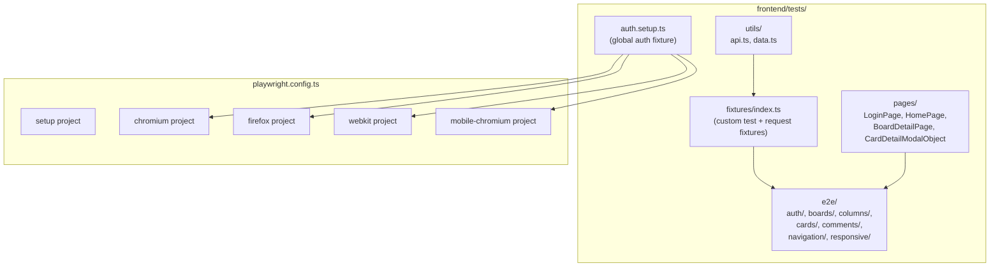
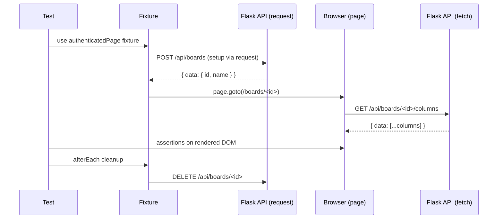

# Playwright E2E Test Suite — Design

## Overview

This document describes the design for the Playwright end-to-end test suite covering the Task Management Application. The suite lives inside `frontend/tests/` and runs against the full application stack: Next.js frontend at `http://localhost:3000` and the Flask backend at `http://localhost:5000` (or the value of `API_BASE_URL`).

The existing suite already has two files — `auth.setup.ts` (authentication state setup) and `auth.spec.ts` (four auth tests). This design expands the suite from that foundation to full functional regression coverage, adds cross-browser projects, adds a mobile viewport project, formalizes the Page Object Model, and defines a CI pipeline split between smoke and full regression runs.

**Property-based testing does not apply to this feature.** Every meaningful acceptance criterion is a specific user workflow that requires a browser, real network calls, and application state — not a universal property that can be verified by generating random inputs. All tests are example-based integration tests verified end-to-end through the browser. The Correctness Properties section is omitted on this basis.

---

## Architecture

### Component Diagram



### Request Flow in Tests



---

## Components and Interfaces

### Page Objects (`tests/pages/`)

```typescript
// LoginPage.ts
class LoginPage {
  constructor(page: Page);
  emailInput: Locator;
  passwordInput: Locator;
  signInButton: Locator;
  errorMessage: Locator; // data-testid="login-error"
  goto(): Promise<void>;
  login(email: string, password: string): Promise<void>;
}

// HomePage.ts
class HomePage {
  constructor(page: Page);
  boardsList: Locator; // role="list", name=/boards/i
  emptyState: Locator;
  goto(): Promise<void>;
  boardLink(name: string): Locator;
  boardCard(name: string): Locator;
}

// BoardDetailPage.ts
class BoardDetailPage {
  constructor(page: Page);
  heading: Locator; // role="heading", level=1
  columnList: Locator; // role="list", name=/column/i
  emptyBoardMessage: Locator;
  goto(boardId: string): Promise<void>;
  column(name: string): Locator;
  cardInColumn(columnName: string, cardTitle: string): Locator;
  addCardButton(columnName: string): Locator;
  cardTitleInput(): Locator;
  addCardSubmitButton(): Locator;
  columnRenameInput(): Locator;
  deleteColumnButton(name: string): Locator;
  deleteCardButton(title: string): Locator;
}

// CardDetailModalObject.ts
class CardDetailModalObject {
  constructor(page: Page);
  dialog: Locator; // role="dialog"
  closeButton: Locator;
  commentTextarea: Locator; // label="Add a comment"
  postCommentButton: Locator;
  commentError: Locator; // id="comment-body-error", role="alert"
  commentsSection: Locator; // role="region", name=/comments/i
  close(): Promise<void>;
  postComment(body: string): Promise<void>;
  commentBody(text: string): Locator;
}
```

### Custom Fixtures (`tests/fixtures/index.ts`)

```typescript
interface TestFixtures {
  /** Authenticated APIRequestContext pointed at the Flask backend. */
  authedRequest: APIRequestContext;
  /** Unique name generators for test isolation. */
  testData: {
    boardName(): string;
    columnName(): string;
    cardTitle(): string;
  };
}

// Extended test object — import instead of base @playwright/test
export const test: ReturnType<typeof base.extend<TestFixtures>>;
export { expect };
```

### API Utilities (`tests/utils/api.ts`)

```typescript
// Resource types (mirror Flask response shapes, envelope unwrapped)
interface Board {
  id: string;
  name: string;
  user_id: string;
  created_at: string;
  updated_at: string;
}
interface Column {
  id: string;
  board_id: string;
  name: string;
  position: number;
  created_at: string;
  updated_at: string;
}
interface Card {
  id: string;
  column_id: string;
  title: string;
  description: string | null;
  position: number;
  created_at: string;
  updated_at: string;
}
interface Comment {
  id: string;
  card_id: string;
  author_id: string;
  body: string;
  created_at: string;
  updated_at: string;
}

// CRUD helpers — all accept an authenticated APIRequestContext
function createBoard(req: APIRequestContext, name: string): Promise<Board>;
function deleteBoard(req: APIRequestContext, id: string): Promise<void>;
function createColumn(
  req: APIRequestContext,
  boardId: string,
  name: string,
  position?: number,
): Promise<Column>;
function deleteColumn(req: APIRequestContext, columnId: string): Promise<void>;
function createCard(
  req: APIRequestContext,
  columnId: string,
  title: string,
  position?: number,
): Promise<Card>;
function deleteCard(req: APIRequestContext, cardId: string): Promise<void>;
function createComment(
  req: APIRequestContext,
  cardId: string,
  body: string,
): Promise<Comment>;
```

### Data Utilities (`tests/utils/data.ts`)

```typescript
// Each function appends a short UUID fragment to prevent name collisions
// when tests run in parallel across workers.
function uniqueBoardName(): string; // "E2E Board <uuid8>"
function uniqueColumnName(): string; // "E2E Column <uuid8>"
function uniqueCardTitle(): string; // "E2E Card <uuid8>"
function uniqueComment(): string; // "E2E Comment <uuid8>"
```

---

## Directory Structure

The target layout after full expansion. Create directories only when the first file in them is added.

```text
frontend/tests/
│
├── auth.setup.ts              ← existing; logs in and saves playwright/.auth/user.json
├── auth.spec.ts               ← existing; 4 auth tests
│
├── fixtures/
│   └── index.ts               ← custom test fixture extending base test
│
├── pages/
│   ├── LoginPage.ts
│   ├── HomePage.ts
│   ├── BoardDetailPage.ts
│   └── CardDetailModalObject.ts
│
├── utils/
│   ├── api.ts                 ← typed wrappers around Playwright's APIRequestContext
│   └── data.ts                ← unique name generators
│
└── e2e/
    ├── auth/
    │   └── auth.spec.ts       ← move existing auth.spec.ts here, or add new tests alongside
    ├── boards/
    │   └── boards.spec.ts
    ├── columns/
    │   └── columns.spec.ts
    ├── cards/
    │   └── cards.spec.ts
    ├── comments/
    │   └── comments.spec.ts
    ├── navigation/
    │   └── navigation.spec.ts
    └── responsive/
        └── responsive.spec.ts
```

> **Note on the existing `auth.spec.ts`:** It can remain at `tests/auth.spec.ts` unchanged to avoid breaking the current working setup. New auth-related tests are added in `tests/e2e/auth/`. The config's `testDir: "./tests"` picks up both locations.

---

## `playwright.config.ts` Changes

The current config defines only `setup` and `chromium` projects, with no screenshot/video config and no mobile or cross-browser coverage. The expanded config adds three browser projects, a mobile project, and failure diagnostics.

```typescript
// frontend/playwright.config.ts (expanded)
import { defineConfig, devices } from "@playwright/test";

export default defineConfig({
  testDir: "./tests",
  fullyParallel: true,
  forbidOnly: !!process.env.CI,
  retries: process.env.CI ? 2 : 0,
  workers: process.env.CI ? 1 : undefined,

  reporter: [["html", { open: "never" }], ["list"]],

  use: {
    baseURL: process.env.BASE_URL ?? "http://localhost:3000",
    trace: "on-first-retry",
    screenshot: "only-on-failure",
    video: "retain-on-failure",
  },

  projects: [
    // ---- Authentication setup (runs once, all browser projects depend on it)
    {
      name: "setup",
      testMatch: /.*\.setup\.ts/,
    },

    // ---- Desktop browsers ---------------------------------------------------
    {
      name: "chromium",
      use: {
        ...devices["Desktop Chrome"],
        storageState: "playwright/.auth/user.json",
      },
      dependencies: ["setup"],
    },
    {
      name: "firefox",
      use: {
        ...devices["Desktop Firefox"],
        storageState: "playwright/.auth/user.json",
      },
      dependencies: ["setup"],
    },
    {
      name: "webkit",
      use: {
        ...devices["Desktop Safari"],
        storageState: "playwright/.auth/user.json",
      },
      dependencies: ["setup"],
    },

    // ---- Mobile viewport (Chromium engine, 390×844) -------------------------
    {
      name: "mobile-chromium",
      use: {
        ...devices["iPhone 14"],
        storageState: "playwright/.auth/user.json",
      },
      dependencies: ["setup"],
    },
  ],

  webServer: {
    command: "npm run dev",
    url: "http://localhost:3000",
    reuseExistingServer: !process.env.CI,
    timeout: 120_000,
  },
});
```

**Key changes from the current config:**

| Setting      | Before                            | After                                                           |
| ------------ | --------------------------------- | --------------------------------------------------------------- |
| Projects     | setup + chromium                  | setup + chromium + firefox + webkit + mobile-chromium           |
| `baseURL`    | hardcoded `http://localhost:3000` | reads `BASE_URL` env var, falls back to `http://localhost:3000` |
| `screenshot` | unset (no screenshots)            | `only-on-failure`                                               |
| `video`      | unset                             | `retain-on-failure`                                             |
| `trace`      | `on-first-retry`                  | unchanged                                                       |

The smoke suite for CI uses `--project=chromium` to keep PR feedback fast. The full matrix runs all four projects.

---

## Page Object Model

Page objects live in `frontend/tests/pages/`. Each encapsulates locators and reusable interactions for one page or modal. Scenario-specific assertions stay in the test file, not inside page objects.

### `LoginPage.ts`

Wraps `/login`. The locators match the actual `app/login/page.tsx` elements exactly.

```typescript
// frontend/tests/pages/LoginPage.ts
import { type Locator, type Page } from "@playwright/test";

export class LoginPage {
  readonly emailInput: Locator;
  readonly passwordInput: Locator;
  readonly signInButton: Locator;
  readonly errorMessage: Locator;

  constructor(private readonly page: Page) {
    // Label text matches <label htmlFor="login-email">Email</label>
    this.emailInput = page.getByLabel("Email");
    // Label text matches <label htmlFor="login-password">Password</label>
    this.passwordInput = page.getByLabel("Password");
    this.signInButton = page.getByRole("button", { name: /sign in/i });
    // data-testid="login-error" with role="alert" in login/page.tsx
    this.errorMessage = page.getByTestId("login-error");
  }

  async goto(): Promise<void> {
    await this.page.goto("/login");
  }

  async login(email: string, password: string): Promise<void> {
    await this.emailInput.fill(email);
    await this.passwordInput.fill(password);
    await this.signInButton.click();
  }
}
```

### `HomePage.ts`

Wraps `/` (the boards grid rendered by `app/page.tsx`).

```typescript
// frontend/tests/pages/HomePage.ts
import { type Locator, type Page } from "@playwright/test";

export class HomePage {
  readonly boardsList: Locator;
  readonly emptyState: Locator;

  constructor(private readonly page: Page) {
    // <ul aria-label="N boards"> from app/page.tsx
    this.boardsList = page.getByRole("list", { name: /boards/i });
    this.emptyState = page.getByText(/you don't have any boards yet/i);
  }

  async goto(): Promise<void> {
    await this.page.goto("/");
  }

  /** Returns the link element for the board with the given name. */
  boardLink(name: string): Locator {
    // Each board is a <Link> wrapping a <BoardCard> whose title is an <article>
    // with a <button aria-label="Open card: {name}"> inside.
    // The clickable area at the board grid level is a <Link href="/boards/<id}">.
    // We locate it by its accessible child text.
    return this.page.getByRole("link", { name: new RegExp(name, "i") });
  }

  /** Returns the board card article element for the given name. */
  boardCard(name: string): Locator {
    return this.page.getByRole("article").filter({ hasText: name });
  }
}
```

### `BoardDetailPage.ts`

Wraps `/boards/[id]`. Columns are `<section role="listitem" aria-label={col.name}>` from `app/boards/[id]/page.tsx`.

```typescript
// frontend/tests/pages/BoardDetailPage.ts
import { type Locator, type Page } from "@playwright/test";

export class BoardDetailPage {
  readonly heading: Locator;
  readonly columnList: Locator;
  readonly emptyBoardMessage: Locator;

  constructor(private readonly page: Page) {
    // <h1> in the board header
    this.heading = page.getByRole("heading", { level: 1 });
    // <div role="list" aria-label="N columns">
    this.columnList = page.getByRole("list", { name: /column/i });
    this.emptyBoardMessage = page.getByText(/this board has no columns yet/i);
  }

  async goto(boardId: string): Promise<void> {
    await this.page.goto(`/boards/${boardId}`);
  }

  /** Returns the column section element by its accessible name. */
  column(name: string): Locator {
    // <section role="listitem" aria-label={col.name}>
    return this.page.getByRole("listitem", { name });
  }

  /** Returns the card button inside a named column, located by card title. */
  cardInColumn(columnName: string, cardTitle: string): Locator {
    return this.column(columnName).getByRole("button", {
      name: new RegExp(`open card: ${cardTitle}`, "i"),
    });
  }

  /** Returns the "Add card" button inside a named column (when implemented). */
  addCardButton(columnName: string): Locator {
    return this.column(columnName).getByRole("button", { name: /add card/i });
  }

  /** Returns the card title textarea inside AddCardForm. */
  cardTitleInput(): Locator {
    // <label htmlFor="card-title" class="sr-only">Card title</label>
    return this.page.getByLabel("Card title");
  }

  /** Returns the submit button inside AddCardForm. */
  addCardSubmitButton(): Locator {
    return this.page.getByRole("button", { name: /^add card$/i });
  }

  /** Returns the rename input inside ColumnHeader when editing. */
  columnRenameInput(): Locator {
    // <label htmlFor="column-title-input" class="sr-only">Column name</label>
    return this.page.getByLabel("Column name");
  }

  /** Returns the delete button for a named column. */
  deleteColumnButton(name: string): Locator {
    return this.page.getByRole("button", {
      name: new RegExp(`delete column: ${name}`, "i"),
    });
  }

  /** Returns the delete button for a named card. */
  deleteCardButton(title: string): Locator {
    return this.page.getByRole("button", {
      name: new RegExp(`delete card: ${title}`, "i"),
    });
  }
}
```

### `CardDetailModalObject.ts`

Wraps the `CardDetailModal` component rendered as `role="dialog"`.

```typescript
// frontend/tests/pages/CardDetailModalObject.ts
import { type Locator, type Page } from "@playwright/test";

export class CardDetailModalObject {
  readonly dialog: Locator;
  readonly closeButton: Locator;
  readonly commentTextarea: Locator;
  readonly postCommentButton: Locator;
  readonly commentError: Locator;
  readonly commentsSection: Locator;

  constructor(private readonly page: Page) {
    // <div role="dialog" aria-modal="true" aria-labelledby="base-modal-title">
    this.dialog = page.getByRole("dialog");
    // <button aria-label="Close modal">
    this.closeButton = page.getByRole("button", { name: /close modal/i });
    // <label htmlFor="comment-body" class="sr-only">Add a comment</label>
    this.commentTextarea = page.getByLabel("Add a comment");
    this.postCommentButton = page.getByRole("button", {
      name: /post comment/i,
    });
    // <p id="comment-body-error" role="alert">
    this.commentError = page.locator("#comment-body-error");
    // <section aria-label="Comments">
    this.commentsSection = page.getByRole("region", { name: /comments/i });
  }

  async close(): Promise<void> {
    await this.closeButton.click();
  }

  async postComment(body: string): Promise<void> {
    await this.commentTextarea.fill(body);
    await this.postCommentButton.click();
  }

  /** Returns a locator for a comment paragraph containing the given text. */
  commentBody(text: string): Locator {
    return this.commentsSection.getByText(text);
  }
}
```

---

## Custom Fixtures

The custom fixture file extends Playwright's `test` to provide pre-wired helpers that every test spec can import.

```typescript
// frontend/tests/fixtures/index.ts
import { test as base, expect, type APIRequestContext } from "@playwright/test";
import {
  uniqueBoardName,
  uniqueCardTitle,
  uniqueColumnName,
} from "../utils/data";
import * as api from "../utils/api";

export type TestFixtures = {
  /** An API request context authenticated with the test user's Bearer token. */
  authedRequest: APIRequestContext;
  /** Helpers for generating unique test-data names. */
  testData: {
    boardName: () => string;
    columnName: () => string;
    cardTitle: () => string;
  };
};

export const test = base.extend<TestFixtures>({
  authedRequest: async ({ playwright }, use) => {
    // The test user's access token is obtained via the same credentials used
    // in auth.setup.ts, but through a direct API login so the fixture is
    // independent of browser storageState.
    const email = process.env.TEST_USER_EMAIL ?? "test@example.com";
    const password = process.env.TEST_USER_PASSWORD ?? "TestPass1!";

    const apiBase = process.env.API_BASE_URL ?? "http://localhost:5000";

    const loginContext = await playwright.request.newContext({
      baseURL: apiBase,
    });
    const loginRes = await loginContext.post("/api/auth/login", {
      data: { email, password },
    });
    const { data } = (await loginRes.json()) as {
      data: { access_token: string };
    };
    await loginContext.dispose();

    const authedContext = await playwright.request.newContext({
      baseURL: apiBase,
      extraHTTPHeaders: {
        Authorization: `Bearer ${data.access_token}`,
      },
    });

    await use(authedContext);
    await authedContext.dispose();
  },

  testData: async ({}, use) => {
    await use({
      boardName: () => uniqueBoardName(),
      columnName: () => uniqueColumnName(),
      cardTitle: () => uniqueCardTitle(),
    });
  },
});

export { expect };
```

```typescript
// frontend/tests/utils/data.ts
import { randomUUID } from "crypto";

export const uniqueBoardName = () => `E2E Board ${randomUUID().slice(0, 8)}`;
export const uniqueColumnName = () => `E2E Column ${randomUUID().slice(0, 8)}`;
export const uniqueCardTitle = () => `E2E Card ${randomUUID().slice(0, 8)}`;
export const uniqueComment = () => `E2E Comment ${randomUUID().slice(0, 8)}`;
```

```typescript
// frontend/tests/utils/api.ts
// Typed wrappers for the Flask API, used in fixture setup/teardown.
// These call the backend directly (bypassing the Next.js server) using
// the authedRequest APIRequestContext.
import type { APIRequestContext } from "@playwright/test";

export interface Board {
  id: string;
  name: string;
}
export interface Column {
  id: string;
  name: string;
  position: number;
}
export interface Card {
  id: string;
  title: string;
  position: number;
}
export interface Comment {
  id: string;
  body: string;
}

export async function createBoard(
  req: APIRequestContext,
  name: string,
): Promise<Board> {
  const res = await req.post("/api/boards", { data: { name } });
  const { data } = (await res.json()) as { data: Board };
  return data;
}

export async function deleteBoard(
  req: APIRequestContext,
  id: string,
): Promise<void> {
  await req.delete(`/api/boards/${id}`);
}

export async function createColumn(
  req: APIRequestContext,
  boardId: string,
  name: string,
  position = 1,
): Promise<Column> {
  const res = await req.post(`/api/boards/${boardId}/columns`, {
    data: { name, position },
  });
  const { data } = (await res.json()) as { data: Column };
  return data;
}

export async function deleteColumn(
  req: APIRequestContext,
  columnId: string,
): Promise<void> {
  await req.delete(`/api/columns/${columnId}`);
}

export async function createCard(
  req: APIRequestContext,
  columnId: string,
  title: string,
  position = 1,
): Promise<Card> {
  const res = await req.post(`/api/columns/${columnId}/cards`, {
    data: { title, position },
  });
  const { data } = (await res.json()) as { data: Card };
  return data;
}

export async function deleteCard(
  req: APIRequestContext,
  cardId: string,
): Promise<void> {
  await req.delete(`/api/cards/${cardId}`);
}

export async function createComment(
  req: APIRequestContext,
  cardId: string,
  body: string,
): Promise<Comment> {
  const res = await req.post(`/api/cards/${cardId}/comments`, {
    data: { body },
  });
  const { data } = (await res.json()) as { data: Comment };
  return data;
}
```

---

## Test Data Strategy

**Principle:** Each test creates its own data via the API in `beforeEach` or in a fixture, then deletes it in `afterEach`. Tests never share mutable records.

**Setup path:** `authedRequest` → Flask API → database. This is faster than navigating the UI to create setup data and keeps setup and subject under test clearly separated.

**Teardown:** Use `try/finally` in test teardown or a fixture `afterEach` to ensure cleanup runs even on failure. Board deletion cascades to columns and cards (per the backend schema), so deleting the board in teardown is usually sufficient.

```typescript
// Canonical setup/teardown pattern used in every spec that needs a board
test.describe("board workflows", () => {
  let boardId: string;

  test.beforeEach(async ({ authedRequest, testData }) => {
    const board = await api.createBoard(authedRequest, testData.boardName());
    boardId = board.id;
  });

  test.afterEach(async ({ authedRequest }) => {
    if (boardId) await api.deleteBoard(authedRequest, boardId);
  });

  test("user sees board on home page", async ({ page }) => {
    /* ... */
  });
});
```

**Unique names:** Every generated name includes a short UUID fragment via `uniqueBoardName()`, `uniqueColumnName()`, `uniqueCardTitle()`. This prevents collisions when workers run in parallel.

**No hardcoded IDs:** Tests that navigate to board URLs use the `boardId` returned from the setup API call — never a hardcoded value.

---

## Smoke Suite

The smoke suite is the subset of tests that must pass on every pull request. Smoke tests are tagged with `@smoke` via `test.describe` or inline test annotations.

**Files that form the smoke suite:**

| File                                      | Tests tagged `@smoke`                                   |
| ----------------------------------------- | ------------------------------------------------------- |
| `tests/auth.spec.ts`                      | All 4 existing tests                                    |
| `tests/e2e/boards/boards.spec.ts`         | Create board, view board list, navigate to board detail |
| `tests/e2e/cards/cards.spec.ts`           | Create card, view card in column                        |
| `tests/e2e/navigation/navigation.spec.ts` | Home → board detail navigation, 404 handling            |

**Running only the smoke suite locally:**

```bash
npx playwright test --project=chromium --grep "@smoke"
```

Non-smoke tests (column rename, comment editing, responsive, Firefox/WebKit, etc.) run only on the full regression pass.

---

## CI/CD Integration

### Updated `.github/workflows/playwright.yml`

The current workflow runs all tests on every push to `main`/`master` and every PR targeting those branches. The updated workflow splits into two jobs:

1. **`smoke`** — runs on every pull request, Chromium only, `@smoke`-tagged tests.
2. **`regression`** — runs on push to `main`/`develop`, all four browser projects, all tests.

```yaml
name: Playwright Tests

on:
  push:
    branches: [main, master, develop]
  pull_request:
    branches: [main, master, develop]

jobs:
  # ── Smoke suite: every PR, Chromium only ──────────────────────────────────
  smoke:
    name: Smoke (Chromium)
    if: github.event_name == 'pull_request'
    timeout-minutes: 20
    runs-on: ubuntu-latest
    defaults:
      run:
        working-directory: frontend

    steps:
      - uses: actions/checkout@v4

      - uses: actions/setup-node@v4
        with:
          node-version: lts/*
          cache: npm
          cache-dependency-path: frontend/package-lock.json

      - name: Install dependencies
        run: npm ci

      - name: Install Playwright browsers (Chromium only)
        run: npx playwright install chromium --with-deps

      - name: Validate required environment variables
        run: |
          : "${BASE_URL:?BASE_URL is required}"
          : "${API_BASE_URL:?API_BASE_URL is required}"
        env:
          BASE_URL: ${{ vars.BASE_URL || 'http://localhost:3000' }}
          API_BASE_URL: ${{ vars.API_BASE_URL || 'http://localhost:5000' }}

      - name: Run smoke tests
        run: npx playwright test --project=chromium --grep "@smoke"
        env:
          BASE_URL: ${{ vars.BASE_URL || 'http://localhost:3000' }}
          API_BASE_URL: ${{ vars.API_BASE_URL || 'http://localhost:5000' }}
          TEST_USER_EMAIL: ${{ secrets.TEST_USER_EMAIL }}
          TEST_USER_PASSWORD: ${{ secrets.TEST_USER_PASSWORD }}

      - name: Upload Playwright report
        uses: actions/upload-artifact@v4
        if: ${{ !cancelled() }}
        with:
          name: playwright-smoke-report
          path: frontend/playwright-report/
          retention-days: 14

  # ── Full regression: push to main/develop ────────────────────────────────
  regression:
    name: Full Regression
    if: github.event_name == 'push'
    timeout-minutes: 60
    runs-on: ubuntu-latest
    defaults:
      run:
        working-directory: frontend

    steps:
      - uses: actions/checkout@v4

      - uses: actions/setup-node@v4
        with:
          node-version: lts/*
          cache: npm
          cache-dependency-path: frontend/package-lock.json

      - name: Install dependencies
        run: npm ci

      - name: Install Playwright browsers (all)
        run: npx playwright install --with-deps

      - name: Run full test suite
        run: npx playwright test
        env:
          BASE_URL: ${{ vars.BASE_URL || 'http://localhost:3000' }}
          API_BASE_URL: ${{ vars.API_BASE_URL || 'http://localhost:5000' }}
          TEST_USER_EMAIL: ${{ secrets.TEST_USER_EMAIL }}
          TEST_USER_PASSWORD: ${{ secrets.TEST_USER_PASSWORD }}

      - name: Upload Playwright report
        uses: actions/upload-artifact@v4
        if: ${{ !cancelled() }}
        with:
          name: playwright-regression-report
          path: frontend/playwright-report/
          retention-days: 30
```

**Key differences from the current `playwright.yml`:**

- `working-directory: frontend` — the current workflow runs from the repo root, so `npx playwright test` and `npm ci` need to find `frontend/package.json`. Setting the working directory is cleaner than prefixing every command with `cd frontend &&`.
- Two separate jobs keyed on `github.event_name` instead of one job for all triggers.
- Smoke job installs only the Chromium browser binary to stay fast.
- `cache: npm` with `cache-dependency-path` speeds up subsequent runs.
- Explicit `TEST_USER_EMAIL` and `TEST_USER_PASSWORD` secrets passed to the env.
- Artifact retention: 14 days for smoke, 30 days for regression.

---

## Environment Variables

### `frontend/.env.example`

Add the following entries to document all variables consumed by the test suite:

```env
# ── Playwright E2E test configuration ─────────────────────────────────────

# Base URL for the Next.js frontend (consumed by playwright.config.ts)
BASE_URL=http://localhost:3000

# Base URL for the Flask backend API (consumed by test fixtures and utils/api.ts)
# Server-only — never prefixed with NEXT_PUBLIC_
API_BASE_URL=http://localhost:5000

# Public API base URL exposed to the Next.js client bundle
NEXT_PUBLIC_API_BASE_URL=http://localhost:5000

# Test account credentials (never commit real values)
TEST_USER_EMAIL=test@example.com
TEST_USER_PASSWORD=TestPass1!
```

The variables `TEST_USER_EMAIL` and `TEST_USER_PASSWORD` are already consumed by `auth.setup.ts`; this makes them explicit in `.env.example`.

---

## Data Models

The API types used in `utils/api.ts` mirror the backend serialization shapes:

```typescript
// Board (GET /api/boards, POST /api/boards)
interface Board {
  id: string; // UUID
  name: string;
  user_id: string;
  created_at: string;
  updated_at: string;
}

// Column (GET /api/boards/<id>/columns, POST /api/boards/<id>/columns)
interface Column {
  id: string;
  board_id: string;
  name: string;
  position: number;
  created_at: string;
  updated_at: string;
}

// Card (POST /api/columns/<id>/cards)
interface Card {
  id: string;
  column_id: string;
  title: string;
  description: string | null;
  position: number;
  created_at: string;
  updated_at: string;
}

// Comment (POST /api/cards/<id>/comments)
interface Comment {
  id: string;
  card_id: string;
  author_id: string;
  body: string;
  created_at: string;
  updated_at: string;
}
```

All Flask responses wrap resources in `{ data: T }`. The API utilities in `utils/api.ts` unwrap this envelope before returning.

---

## Error Handling

### Application Error States Under Test

| Scenario                       | How triggered in test                             | Expected UI outcome                                       |
| ------------------------------ | ------------------------------------------------- | --------------------------------------------------------- |
| Login with invalid credentials | Fill wrong email/password, submit                 | `data-testid="login-error"` visible, URL remains `/login` |
| Unauthenticated route access   | Fresh browser context, navigate to `/boards/<id>` | Redirect to `/login`                                      |
| Board not found (404)          | Navigate to `/boards/nonexistent-uuid`            | `notFound()` → nearest not-found boundary                 |
| API server error (5xx)         | Mock with `page.route()` to return 500            | Inline error message rendered, no crash                   |
| Empty card title submission    | Submit `AddCardForm` with blank textarea          | `role="alert"` with "Card title is required."             |
| Empty comment submission       | Submit `CommentForm` with blank textarea          | `role="alert"` with "Comment cannot be empty."            |
| Card title over 255 characters | Fill textarea beyond limit                        | Character counter turns red, submit disabled              |

### Mocking Strategy

Use `page.route()` only for error scenarios that cannot be reliably reproduced against the real backend (e.g. 5xx responses, network timeouts). All happy-path and 4xx tests run against the real application stack.

```typescript
// Example: mock a 500 response for the boards endpoint
await page.route("**/api/boards", (route) =>
  route.fulfill({
    status: 500,
    body: JSON.stringify({ error: { message: "Internal error" } }),
  }),
);
```

---

## Testing Strategy

This feature is a Playwright E2E test suite spec. The testing strategy describes how the suite itself is validated and kept healthy.

**Unit tests (not applicable):** The test suite is not independently unit-tested. Page objects are thin locator wrappers without logic to unit test.

**Smoke tests (Chromium, every PR):** Verify the most critical user journeys — authentication, board visibility, card creation, and protected-route enforcement — before any merge. These must complete within three minutes.

**Full regression (all 4 projects, push to main/develop):** Covers the complete functional scope: all CRUD workflows, search, form validation, error states, responsive layouts, and cross-browser behavior.

**Flaky test policy:** Any test that fails intermittently must be investigated. Retries (`retries: 2` in CI) exist to surface transient environment failures, not to conceal unstable tests. A test that passes only on retry is filed as a flaky test and fixed before the next release cycle.

**Waiting strategy:** No `page.waitForTimeout()` anywhere in the suite. All synchronization uses Playwright's auto-retrying locator assertions:

```typescript
// Correct — waits up to assertionTimeout for the element
await expect(page.getByRole("heading", { name: "My Boards" })).toBeVisible();

// Prohibited
await page.waitForTimeout(2000);
```

**Locator priority within specs:**

1. `getByRole` / `getByLabel` / `getByPlaceholderText` — preferred everywhere
2. `getByTestId` — only when no semantic locator is practical (existing: `data-testid="login-error"`)
3. Stable CSS attribute selectors — last resort, never on generated class names

**Accessibility verification:** Auth and navigation tests verify that interactive elements are reachable via `getByRole`, which incidentally confirms correct ARIA roles and labels. Dedicated accessibility tests are out of scope for this spec (handled separately per requirements §3.5).
