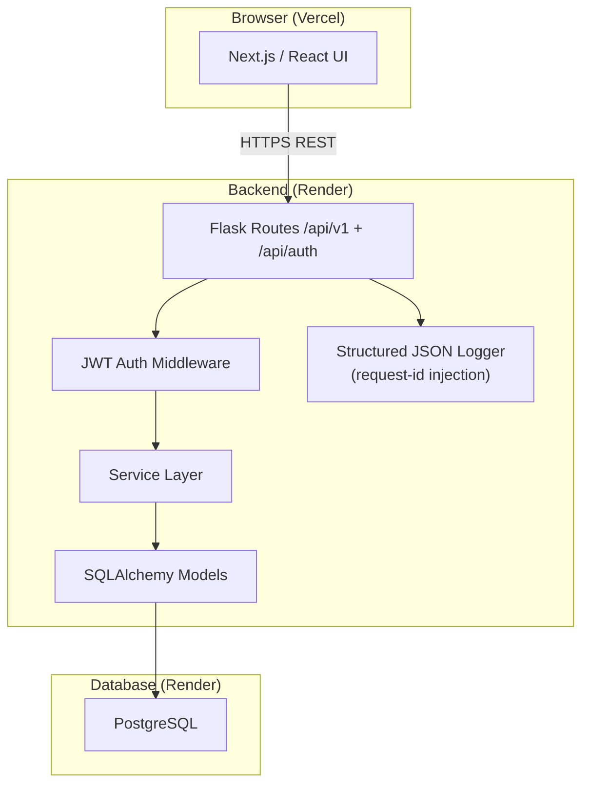
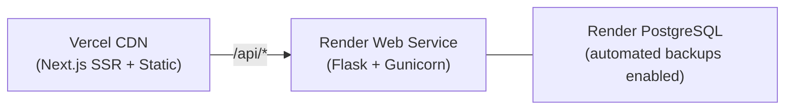
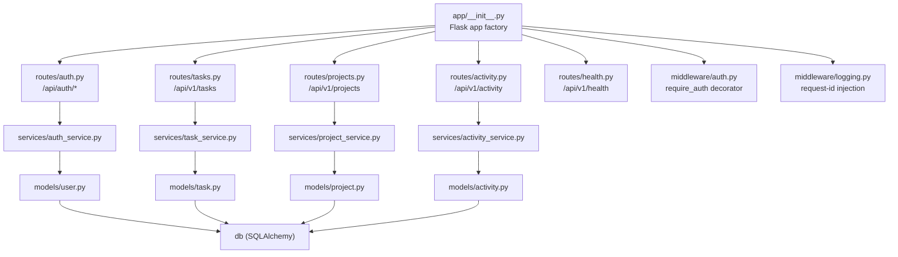
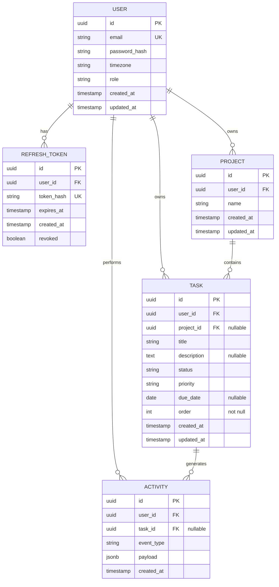

# Design Document — Task Management Application

## Overview

The Task Management Application is a full-stack web application that lets authenticated users create, organize, prioritize, and track tasks grouped into projects. The MVP delivers a private per-user workspace with no sharing between accounts.

The system is split into a **Next.js / React** frontend served from Vercel and a **Flask / SQLAlchemy** REST API backend hosted on Render, backed by **PostgreSQL**. Authentication is JWT-based. All business rules and authorization are enforced on the backend.

The application supports three user roles: **Guest** (unauthenticated visitor), **Member** (authenticated user with personal task management permissions), and **Admin** (administrative user with account management capabilities). The `role` field on the `User` model drives role-based access control. The MVP implements the Guest and Member roles fully; the Admin interface is scaffolded but limited in scope.

### Key Design Goals

- **Data ownership isolation** — every backend query filters by the authenticated user's ID; no cross-user data leakage is possible at the query layer.
- **Validation at the boundary** — all incoming data is validated before any business logic runs, returning structured JSON errors on failure.
- **Transactional integrity** — multi-record operations (project deletion + task unassignment) execute inside a single database transaction.
- **Deterministic pagination and sorting** — a stable sort key chain ensures consistent page results (see Sorting Implementation).
- **Secure by default** — HTTPS everywhere, JWT expiration and revocation, password hashing with PBKDF2-SHA256, secrets in environment variables, CSRF mitigation.
- **Observability** — structured JSON logs with per-request IDs, health-check endpoint, error reporting that never leaks internals.
- **Maintainability** — the backend follows a layered architecture (routes → services → models); the frontend uses reusable components.
- **Future-ready ordering** — the `Task.order` column is present in the schema now to support drag-and-drop reordering (a planned future enhancement).

---

## Architecture

The application uses a **client–server architecture** with a clear API boundary.



### Request Lifecycle

1. The browser sends an HTTPS request with a `Bearer` JWT in the `Authorization` header.
2. Flask auth middleware validates the token and attaches `current_user` to `flask.g`. Missing or invalid tokens return `401` immediately.
3. A route handler deserializes and validates the request body / query parameters.
4. The service layer executes the business operation using SQLAlchemy, always scoping queries to `current_user.id`.
5. The route handler serializes the result and returns a JSON response with the appropriate HTTP status code.
6. All writes are committed in a transaction before the success response is sent.
7. The structured logger records every request with a unique `X-Request-ID` header value; errors are logged with full context but without secrets or stack traces in the response body.

### Deployment Topology



Automated PostgreSQL backups are enabled on the Render database instance. Backup restoration procedures are tested separately per the reliability requirements.

---

## Components and Interfaces

### Backend Components



#### REST API Surface

Authentication routes use the prefix `/api/auth`. All other routes are prefixed with `/api/v1`. Every response body uses the envelope:

```json
{ "data": <payload>, "error": null }
// or
{ "data": null, "error": { "code": "VALIDATION_ERROR", "message": "...", "details": {} } }
```

| Method   | Path                    | Auth required | Description                                                           |
| -------- | ----------------------- | ------------- | --------------------------------------------------------------------- |
| `POST`   | `/api/auth/register`    | No            | Create account                                                        |
| `POST`   | `/api/auth/login`       | No            | Obtain JWT pair (access + refresh)                                    |
| `POST`   | `/api/auth/logout`      | Yes           | Revoke refresh token                                                  |
| `POST`   | `/api/auth/refresh`     | No            | Exchange refresh token for new access token                           |
| `GET`    | `/api/v1/health`        | No            | Application and database connectivity check                           |
| `GET`    | `/api/v1/tasks`         | Yes           | List tasks (filter, sort, search, paginate)                           |
| `POST`   | `/api/v1/tasks`         | Yes           | Create task                                                           |
| `GET`    | `/api/v1/tasks/:id`     | Yes           | Get task                                                              |
| `PATCH`  | `/api/v1/tasks/:id`     | Yes           | Update task                                                           |
| `DELETE` | `/api/v1/tasks/:id`     | Yes           | Delete task                                                           |
| `PATCH`  | `/api/v1/tasks/reorder` | Yes           | Bulk-update task order positions (body: array of `{id, order}` pairs) |
| `GET`    | `/api/v1/projects`      | Yes           | List projects                                                         |
| `POST`   | `/api/v1/projects`      | Yes           | Create project                                                        |
| `GET`    | `/api/v1/projects/:id`  | Yes           | Get project with its tasks                                            |
| `PATCH`  | `/api/v1/projects/:id`  | Yes           | Update project                                                        |
| `DELETE` | `/api/v1/projects/:id`  | Yes           | Delete project (unassigns tasks)                                      |
| `GET`    | `/api/v1/activity`      | Yes           | List activity log for current user                                    |

#### Query Parameters — `GET /api/v1/tasks`

| Parameter    | Type                                    | Description                                   |
| ------------ | --------------------------------------- | --------------------------------------------- |
| `status`     | `todo\|in_progress\|done`               | Filter by status                              |
| `priority`   | `low\|medium\|high`                     | Filter by priority                            |
| `project_id` | UUID                                    | Filter by project                             |
| `overdue`    | boolean                                 | Tasks past due date and not done              |
| `due_today`  | boolean                                 | Tasks due today (user's timezone)             |
| `q`          | string (1–100 chars)                    | Search title + description (case-insensitive) |
| `sort`       | `due_date\|priority\|created_at\|title` | Sort field                                    |
| `order`      | `asc\|desc`                             | Sort direction                                |
| `page`       | integer ≥ 1                             | Page number                                   |
| `per_page`   | integer 1–100                           | Page size                                     |

#### Security Middleware

**JWT authentication** (`middleware/auth.py`):

- `require_auth` decorator validates the `Bearer` token on every protected endpoint.
- Access token TTL: 15 minutes. Refresh token TTL: 7 days.
- Refresh tokens are stored server-side in a `refresh_tokens` table and can be revoked on logout.
- Expired, missing, or tampered tokens return `401 Unauthorized`.

**CSRF mitigation**:

- The API is stateless (Bearer token in header, not cookies), which eliminates the classic CSRF attack surface for the API endpoints.
- The refresh token is stored in an `httpOnly`, `SameSite=Strict` cookie on the frontend, providing cookie-level CSRF resistance.

**Structured logging** (`middleware/logging.py`):

- Generates a `X-Request-ID` UUID per request (or echoes the client-supplied header).
- Logs method, path, status code, duration, and request ID as JSON.
- Never logs passwords, tokens, or personal data fields.

**Health check** (`GET /api/v1/health`):

- Returns `200` with `{ "status": "ok", "db": "ok" }` when the application and database are reachable.
- Returns `503` if the database connection fails.

### Frontend Components

```mermaid
graph TD
    App["app/providers.tsx\n(AuthProvider, QueryClient)"]
    App --> AuthPages["app/auth/\nlogin, register"]
    App --> Dashboard["app/dashboard/\ntask list, filters"]
    App --> ProjectPage["app/projects/[id]/page.tsx"]
    App --> TaskModal["components/TaskModal\n(create / edit form)"]
    App --> TaskCard["components/TaskCard"]
    App --> FilterBar["components/FilterBar"]
    App --> SortSelector["components/SortSelector"]
    App --> ProjectSidebar["components/ProjectSidebar"]
    App --> ConfirmDialog["components/ConfirmDialog"]
    App --> StatusBadge["components/StatusBadge"]
    App --> PriorityBadge["components/PriorityBadge"]
    App --> Pagination["components/Pagination"]
```



#### State Management

- **Server state** — React Query (`@tanstack/react-query`) for all API data, caching, and background refresh.
- **UI state** — React `useState` / `useReducer` for modals, form state, and ephemeral UI.
- **Auth state** — React Context (`AuthContext`) in `app/providers.tsx` storing decoded JWT claims and exposing `login` / `logout` helpers. The access token is held in memory only (never `localStorage`); the refresh token is in an `httpOnly` cookie.

#### Form Handling

- `react-hook-form` with Zod schemas mirroring backend validation rules.
- Validation runs client-side on submit; server errors from `400` responses are merged into the form state so unsaved data is preserved on failure (Requirement 11.12).

#### Route Protection

- `frontend/middleware.ts` redirects unauthenticated users to `/auth/login` for all protected routes.
- On `401` from any API call, the client attempts a silent token refresh via `POST /api/auth/refresh`; if that fails it clears auth state and redirects to `/auth/login`.

---

## Data Models

### Entity Relationship Diagram



### SQLAlchemy Model Descriptions

#### `User`

| Column          | Type                | Constraints                                             |
| --------------- | ------------------- | ------------------------------------------------------- |
| `id`            | `UUID`              | PK, default `gen_random_uuid()`                         |
| `email`         | `String(254)`       | unique, not null, indexed                               |
| `password_hash` | `String(255)`       | not null                                                |
| `timezone`      | `String(64)`        | not null, default `'UTC'`                               |
| `role`          | `String(16)`        | not null, default `'member'`; values: `member`, `admin` |
| `created_at`    | `DateTime(tz=True)` | not null, server default `now()`                        |
| `updated_at`    | `DateTime(tz=True)` | not null, `onupdate` trigger                            |

**Password hashing**: `werkzeug.security.generate_password_hash` (PBKDF2-SHA256) for hashing; `werkzeug.security.check_password_hash` for verification. This satisfies the security NFR requirement for a secure hashing algorithm (the NFR lists "such as Argon2id" as an example; PBKDF2-SHA256 via Werkzeug is the chosen implementation).

**Role enforcement**: The `role` column drives authorization checks in the service layer. The `require_auth` decorator validates authentication; role-specific guards (e.g., `require_role('admin')`) are applied to Admin-only endpoints.

#### `RefreshToken`

| Column       | Type                | Constraints                                  |
| ------------ | ------------------- | -------------------------------------------- |
| `id`         | `UUID`              | PK                                           |
| `user_id`    | `UUID`              | FK → `users.id`, not null, indexed           |
| `token_hash` | `String(255)`       | unique, not null — SHA-256 hash of raw token |
| `expires_at` | `DateTime(tz=True)` | not null                                     |
| `revoked`    | `Boolean`           | not null, default `False`                    |
| `created_at` | `DateTime(tz=True)` | not null                                     |

The raw refresh token (a securely generated random string) is returned to the client once and never stored. Only its SHA-256 hash is persisted. Logout sets `revoked = True`; the refresh endpoint rejects revoked or expired tokens.

#### `Project`

| Column       | Type                | Constraints                        |
| ------------ | ------------------- | ---------------------------------- |
| `id`         | `UUID`              | PK                                 |
| `user_id`    | `UUID`              | FK → `users.id`, not null, indexed |
| `name`       | `String(100)`       | not null                           |
| `created_at` | `DateTime(tz=True)` | not null                           |
| `updated_at` | `DateTime(tz=True)` | not null                           |

Unique constraint: `(user_id, lower(name))` — enforced at the DB level and checked case-insensitively in the service layer before insert to return a clean `409` rather than a raw DB exception.

#### `Task`

| Column        | Type                                | Constraints                                                                                                              |
| ------------- | ----------------------------------- | ------------------------------------------------------------------------------------------------------------------------ |
| `id`          | `UUID`                              | PK                                                                                                                       |
| `user_id`     | `UUID`                              | FK → `users.id`, not null, indexed                                                                                       |
| `project_id`  | `UUID`                              | FK → `projects.id`, nullable, indexed                                                                                    |
| `title`       | `String(255)`                       | not null                                                                                                                 |
| `description` | `Text`                              | nullable                                                                                                                 |
| `status`      | `Enum('todo','in_progress','done')` | not null, default `'todo'`                                                                                               |
| `priority`    | `Enum('low','medium','high')`       | not null, default `'medium'`                                                                                             |
| `due_date`    | `Date`                              | nullable                                                                                                                 |
| `order`       | `Integer`                           | not null; user-scoped sequential integer; default = `SELECT COALESCE(MAX(order), 0) + 1 FROM tasks WHERE user_id = :uid` |
| `created_at`  | `DateTime(tz=True)`                 | not null                                                                                                                 |
| `updated_at`  | `DateTime(tz=True)`                 | not null                                                                                                                 |

The `order` column is the foundation for drag-and-drop reordering (a planned future enhancement listed in Requirement 10). It is present in the schema now so that future work does not require a migration that renumbers existing rows. `PATCH /api/v1/tasks/reorder` accepts an array of `{id, order}` pairs and bulk-updates order positions inside a single transaction, ensuring no two tasks share an order value for the same user after the operation.

Composite indexes on `(user_id, status)`, `(user_id, priority)`, and `(user_id, due_date)` to support common filter queries. Full-text search via a `tsvector` column on `title || ' ' || coalesce(description, '')`, updated by a PostgreSQL trigger.

#### `Activity`

| Column       | Type                | Constraints                                            |
| ------------ | ------------------- | ------------------------------------------------------ |
| `id`         | `UUID`              | PK                                                     |
| `user_id`    | `UUID`              | FK → `users.id`, not null, indexed                     |
| `task_id`    | `UUID`              | FK → `tasks.id`, nullable (set to null on task delete) |
| `event_type` | `String(64)`        | not null — e.g. `task.created`, `task.status_changed`  |
| `payload`    | `JSONB`             | not null, stores diff or relevant fields               |
| `created_at` | `DateTime(tz=True)` | not null                                               |

Activity records are **immutable** after creation. No application-level update or delete path exists for them.

### Validation Rules Summary

| Field            | Rule                                                        |
| ---------------- | ----------------------------------------------------------- |
| Task title       | 1–255 chars, not blank after strip                          |
| Task description | 0–2000 chars                                                |
| Task status      | one of `todo`, `in_progress`, `done`                        |
| Task priority    | one of `low`, `medium`, `high`                              |
| Task due_date    | ISO 8601 date string or null                                |
| Project name     | 1–100 chars, not blank after strip                          |
| Search query     | 1–100 chars                                                 |
| Email            | valid RFC 5322 format                                       |
| Password         | ≥ 8 chars, at least one uppercase, one lowercase, one digit |

### Sorting Implementation

The default task list order is `order ASC` (the user-defined drag-and-drop position). When a sort parameter is supplied, the sort chain is:

1. **Primary**: the requested sort field and direction.
2. **Secondary tiebreaker**: `tasks.order ASC`.
3. **Final tiebreaker**: `tasks.created_at DESC`.

This chain guarantees deterministic results even when many tasks share the same primary sort value.

Priority sort (descending) maps the enum to an integer weight for SQL ordering via a `CASE` expression:

```python
PRIORITY_WEIGHT = {"high": 3, "medium": 2, "low": 1}
```

Tasks without a `due_date` always sort last when sorting by due date, regardless of direction, using a `NULLS LAST` clause.

### Pagination

Standard offset-based pagination. The API returns:

```json
{
  "data": {
    "items": [...],
    "pagination": {
      "page": 1,
      "per_page": 20,
      "total": 143,
      "total_pages": 8
    }
  }
}
```

---

## Correctness Properties

_A property is a characteristic or behavior that should hold true across all valid executions of a system — essentially, a formal statement about what the system should do. Properties serve as the bridge between human-readable specifications and machine-verifiable correctness guarantees._

### Property 1: Task creation ownership

_For any_ authenticated user and any valid task payload, the task returned after creation SHALL have its `user_id` set to the creating user's ID.

**Validates: Requirements 2.2**

---

### Property 2: Task creation defaults

_For any_ valid task creation request that omits `status` and `priority`, the resulting task SHALL have `status = "todo"` and `priority = "medium"`.

**Validates: Requirements 2.3, 2.4**

---

### Property 3: Whitespace title rejection

_For any_ string composed entirely of whitespace characters, submitting it as a task title SHALL be rejected and the task list SHALL remain unchanged.

**Validates: Requirements 2.7**

---

### Property 4: Title length enforcement

_For any_ task title string, it SHALL be accepted when its length (after stripping) is in [1, 255] and rejected when its length is 0 (after stripping) or > 255.

**Validates: Requirements 2.1, 2.7, 2.8**

---

### Property 5: Description length enforcement

_For any_ task description string, it SHALL be accepted when its length is ≤ 2000 characters and rejected when its length exceeds 2000 characters.

**Validates: Requirements 2.5, 2.9**

---

### Property 6: Cross-user task isolation

_For any_ two distinct users A and B, a task owned by A SHALL never appear in the task list returned to B, regardless of filter, search, or sort parameters.

**Validates: Requirements 3.8, 8.13**

---

### Property 7: Filter AND semantics

_For any_ combination of active filters (status, priority, project, overdue, due_today) and optional search query, every task returned SHALL satisfy ALL active criteria simultaneously.

**Validates: Requirements 8.1, 8.2, 8.3, 8.4, 8.5, 8.9, 8.10**

---

### Property 8: Overdue filter correctness

_For any_ task list and user timezone, applying the overdue filter SHALL return exactly the tasks where `due_date < today(user_timezone)` AND `status != "done"`, and no others.

**Validates: Requirements 8.6**

---

### Property 9: Sort stability — tasks without due date appear last

_For any_ task list sorted by due date in either direction, every task with a non-null `due_date` SHALL appear before every task with a null `due_date`.

**Validates: Requirements 9.2**

---

### Property 10: Priority sort order correctness

_For any_ task list sorted by priority descending, every task with priority `high` SHALL appear before every task with priority `medium`, and every `medium` task SHALL appear before every `low` task.

**Validates: Requirements 9.3**

---

### Property 11: Task ownership enforcement on mutation

_For any_ authenticated user, attempting to update or delete a task not owned by that user SHALL be rejected with `403 Forbidden` or a non-disclosing `404 Not Found`.

**Validates: Requirements 4.8, 5.5**

---

### Property 12: Task update preserves data on validation failure

_For any_ valid existing task, submitting an invalid update (e.g., title too long, bad status value) SHALL leave the stored task data unchanged.

**Validates: Requirements 4.6**

---

### Property 13: Project name uniqueness per user (case-insensitive)

_For any_ user who already owns a project with name N, attempting to create a second project with any case variant of N SHALL be rejected with `409 Conflict`. Different users SHALL be able to create projects with the same name.

**Validates: Requirements 7.4, 7.5**

---

### Property 14: Project deletion unassigns tasks atomically

_For any_ project with associated tasks, deleting the project SHALL set all those tasks' `project_id` to null and remove the project record within a single transaction; the tasks themselves SHALL remain accessible.

**Validates: Requirements 7.9, 7.10, 7.11**

---

### Property 15: Search case-insensitive matching

_For any_ search query Q and any task whose title or description contains Q as a substring (ignoring case), that task SHALL appear in the search results.

**Validates: Requirements 8.8**

---

### Property 16: Activity record immutability

_For any_ activity record, once created it SHALL never be modified or deleted by any application-level operation.

**Validates: Requirements 12.5**

---

### Property 17: Persistence before success response

_For any_ task or project create, update, or delete operation that returns HTTP 2xx, the backend SHALL have already committed the change to PostgreSQL. Conversely, if the commit fails, the backend SHALL NOT return a 2xx response.

**Validates: Requirements 10.3, 10.6**

---

### Property 18: Status and priority enum enforcement

_For any_ request supplying a `status` value not in `{todo, in_progress, done}` or a `priority` value not in `{low, medium, high}`, the backend SHALL reject the request with HTTP `400 Bad Request`.

**Validates: Requirements 2.10, 6.7**

---

### Property 19: Task order uniqueness per user

_For any_ user, after any reorder operation (`PATCH /api/v1/tasks/reorder`), no two tasks owned by that user SHALL share the same `order` value.

**Validates: Requirements 9.1, 9.4, 9.5, 9.6**

---

## Error Handling

### HTTP Status Code Mapping

| Situation                                     | Status Code                                         |
| --------------------------------------------- | --------------------------------------------------- |
| Invalid request body / query params           | `400 Bad Request`                                   |
| Missing or invalid JWT                        | `401 Unauthorized`                                  |
| Authenticated but not authorized              | `403 Forbidden` or `404 Not Found` (non-disclosing) |
| Resource not found                            | `404 Not Found`                                     |
| Duplicate project name (same user)            | `409 Conflict`                                      |
| Stale update conflict (`updated_at` mismatch) | `409 Conflict`                                      |
| Application or database connectivity failure  | `503 Service Unavailable` with `Retry-After` header |
| Unexpected server error                       | `500 Internal Server Error`                         |

### Error Response Envelope

```json
{
  "data": null,
  "error": {
    "code": "VALIDATION_ERROR",
    "message": "Title must be between 1 and 255 characters.",
    "details": {
      "field": "title"
    }
  }
}
```

Internal stack traces, SQL errors, and secrets are never included in `500` responses. A structured log entry with the request ID is emitted server-side instead.

### Frontend Error Handling

- React Query's `onError` callbacks surface API errors to the UI via toast notifications.
- Form-level errors from `400` responses are merged into react-hook-form's error state so the user's input is preserved (Requirement 11.12).
- Network failures and `5xx` errors display a generic retry prompt.
- Loading and error boundary states are implemented for every data-dependent page (Requirement 3.5, 3.6).

### Database Failure Handling

- SQLAlchemy's `Session.rollback()` is called in every exception handler before returning an error response.
- The backend never sends `2xx` after a failed commit (Property 17).
- Connection pool exhaustion returns `503` with a `Retry-After` header.

### JWT Handling

- Access token TTL: 15 minutes.
- Refresh token TTL: 7 days, stored server-side in the `refresh_tokens` table for revocation support.
- On `401`, the frontend attempts a silent token refresh via `POST /api/auth/refresh`; if that fails it clears auth state and redirects to `/auth/login`.
- Secrets (`JWT_SECRET_KEY`, database URL, etc.) are stored in environment variables and never committed to the repository.

---

## Testing Strategy

### Dual Testing Approach

The testing strategy combines **example-based unit and integration tests** for concrete scenarios with **property-based tests** for universal behavioral guarantees.

### Unit Tests (Pytest)

Focus areas:

- Task and project validation logic (title length, whitespace, enum values, description length).
- Priority sort weight mapping (`PRIORITY_WEIGHT`).
- Timezone-aware overdue and due-today date calculations.
- JWT generation and validation helpers.
- Pagination offset/limit math.
- Password hashing: verify stored value ≠ plaintext; verify correct password passes; verify wrong password fails.

### Integration Tests (Pytest + test database)

Focus areas:

- Full CRUD lifecycle for tasks and projects via the Flask test client.
- Cross-user isolation: authenticated as user B, attempt to read/modify user A's resources.
- Filter AND logic: apply multiple simultaneous filters and assert only matching records are returned.
- Project deletion transaction: verify tasks are unassigned and project is removed in one operation.
- Activity log entries are created for task lifecycle events.
- Stale update conflict detection (optimistic locking via `updated_at`).
- API error envelopes match the defined structure for each error type.
- Duplicate email registration returns `409`.
- Invalid JWT (tampered signature, expired): returns `401`.

### Property-Based Tests (Pytest + Hypothesis)

Each property test runs a **minimum of 100 iterations** via Hypothesis's `@given` decorator. Each test is tagged with its design property using the comment format:

```
# Feature: task-management-app, Property N: <property text>
```

Example:

```python
# Feature: task-management-app, Property 3: Whitespace title rejection
@given(title=st.text(alphabet=string.whitespace, min_size=1))
def test_whitespace_title_rejected(client, auth_headers, title):
    response = client.post("/api/v1/tasks", json={"title": title}, headers=auth_headers)
    assert response.status_code == 400
```

Properties targeted by Hypothesis tests:

| Design Property                                         | Generator Strategy                                                                                      |
| ------------------------------------------------------- | ------------------------------------------------------------------------------------------------------- |
| Property 2: Task creation defaults                      | Generate valid payloads omitting `status`/`priority`; assert defaults applied                           |
| Property 3: Whitespace title rejection                  | Generate whitespace-only strings; assert `400`                                                          |
| Property 4: Title length enforcement                    | Generate titles of varying lengths; assert accept/reject boundary at 1 and 255                          |
| Property 5: Description length enforcement              | Generate descriptions of varying lengths; assert boundary at 2000                                       |
| Property 6: Cross-user task isolation                   | Create tasks as user A; list/filter/search as user B; assert empty result                               |
| Property 7: Filter AND semantics                        | Generate task sets and random filter combinations; assert every result satisfies all active filters     |
| Property 8: Overdue filter correctness                  | Generate tasks with varying `due_date`s and statuses; verify overdue result set matches exact condition |
| Property 9: Due date sort — nulls last                  | Generate task sets with mixed null/non-null dates; assert nulls always appear after non-nulls           |
| Property 10: Priority sort order                        | Generate task sets; assert `high` > `medium` > `low` ordering holds for all inputs                      |
| Property 13: Project name uniqueness (case-insensitive) | Generate name variants with different casing; assert reject for same user, accept for different user    |
| Property 15: Search case-insensitive                    | Create task with known substring; search with varied casing; assert task appears in results             |
| Property 17: Persistence before success                 | Generate valid payloads; assert DB record reflects change after `2xx` response                          |
| Property 18: Enum enforcement                           | Generate arbitrary non-enum strings for `status`/`priority`; assert `400`                               |
| Property 19: Task order uniqueness per user             | Generate reorder payloads; assert no two tasks share `order` value for same user after operation        |

Properties 1, 11, 12, 14, and 16 are covered by integration tests with targeted examples (ownership on creation, ownership on mutation, validation failure preservation, atomic project deletion, activity immutability).

### End-to-End Tests (Playwright)

Scenarios:

- Register → login → create task → edit task → delete task.
- Create project → assign task → view project → delete project (verify tasks survive on dashboard).
- Apply status, priority, and overdue filters simultaneously; verify UI matches expected results.
- Search with mixed casing; verify results.
- Sort by due date ascending; verify null due dates appear last in the list.
- Logout → verify private routes redirect to `/auth/login`.
- Attempt to access another user's task URL directly; verify `404` or redirect.

### Security Tests

- Authentication bypass: requests to protected endpoints without JWT return `401`.
- Cross-user BOLA: authenticated as user B, `GET /api/v1/tasks/:id` for a task owned by A returns `404`.
- Invalid JWT (tampered signature, expired token): returns `401`.
- SQL injection: title field containing SQL metacharacters is stored safely and returns expected data.
- XSS: task title containing `<script>` is returned as escaped text in the API response.
- Duplicate email registration: returns `409` without revealing whether the email exists.
