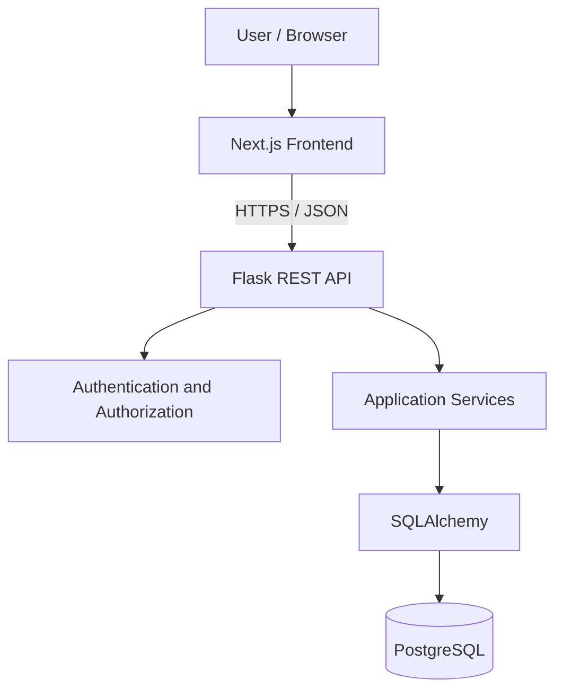
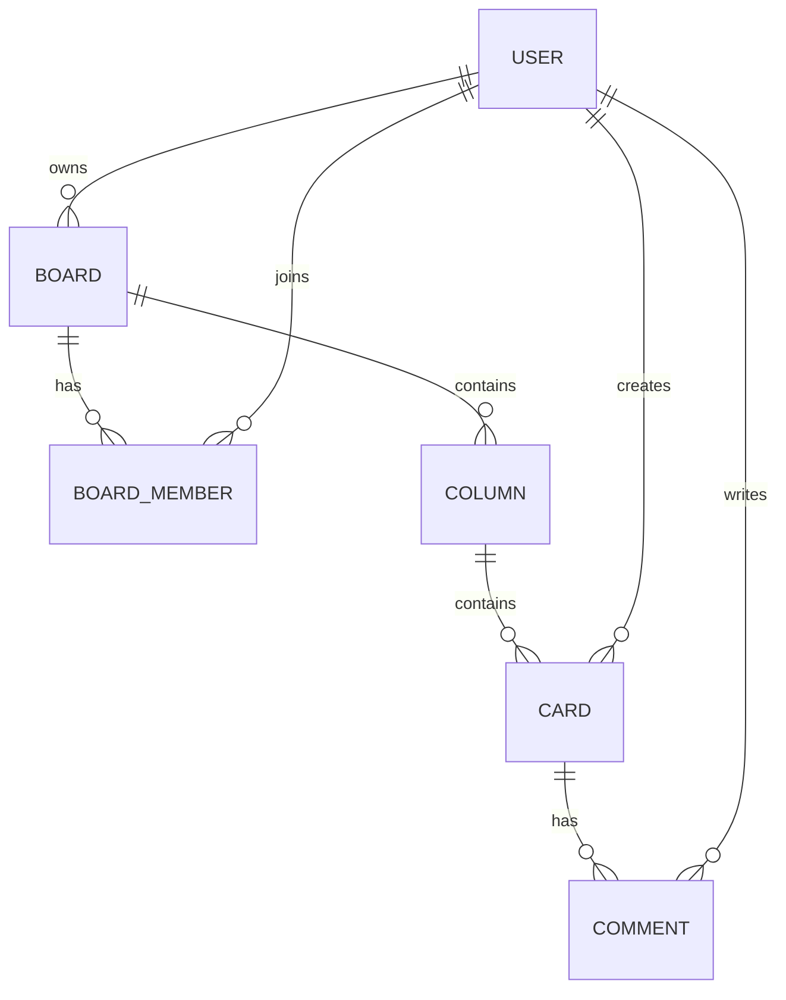
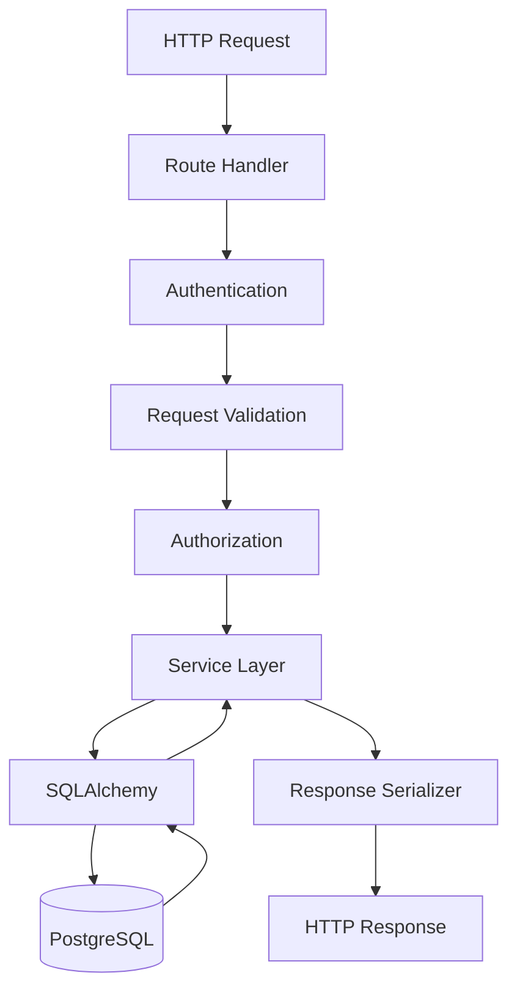

# Architecture Standards

## 1. Purpose

This document defines the system architecture, technical boundaries, component responsibilities, and architectural principles for the Task Management Application.

All contributors and AI coding agents MUST follow these standards when designing, implementing, or modifying application architecture.

The goal is to maintain a system that is:

- Modular and maintainable.
- Secure by design.
- Easy to test.
- Scalable without unnecessary complexity.
- Consistent across frontend, backend, and database layers.

This document defines architectural boundaries. Detailed implementation rules belong in `frontend.md`, `backend.md`, `database.md`, `api-contracts.md`, and `security.md`.

---

## 2. System Overview

### 2.1 Technology Stack

| Layer | Technology | Responsibility |
|---|---|---|
| Frontend | Next.js, React, TypeScript | User interface and client interactions |
| Styling | Tailwind CSS | Responsive UI and visual consistency |
| Backend | Flask, Python | API endpoints and business logic |
| ORM | SQLAlchemy | Database access and persistence |
| Database | PostgreSQL | Persistent application data |
| Backend Testing | Pytest | Unit, integration, and API tests |
| E2E Testing | Playwright | Browser-based user journey verification |

Do not introduce additional frameworks or infrastructure without evaluating the existing stack and documenting significant architectural changes.

### 2.2 Architecture Pattern

Use a **modular monolith** with a separately deployed frontend and backend.

The frontend and backend are independently deployable applications, but the backend remains a single modular application.

Do not introduce microservices unless a documented requirement justifies the additional operational and architectural complexity.

### 2.3 High-Level Architecture



The frontend MUST communicate with the backend through defined API contracts.

The frontend MUST NOT connect directly to PostgreSQL or bypass backend authorization.

---

## 3. Architectural Boundaries

The application MUST maintain clear responsibilities between layers.

### 3.1 Frontend

The frontend is responsible for:

- Rendering application pages and reusable UI components.
- Handling user interactions.
- Managing local presentation state.
- Performing client-side form validation for usability.
- Communicating with the backend API.
- Displaying loading, empty, success, and error states.
- Enforcing route-level navigation behavior.
- Providing accessible and responsive interfaces.

The frontend MUST NOT be the authority for:

- User identity.
- Resource ownership.
- Permission enforcement.
- Business-critical validation.
- Database integrity.

All security-sensitive decisions MUST be enforced by the backend.

### 3.2 Backend API

The backend is responsible for:

- Exposing REST API endpoints.
- Validating incoming requests.
- Authenticating users.
- Authorizing access to resources.
- Executing business rules.
- Coordinating database transactions.
- Returning consistent API responses.
- Handling application and unexpected errors.
- Recording relevant operational events.

Routes MUST remain thin and delegate business operations to services.

### 3.3 Service Layer

The service layer owns application use cases and business logic.

Examples:

- Creating a board.
- Adding a column to a board.
- Creating a card.
- Moving a card between columns.
- Updating card position.
- Adding a comment.
- Checking board membership and permissions.

Services MUST:

- Be independently testable.
- Avoid depending on Flask request or response objects.
- Enforce relevant business rules.
- Coordinate transaction boundaries.
- Raise defined application exceptions.
- Avoid returning HTTP response objects.

### 3.4 Database Layer

The database layer is responsible for:

- Persistent application data.
- Entity relationships.
- Foreign key constraints.
- Unique and check constraints.
- Indexes.
- Transactional consistency.
- Referential integrity.

Database operations MUST use SQLAlchemy according to `database.md`.

The database MUST NOT be accessed directly from frontend components or Flask route handlers.

---

## 4. Domain Architecture

### 4.1 Primary Domain Model

The current architecture assumes the following primary entities:

- User
- Board
- BoardMember (if board collaboration is enabled)
- Column
- Card
- Comment
- Notification (if notifications are enabled)

Conceptual relationships:



This is a conceptual model, not a final database schema.

Before implementing models or migrations, confirm:

- Whether boards are private or collaborative.
- Whether a board can have multiple members.
- Whether roles are global, board-specific, or both.
- Whether cards can belong to only one column.
- Whether card movement must preserve ordering.
- Whether comments and notifications are required for the initial release.

Do not introduce entities or relationships that have not been approved by the product requirements.

### 4.2 Domain Ownership

Every resource MUST have an explicit ownership or access-control rule.

Examples:

- A board belongs to its owner.
- A board member can access a board according to their membership role.
- A column belongs to a board.
- A card belongs to a column and therefore a board.
- A comment belongs to a card and has an author.

The backend MUST verify the entire resource relationship when processing nested resource requests.

A valid card ID alone does not grant permission to access or modify that card.

---

## 5. Frontend Architecture

### 5.1 Next.js Application

Use the Next.js App Router.

Responsibilities should be separated into:

- `app/`: Routes, layouts, loading states, error boundaries, and page composition.
- `components/`: Shared and reusable UI components.
- `features/`: Domain-specific frontend functionality.
- `hooks/`: Reusable React hooks.
- `lib/`: API clients, shared utilities, and infrastructure helpers.
- `types/`: Shared frontend TypeScript types where appropriate.

Feature-specific logic SHOULD remain within its feature boundary rather than being scattered across unrelated directories.

### 5.2 Rendering Strategy

- Prefer Server Components by default.
- Use Client Components only when browser-side interactivity is necessary.
- Keep client-side boundaries as small as practical.
- Do not expose secrets or private server configuration to browser code.
- Do not pass non-serializable values across Server Component and Client Component boundaries.

### 5.3 Frontend State

Separate state by responsibility:

- Component state: temporary UI state.
- Shared UI state: state needed across related components.
- Server state: data retrieved from the backend.
- Authentication state: presentation of the authenticated session.

The backend remains the source of truth for persisted data.

Do not duplicate server data into unrelated client state without a clear synchronization strategy.

---

## 6. Backend Architecture

### 6.1 Flask Application Structure

Organize backend functionality by domain or feature.

Recommended structure:

```text
app/
├── __init__.py
├── config.py
├── extensions.py
├── models/
├── blueprints/
│   ├── auth/
│   ├── boards/
│   ├── columns/
│   ├── cards/
│   ├── comments/
│   └── notifications/
├── common/
│   ├── exceptions.py
│   ├── error_handlers.py
│   ├── permissions.py
│   ├── responses.py
│   └── logging.py
└── utils/
```

A feature module SHOULD contain its routes, schemas, and service logic.

Shared functionality MUST NOT be duplicated across feature modules.

### 6.2 Request Flow

The expected request flow is:



Actual middleware and decorator execution order may differ, but authentication, validation, authorization, and business execution MUST all be enforced.

---

## 7. Frontend–Backend Communication

### 7.1 API Communication

- Use HTTPS outside local development.
- Use JSON for standard API request and response bodies.
- Define API contracts explicitly.
- Centralize frontend API communication.
- Use consistent authentication handling.
- Handle network failures and timeouts.
- Avoid direct API calls scattered throughout presentation components.

### 7.2 API Contract Ownership

The backend defines the authoritative API contract.

The frontend MUST conform to the backend's request and response schemas.

When an API changes:

1. Identify affected consumers.
2. Update the backend schema and endpoint.
3. Update frontend types and API integration.
4. Update relevant tests.
5. Update API documentation.

See `api-contracts.md` for detailed API standards.

### 7.3 Error Communication

The backend MUST return consistent structured errors.

The frontend MUST:

- Handle known error codes.
- Display safe, understandable messages.
- Avoid exposing internal server details.
- Distinguish validation, authentication, authorization, and server errors.
- Provide recovery actions where appropriate.

---

## 8. Authentication and Authorization Architecture

Authentication and authorization are backend responsibilities.

- Authentication establishes user identity.
- Authorization determines what that identity can access.
- Resource ownership and membership MUST be verified on the backend.
- Frontend route protection is a user-experience mechanism, not a security boundary.
- Role checks MUST use authoritative backend data.

The exact session transport, token lifecycle, CSRF protection, and permission rules are defined in `security.md`.

---

## 9. Cross-Cutting Concerns

The following concerns MUST be considered across relevant layers:

### Error Handling
- Centralized backend exception handling.
- Consistent API error responses.
- Appropriate frontend error states.
- No silent failure.

### Logging and Observability
- Structured backend logs.
- Request correlation identifiers.
- Appropriate error and operational event logging.
- No sensitive information in logs.

### Validation
- Client-side validation for usability.
- Server-side validation for correctness and security.
- Database constraints for data integrity.

### Performance
- Pagination for potentially large collections.
- Efficient database queries.
- Appropriate indexes.
- Avoid unnecessary client-side rendering and network requests.

### Accessibility
- Semantic HTML.
- Keyboard navigation.
- Accessible forms and validation messages.
- Appropriate focus management.

---

## 10. Architecture Decision Records

Significant architectural decisions MUST be documented as ADRs.

Store ADRs in:

```text
docs/
└── adr/
    ├── 0001-modular-monolith.md
    ├── 0002-authentication-strategy.md
    └── 0003-database-id-strategy.md
```

Each ADR SHOULD include:

- Title and status.
- Context and problem.
- Decision.
- Alternatives considered.
- Consequences and trade-offs.

Create an ADR when a decision materially affects architecture, security, data integrity, deployment, or future maintainability.

Do not create ADRs for ordinary implementation details.

---

## 11. Architectural Constraints

The following are prohibited unless explicitly approved:

- Direct frontend access to PostgreSQL.
- Business logic inside Flask route handlers.
- Database queries inside frontend components.
- Circular dependencies between application layers.
- Duplicated business rules across frontend and backend.
- Unnecessary microservices.
- Uncontrolled global state.
- Silent changes to API contracts.
- Schema changes without migrations.
- Authorization enforced only in the frontend.

---

## 12. AI Coding Agent Instructions

AI coding agents MUST:

1. Inspect existing architecture before proposing structural changes.
2. Follow the established modular monolith.
3. Respect frontend, backend, database, API, and security boundaries.
4. Reuse existing modules when appropriate.
5. Avoid introducing unnecessary abstractions.
6. Identify cross-layer impacts before modifying contracts.
7. Update affected tests and documentation.
8. Document significant architectural decisions.
9. Ask for clarification when domain relationships or business rules are ambiguous.
10. Never assume that conceptual entities are approved database models.

---

## 13. Architecture Definition of Done

- [ ] Responsibilities are separated correctly.
- [ ] Dependencies follow established architectural boundaries.
- [ ] API contracts remain consistent.
- [ ] Domain ownership and access rules are explicit.
- [ ] Database integrity is preserved.
- [ ] Security boundaries are enforced.
- [ ] Relevant tests cover the affected layers.
- [ ] Documentation and ADRs are updated where necessary.

When architectural requirements conflict, prioritize security, data integrity, correctness, approved product requirements, and maintainability.