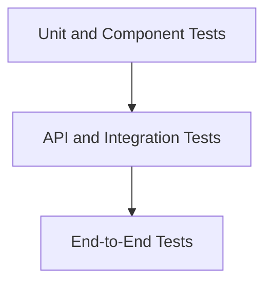
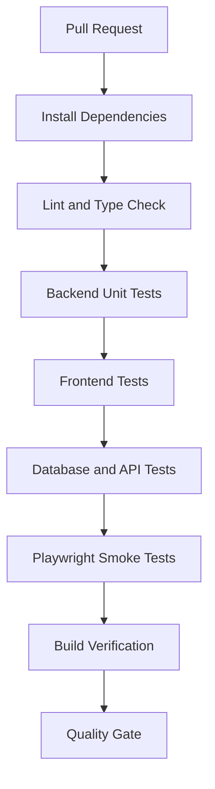

# Testing Engineering Standards

## 1. Purpose

This document defines the testing strategy, testing responsibilities, quality gates, and verification standards for the Task Management Application.

The goal is to detect defects early, prevent regressions, verify business behavior, and maintain confidence in application changes.

All contributors and AI coding agents MUST write and execute appropriate tests for changes they introduce.

This document defines general testing standards. Detailed browser automation requirements belong in the Playwright specification.

---

## 2. Testing Principles

1. **Test Behavior, Not Implementation Details** — verify observable outcomes rather than internal implementation structure.
2. **Test Critical Business Rules** — prioritize correctness, authorization, and data integrity.
3. **Isolate Tests** — tests must not depend on execution order or shared mutable state.
4. **Make Tests Deterministic** — avoid reliance on uncontrolled external services, timing, or production data.
5. **Test Failure Paths** — successful execution alone is insufficient.
6. **Prefer Fast Feedback** — run focused tests during development and broader suites before integration.
7. **Prevent Regressions** — add regression tests for fixed defects where practical.
8. **Keep Tests Maintainable** — avoid duplicated setup and overly complex fixtures.
9. **Do Not Hide Failures** — flaky or failing tests must be investigated.
10. **Verify Real Integration Boundaries** — mock external dependencies selectively, not the behavior being verified.

---

## 3. Testing Strategy

Use a layered testing approach.

| Test level | Primary tool | Purpose |
|---|---|---|
| Frontend unit | Vitest or the project's approved test runner | Test isolated UI logic and utilities |
| Frontend component | React Testing Library | Test component behavior and accessibility |
| Backend unit | Pytest | Test services, validation, and business rules |
| Backend integration | Pytest | Test database and service integration |
| API | Pytest | Test HTTP endpoints and API contracts |
| End-to-End | Playwright | Test complete user workflows |
| Security | Pytest + Playwright | Verify authentication and authorization controls |

Do not introduce a second testing framework for an existing test category without a clear reason.

### 3.1 Test Pyramid



Maintain a broad foundation of fast unit and component tests, a strong integration layer, and a focused set of critical end-to-end tests.

Do not use E2E tests as a replacement for unit or integration testing.

---

## 4. Testing Scope

Tests SHOULD cover the following application capabilities when implemented.

### 4.1 Authentication

- User registration.
- Successful login.
- Invalid credentials.
- Logout.
- Expired or invalid session.
- Protected route behavior.
- Unauthenticated API access.
- Authorization failure.

### 4.2 Boards

- Create a board.
- View accessible boards.
- Update board information.
- Delete a board.
- Reject invalid board data.
- Enforce board ownership and membership.
- Prevent unauthorized access.

### 4.3 Columns

- Create a column.
- Rename a column.
- Reorder columns.
- Delete a column.
- Verify the expected behavior for cards when a column is deleted.
- Reject operations against unauthorized boards.

### 4.4 Cards

- Create a card.
- View card details.
- Update card information.
- Change status or column.
- Reorder cards.
- Delete a card.
- Validate required fields and length limits.
- Enforce board permissions.
- Verify ordering and persistence after movement.

### 4.5 Comments

If comments are implemented:

- Add a comment.
- View comments.
- Edit a comment according to permissions.
- Delete a comment according to permissions.
- Reject access to comments belonging to inaccessible boards.

### 4.6 Search and Filtering

If implemented:

- Search by supported text fields.
- Filter by status or priority where applicable.
- Combine supported filters.
- Handle empty search results.
- Validate invalid filter parameters.
- Verify pagination and sorting behavior.

### 4.7 Notifications and Analytics

If implemented:

- Verify notification creation and access permissions.
- Verify read/unread behavior.
- Verify notification counts.
- Verify analytics calculations against known test data.
- Ensure users cannot access another user's private information.

Do not write tests for unapproved or unimplemented features merely because they appear in a conceptual architecture.

---

## 5. Frontend Testing Standards

### 5.1 Unit Tests

Test isolated frontend logic such as:

- Formatting utilities.
- Date and time helpers.
- Validation functions.
- Sorting and filtering functions.
- Permission-related presentation helpers.
- Data transformation utilities.

Unit tests MUST be deterministic and independent of browser rendering unless browser behavior is part of the function being tested.

### 5.2 Component Tests

Use React Testing Library to verify user-visible behavior.

Test:

- Rendering.
- User interactions.
- Form submission.
- Validation messages.
- Loading states.
- Empty states.
- Error states.
- Accessibility behavior.
- Conditional rendering based on supported permissions.

Prefer accessible queries such as:

- `getByRole`
- `getByLabelText`
- `getByPlaceholderText`
- `getByText` when appropriate

Avoid tests that depend heavily on implementation-specific CSS classes or internal component state.

### 5.3 Frontend API Behavior

Test:

- Successful API responses.
- Validation errors.
- Authentication failures.
- Authorization failures.
- Network errors.
- Timeout behavior.
- Unexpected server errors.

Verify that the UI communicates failures clearly and does not silently discard user input.

### 5.4 Frontend State

Test:

- State updates after successful operations.
- Loading behavior during requests.
- Error recovery.
- Optimistic updates and rollback where implemented.
- State consistency after navigation or refresh where required.

---

## 6. Backend Testing Standards

### 6.1 Unit Tests

Use Pytest for isolated business logic.

Test service behavior including:

- Valid operations.
- Invalid operations.
- Business rule enforcement.
- Permission checks.
- Missing resources.
- Conflict conditions.
- Defined application exceptions.

Service tests SHOULD avoid depending on Flask request context unless the behavior explicitly requires it.

### 6.2 Integration Tests

Verify interactions between:

- Services and SQLAlchemy models.
- SQLAlchemy and PostgreSQL.
- Related domain entities.
- Transaction boundaries.
- Constraints and relationships.
- Authentication and authorization components.

Use an isolated test database.

Prefer PostgreSQL for tests involving PostgreSQL-specific behavior, constraints, JSON operations, or query semantics.

Do not assume SQLite provides equivalent behavior to PostgreSQL.

### 6.3 API Tests

Use Flask's test client to verify:

- HTTP methods and routes.
- Request validation.
- Authentication requirements.
- Authorization rules.
- Response structure.
- HTTP status codes.
- Pagination and filtering.
- Error handling.
- Database persistence.

Test both successful and unsuccessful request scenarios.

### 6.4 Exception and Error Handling Tests

Verify:

- Application exceptions return the expected status and error code.
- Validation errors use a consistent response format.
- Unsupported HTTP methods return appropriate errors.
- Unexpected exceptions return safe generic responses.
- Internal exception details are not exposed.
- Error logging contains appropriate context without secrets.

---

## 7. Database Testing

Database tests MUST verify:

- Primary key behavior.
- Foreign key relationships.
- Unique constraints.
- Check constraints.
- Nullability.
- Cascade behavior.
- Transaction commit behavior.
- Transaction rollback behavior.
- Data preservation where applicable.
- Migration upgrade behavior.

Tests MUST use isolated data.

Do not depend on records left behind by another test.

For operations involving card ordering or concurrent updates, test the defined ordering and transaction behavior.

---

## 8. Authentication and Authorization Testing

Security-related behavior MUST have explicit test coverage.

Test at least:

1. Unauthenticated users cannot access protected endpoints.
2. Authenticated users cannot access resources outside their permissions.
3. Resource ownership is checked on every relevant operation.
4. Board membership and role permissions are enforced where applicable.
5. Invalid and expired credentials are rejected.
6. Users cannot modify resources by manipulating IDs.
7. Sensitive fields are excluded from responses.
8. Logout and session invalidation work as designed.

Include negative tests. A successful owner workflow does not prove that authorization is correct.

---

## 9. Test Data and Isolation

### 9.1 Test Fixtures

Use reusable fixtures for common test setup.

Backend fixtures SHOULD support:

- Application configuration.
- Test client.
- Test database session.
- Authenticated users.
- Boards and memberships.
- Columns and cards.
- Comments where implemented.

Frontend and E2E fixtures SHOULD provide controlled user accounts and test data.

### 9.2 Isolation Rules

- Each test MUST be independent.
- Tests MUST NOT rely on execution order.
- Parallel tests MUST NOT share mutable records without isolation.
- Use unique test data where appropriate.
- Clean up created resources.
- Avoid shared production or staging data between unrelated test runs.

### 9.3 Test Environment

Use a dedicated test configuration.

- Do not use production credentials.
- Do not connect automated tests to production databases.
- Use isolated test databases or schemas.
- Use deterministic configuration.
- Mock external services where real integration is not required.

---

## 10. End-to-End Testing

Use Playwright for critical browser workflows.

E2E tests SHOULD verify complete user journeys across the frontend and backend.

Priority workflows:

- Registration and login.
- Logout.
- Protected navigation.
- Board creation and management.
- Column creation and ordering.
- Card creation and editing.
- Card movement and ordering.
- Comment workflows, if implemented.
- Search and filtering.
- Permission-restricted actions.
- Responsive behavior.

### 10.1 E2E Rules

- Use semantic locators whenever possible.
- Avoid arbitrary hard-coded waits.
- Use deterministic test data.
- Isolate test accounts and resources.
- Capture useful diagnostics on failure.
- Test critical behavior against the real application stack.
- Mock external services when deterministic failure simulation is required.

Detailed Playwright configuration, Page Object Model conventions, browser matrix, trace settings, and CI execution requirements belong in the Playwright specification.

---

## 11. API Mocking Strategy

Mocking MUST be used intentionally.

Use mocks when:

- Simulating unavailable external services.
- Testing rare network failures.
- Testing timeout behavior.
- Isolating a unit from unrelated dependencies.
- Reproducing deterministic error responses.

Do not mock:

- The service logic being tested.
- Authorization logic in authorization tests.
- Database persistence in tests intended to verify persistence.
- Critical frontend/backend interactions in E2E tests intended to verify integration.

Use real integration tests for critical application boundaries.

---

## 12. Test Naming and Organization

### 12.1 Backend

Use descriptive test names.

Example:

```python
def test_user_cannot_update_card_on_unowned_board():
    ...
```

Recommended structure:

```text
tests/
├── conftest.py
├── unit/
│   ├── test_board_service.py
│   ├── test_card_service.py
│   └── test_auth_service.py
├── integration/
│   ├── test_board_database.py
│   └── test_card_database.py
├── api/
│   ├── test_auth_routes.py
│   ├── test_board_routes.py
│   └── test_card_routes.py
└── security/
    ├── test_authorization.py
    └── test_input_validation.py
```

### 12.2 Frontend

Recommended structure:

```text
src/
├── features/
│   ├── boards/
│   │   └── __tests__/
│   └── cards/
│       └── __tests__/
└── lib/
    └── __tests__/
```

### 12.3 End-to-End

Recommended structure:

```text
tests/
├── pages/
├── fixtures/
├── utils/
└── e2e/
    ├── auth/
    ├── boards/
    ├── cards/
    └── navigation/
```

Keep test organization consistent with the actual repository structure.

---

## 13. Coverage and Quality Standards

Code coverage is a diagnostic metric, not proof of correctness.

Recommended initial targets:

| Test category | Target |
|---|---:|
| Critical backend business logic | 90%+ |
| Backend overall | 80%+ |
| Frontend utility logic | 80%+ |
| Critical user journeys | 100% of approved critical flows |

Coverage MUST NOT be increased through meaningless assertions or tests that only execute lines without verifying behavior.

Prioritize coverage for:

- Authorization.
- Data integrity.
- Business-critical workflows.
- Error handling.
- High-risk state transitions.

Review coverage gaps in critical modules even when overall coverage targets are met.

---

## 14. Test Execution and CI Quality Gates

### 14.1 Local Development

Before submitting a change:

1. Run focused tests for the modified feature.
2. Run relevant unit and integration tests.
3. Run static checks and type checking.
4. Run the relevant E2E tests for critical workflow changes.
5. Review failures and fix regressions.

### 14.2 Continuous Integration

CI SHOULD run the following stages:



A pull request MUST NOT be considered ready when required quality gates fail.

Recommended CI checks:

- Frontend lint.
- TypeScript type checking.
- Backend lint and formatting checks.
- Backend unit and integration tests.
- Frontend component tests.
- Database migration validation.
- Critical Playwright smoke tests.
- Production build verification.
- Dependency security checks.

### 14.3 Test Stages

Use different test stages to balance speed and coverage.

**Pull Request**
- Fast unit and component tests.
- Backend API tests for affected functionality.
- Critical Chromium smoke tests.
- Static checks and build verification.

**Main Branch**
- Expanded integration and E2E coverage.
- Relevant browser compatibility tests.

**Scheduled or Pre-release**
- Full regression suite.
- Cross-browser testing.
- Responsive testing.
- Additional security and performance checks.

Do not require the complete cross-browser regression suite to run on every small pull request unless execution time and project needs justify it.

---

## 15. Flaky Test Management

Flaky tests MUST be investigated.

- Do not normalize intermittent failures.
- Do not use retries to conceal underlying instability.
- Record and track flaky tests.
- Fix timing, isolation, data, or environment problems.
- Keep retry behavior limited and diagnostic.

A test that passes only intermittently is not a reliable quality gate.

---

## 16. Performance Testing

Performance tests SHOULD be introduced when application usage or business requirements justify them.

Evaluate:

- API response times.
- Database query performance.
- Large board and card collections.
- Pagination.
- Search and filtering.
- Frontend rendering performance.
- Concurrent updates.
- Resource consumption.

Performance thresholds MUST be defined from measurable product requirements rather than arbitrary assumptions.

---

## 17. Accessibility Testing

UI changes MUST consider accessibility.

Test:

- Keyboard navigation.
- Semantic roles and labels.
- Form error associations.
- Focus visibility.
- Dialog and modal behavior.
- Screen-reader-friendly status updates.
- Color contrast.
- Responsive layouts.

Automated accessibility checks are useful but MUST NOT replace manual keyboard and interaction testing for critical workflows.

---

## 18. Test Failure Handling

When tests fail:

1. Identify the failing test and assertion.
2. Determine whether the cause is implementation, test logic, data, or environment.
3. Reproduce the failure where possible.
4. Fix the underlying issue.
5. Re-run the focused test.
6. Run relevant regression tests.
7. Report unresolved failures honestly.

Never:

- Delete a valid test simply to obtain a passing suite.
- Weaken assertions without justification.
- Skip failing tests without documenting the reason.
- Claim successful verification based on an incomplete test run.

---

## 19. AI Coding Agent Testing Rules

AI coding agents MUST:

1. Inspect existing tests before adding new ones.
2. Follow the project's existing testing framework and conventions.
3. Add tests for new business behavior.
4. Add regression tests for bug fixes where practical.
5. Test both positive and negative scenarios.
6. Verify authorization for protected resources.
7. Use isolated test data.
8. Avoid relying on test execution order.
9. Run the relevant tests after changes.
10. Report exact test commands and results.
11. Distinguish tests that passed from tests that were not executed.
12. Never fabricate test output or coverage metrics.

When a test cannot run because of missing dependencies, services, or environment configuration, report the blocker and do not claim verification.

---

## 20. Testing Definition of Done

- [ ] Relevant unit tests are implemented.
- [ ] Relevant component tests are implemented.
- [ ] Relevant integration or API tests are implemented.
- [ ] Critical authorization and validation paths are tested.
- [ ] Database integrity and transaction behavior are verified where applicable.
- [ ] Relevant E2E workflows are verified.
- [ ] Test data is isolated.
- [ ] Tests are deterministic.
- [ ] Relevant static checks pass.
- [ ] Required CI quality gates pass.
- [ ] No unresolved regression is hidden.
- [ ] Verification results are reported accurately.

A feature is not considered fully verified merely because the application builds or starts successfully.