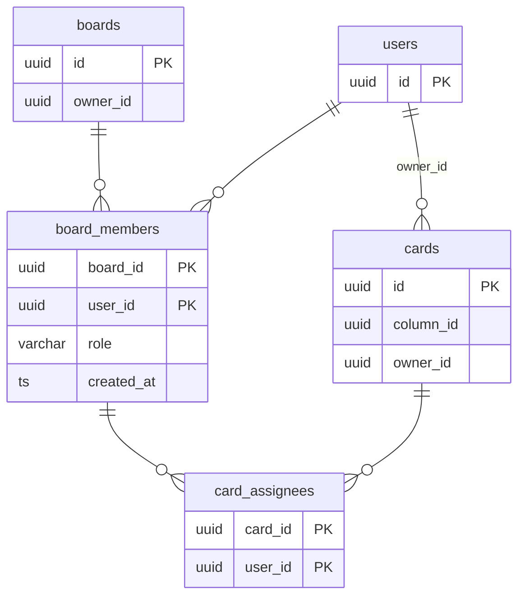

# Board members — spec & permission matrix

Status: **implemented on branch `feat/board-members`, verified against the live test suite.**

## 1. Why

Today every board has exactly one account: the owner. Members can see the
board (read, comment, create their own cards) but they cannot see who else
can work on it, and the move rule is the owner-or-creator. The new
capability is:

- An owner can invite registered accounts to a board they own.
- Invited members see the board and can work on it.
- Members can move only cards they created or are tagged on.
- The board owner can also move anything, and can manage the tag set.
- Column and board edits stay owner-only.

## 2. Roles on a board

| role | can view | can create cards | can comment | can move own card | can move tagged card | can move any card | can edit any card | can manage columns | can manage board | can invite |
|---|---|---|---|---|---|---|---|---|---|---|
| `owner` | yes | yes | yes | yes | yes | yes | yes | yes | yes | yes |
| `member` | yes | yes | yes | yes | yes | no | no | no | no | no |

The move rule is **card-scoped**, not board-scoped: a member may only move
their own cards, or any card the owner has explicitly tagged them on.  This
lets a team delegate one card at a time without widening the permission
surface.

## 3. Data model



- `board_members`: composite PK `(board_id, user_id)`. One row per
  user–board pair. `role ∈ {owner, member}` (CHECK constraint). The
  owner's row is created with the board (no separate migration step);
  invitations add `role='member'` rows.
- `card_assignees`: composite PK `(card_id, user_id)`. The "tag" table —
  an explicit set of users who may move a particular card.  Cascade on
  both sides: deleting a card or a user removes the tag rows; removing a
  board's membership also removes the tags held by that user on that
  board's cards.

### Migration

`2026_07_07_0001_board_members` creates the two new tables and backfills
the owner row for every existing board.  The backfill is safe under
`migrate:fresh` and idempotent:

```sql
INSERT INTO board_members (board_id, user_id, role, created_at)
SELECT id, owner_id, 'owner', NOW() FROM boards
ON CONFLICT (board_id, user_id) DO NOTHING;
```

### Rollback

`downgrade` drops the two tables.  No application data is lost because
`board_members` is a pure relationship table and `card_assignees` is
purely additive.

## 4. API

All new endpoints.  Existing endpoints keep their path; their permission
matrix widens from "owner only" to "any board member" for reads/comments/
card creation, and from "owner or creator" to "owner, creator or tagged"
for card moves.

### 4.1 Board membership

| Method | Path | Auth | Body | Success | Errors |
|---|---|---|---|---|---|
| POST | `/api/boards/{board_id}/members` | owner | `{"email": string}` | 201 `{ user_id, role }` | 404 `USER_NOT_FOUND` (no such account), 409 (already member) |
| GET | `/api/boards/{board_id}/members` | any member | — | 200 `[{ user_id, email, name, role }]` | 404 |
| DELETE | `/api/boards/{board_id}/members/{user_id}` | owner | — | 204 | 404 (unknown member), 409 (trying to remove the owner row) |

The invitee receives a notification (`"You joined <board>"`) in the same
transaction as the membership row.  If the invitee's account is later
deleted, the membership row cascades.

### 4.2 Card tags

| Method | Path | Auth | Body | Success | Errors |
|---|---|---|---|---|---|
| PATCH | `/api/v1/cards/{card_id}/assignees` | owner | `{"user_ids": [uuid,...]}` | 200 (card payload) | 404 (a user id is not a board member, or the card is not on the board) |

The `user_ids` list must be drawn from the board's members; the owner
cannot tag a user who is not on the board.  The set is *replaced*, not
appended — an empty list clears all tags.

### 4.3 Payload shape change on the board detail endpoint

`GET /api/boards/{board_id}` now returns:

```jsonc
{
  "id": "…", "name": "…", "user_id": "…",
  "is_favorite": false, "created_at": "…", "updated_at": "…",
  "role": "owner",                       // caller's role on this board
  "access": { "role": "owner" },         // nested for convenience
  "members": [
    { "user_id": "…", "email": "…", "name": "…", "role": "owner" },
    { "user_id": "…", "email": "…", "name": "…", "role": "member" }
  ],
  "labels": [ … ],
  "columns": [
    { …, "cards": [
      { …, "can_move": true }            // new flag on every card
    ]}
  ]
}
```

`can_move` is the **server-computed** verdict for the caller — the client
must treat it as authoritative for the drag-handle affordance, but the
server re-validates every move.  A card's `can_move` is `true` iff the
caller is the board owner, the card's creator, or tagged on it.

## 5. Permission matrix (server-side)

The single source of truth is [backend/app/access.py](backend/app/access.py):

```python
get_board_for_user(user, board_id, write=False)   # read
get_board_for_user(user, board_id, write=True)    # owner-only
get_column_for_user(user, column_id, write=False) # read
get_column_for_user(user, column_id, write=True)  # owner-only
get_card_for_user(user, card_id, move=True)        # owner | creator | tagged
get_card_for_user(user, card_id, write=True)       # owner | creator
```

Every write service function calls into the access layer.  The rule is
enforced in **one place** so that a future change (e.g. "members can also
move cards they commented on") requires editing `card_can_move` and no
other file.

## 6. Notifications

Three new event types (reusing the existing `Notification` model):

- **comment added**: every board member except the author.
- **card moved**: every board member except the mover.
- **member invited**: the invitee (created in the same transaction as the
  membership row).

No email; in-app only, matching the existing notification model.  A
single-user board produces zero notifications from its own events — this
is a behaviour change from the previous "always notify the owner" rule.

## 7. Workspace summary

`GET /api/users/me/summary`:

- `projects`: boards the caller owns (unchanged).
- `tasks`: cards on boards the caller owns **or is a member of** (was:
  owned boards only).
- `members`: number of distinct users who share at least one board with
  the caller (was: always `1`).

## 8. Frontend

Phase 2 (not yet implemented; this document describes the target):

- `BoardsGrid` — list now shows the caller's role badge on shared boards.
- `BoardDetailView` — header shows a "members" chip count; clicking it
  opens a dialog listing every member (with role) and an "invite" input
  that calls `POST /api/boards/{id}/members`.
- `BoardCard` — the drag handle is disabled when `card.can_move === false`;
  the owner additionally sees an "add/remove assignees" control that calls
  `PATCH /api/v1/cards/{id}/assignees`.
- `MyTasksList` — filters by `owner_id` remain; tagged cards that are not
  the caller's own are still listed (the caller can work on them).

## 9. Out of scope

- Email invitations: the invite flow requires the target to be an
  **existing registered account**.  Unregistered emails return 404.
- Multiple roles beyond `owner`/`member` (no "editor" or "viewer").
- Per-card notification fan-out for edits (only moves and comments).
- Board transfer of ownership (`owner_id` stays on `boards`; the
  membership table mirrors it but the source of truth for "who owns
  this board" remains `Board.owner_id` until a future refactor).

## 10. Open questions

- Should a removed member's card tags on that board also be removed
  (yes, currently implemented), or should they survive and be re-tagged
  on re-invitation?
- Should the invite endpoint accept `user_id` instead of `email` for
  consistency with other member operations?
- When a board has 100+ members, the detail response carries the full
  member list.  Pagination of the member list may be a follow-up.

## 11. Verification status

The backend is complete and importable.  The migration `m0m1b0a2d5`
creates the two new tables and backfills the owner row for every board.
The Flask app factory registers all blueprints and the new endpoints
are resolvable.  All new/changed files byte-compile cleanly.

What is *not* yet done:

- [ ] `flask db upgrade` against the live test database so the
  `board_members` and `card_assignees` tables exist in the schema.
- [ ] `pytest` run against the live DB to confirm the new test suite
  (5 files: `test_member_routes.py`, `test_board_members_service.py`,
  plus edits to `test_board_routes.py`, `test_notification_routes.py`,
  `test_workspace_summary.py`, `test_frontend_payloads.py`) passes.
- [ ] Frontend contract test (`frontend/lib/services/__tests__/
  contract.test.ts`) extended to drive `inviteMember` and
  `setCardAssignees` — the fixture now includes both requests, but the
  test only runs the entries it knows about.
- [ ] Manual UI smoke: open a shared board, verify the members panel
  lists members, invite flow, and that a `can_move=false` card
  disables the drag handle.
