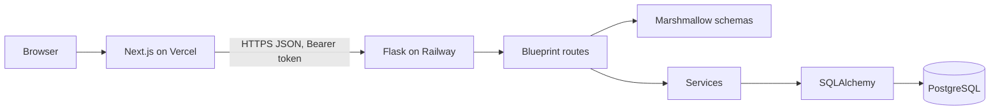
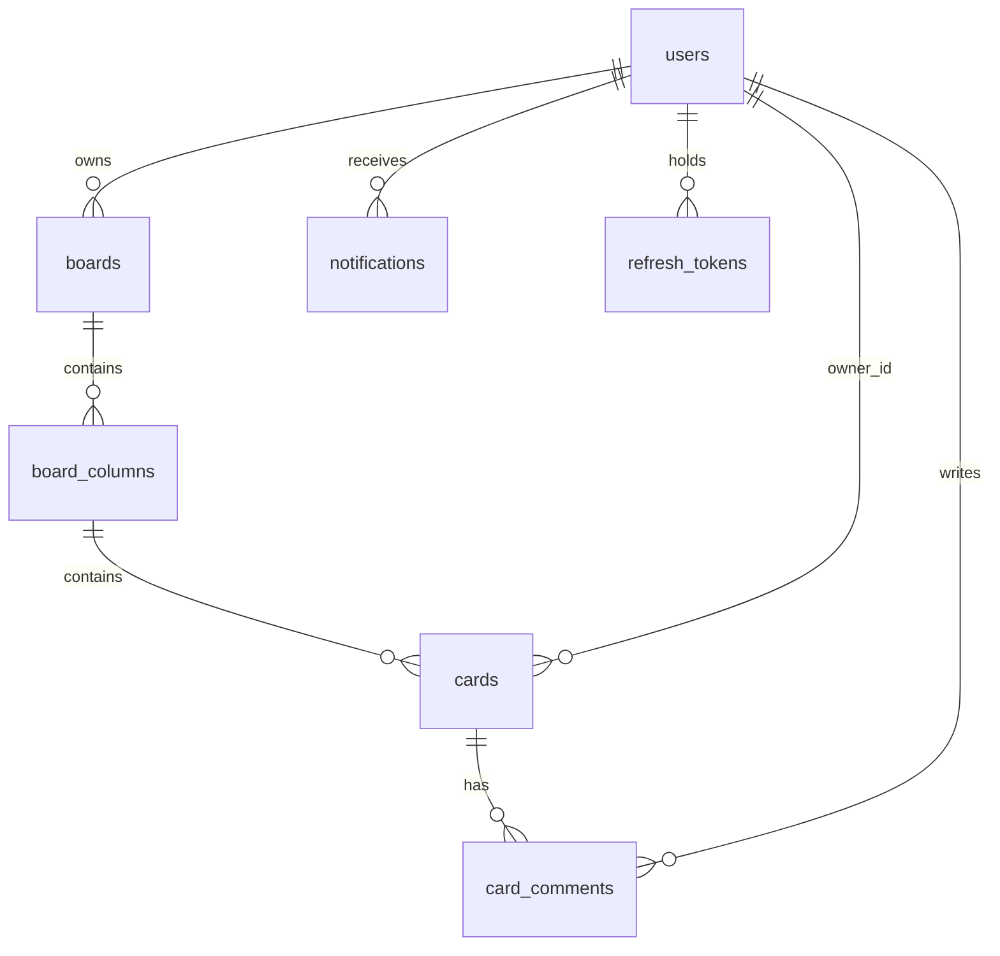
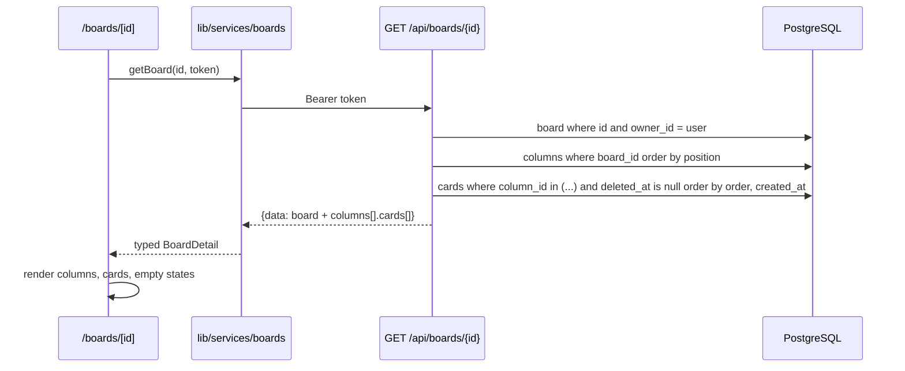

# Design Document: RevoTask (Kanban)

Authoritative copy. `.kiro/specs/` holds an older duplicate set (V-028) and is not maintained.

## 1. Overview

RevoTask is a modular monolith with two separately deployed applications. A Next.js frontend on Vercel calls a Flask REST API on Railway directly from the browser. The API stores data in PostgreSQL through SQLAlchemy. Authentication is a Bearer JWT. Every resource belongs to one user through its board, and every backend service checks that ownership.

This design describes the code at commit `339dfe3` and the changes needed to meet `specs/requirements.md`. Each route, field and page is either read from the code ("Current") or marked "Planned". The design was written by reading the code. No server, test or build was run for it.

Key decisions, with the alternative that was rejected:

- **Board read.** `GET /api/boards/{id}` returns board, columns and cards in one response (D2). Rejected: two separate list endpoints, which cost one request per column and need new routes and tests for each.
- **Search.** Runs in the browser over the loaded board (D13). Rejected: a backend search route. The board payload already contains every card, and the MVP has no pagination.
- **Move.** The client sends `{column_id, order}` and then reloads the board. Rejected: trusting local `order` values, because the backend renumbers orders after each move (section 7.3).
- **Header.** Rendered once in the root layout when a token exists. Rejected: moving pages into `(auth)` and `(dashboard)` route groups, which is a structural migration unrelated to the product work (`structure.md` section 13).
- **Prefix.** Target `/api/v1` for all routes (D10), done as one task (P1) with a temporary dual registration.

## 2. Technology stack (locked)

| Layer          | Technology                                                                                                | Source                          |
| -------------- | --------------------------------------------------------------------------------------------------------- | ------------------------------- |
| Frontend       | Next.js 16.4.6, React 19.3.0, TypeScript 5, Tailwind CSS 4.3.3, react-hot-toast                           | `frontend/package.json`         |
| Frontend tests | Jest 30, Testing Library, Playwright 1.65                                                                 | `frontend/package.json`, `e2e/` |
| Backend        | Flask 3.1, Marshmallow 4.4, SQLAlchemy 2.1, Flask-Migrate, PyJWT 2.15, flask-cors 6.0, flasgger, gunicorn | `backend/requirements.txt`      |
| Database       | PostgreSQL                                                                                                | `backend/app/config.py`         |
| Backend tests  | Pytest                                                                                                    | `backend/tests/`                |
| Hosting        | Vercel (frontend), Railway (backend + Postgres)                                                           | `docs/deployment-*.md`          |

No new runtime dependency is introduced by this design, except a shared store for rate limiting (task P3), which needs its own decision before work starts.

## 3. Architecture

The browser calls the Railway origin directly. There are no Vercel rewrites. The backend allows only the origins in `CORS_ALLOWED_ORIGINS`.

Request path in the backend: route handler (decorator `token_required` loads the user) -> Marshmallow `load` -> service function (ownership check, rules, commit) -> serializer function (`*_to_dict`) -> JSON envelope. Errors are `AppException` subclasses or Marshmallow `ValidationError`, converted in `app/common/error_handlers.py`.

Services do not touch Flask request or response objects. Routes do not run queries. This holds in the current code.

## 4. Data model (as implemented)

Source: `backend/app/models/*.py` and migration `e75e73442f21` (the only migration, creates all tables).

| Table            | Columns                                                                                                                                                                                                                       | Constraints and indexes                                               |
| ---------------- | ----------------------------------------------------------------------------------------------------------------------------------------------------------------------------------------------------------------------------- | --------------------------------------------------------------------- |
| `users`          | `id` UUID PK, `email` String(254), `password_hash` String(255), `name` String(255) null, `timezone` String(64) default `UTC`, `role` String(16) default `member`, `is_active` bool default true, `created_at`, `updated_at`   | unique index `ix_users_email`; check `role IN ('member','admin')`     |
| `boards`         | `id` UUID PK, `owner_id` FK `users.id` ON DELETE CASCADE, `name` String(100), `created_at`, `updated_at`                                                                                                                      | index on `owner_id`. No unique index on name (Planned, R12.5)         |
| `board_columns`  | `id` UUID PK, `board_id` FK `boards.id` ON DELETE CASCADE, `name` String(100), `position` **Float**, `created_at`, `updated_at`                                                                                               | check `position >= 0`; index `(board_id, position)`                   |
| `cards`          | `id` UUID PK, `column_id` FK `board_columns.id` ON DELETE CASCADE, `owner_id` FK `users.id` ON DELETE CASCADE, `title` String(255), `description` Text null, `order` **Float**, `created_at`, `updated_at`, `deleted_at` null | check `"order" >= 0`; index `(column_id, order)`; index on `owner_id` |
| `card_comments`  | `id` UUID PK, `card_id` FK `cards.id` ON DELETE CASCADE, `author_id` FK `users.id` ON DELETE CASCADE, `body` Text, `created_at`, `updated_at`                                                                                 | indexes on `card_id`, `author_id`                                     |
| `notifications`  | `id` UUID PK, `user_id` FK `users.id` ON DELETE CASCADE, `title` String(255), `body` Text null, `is_read` bool default false, `created_at`, `updated_at`                                                                      | index on `user_id`                                                    |
| `refresh_tokens` | `id` UUID PK, `user_id` FK ON DELETE CASCADE, `token_hash` String(255) unique, `expires_at`, `revoked` bool, `created_at`                                                                                                     | index `ix_refresh_tokens_user_id`                                     |

Facts that matter for the design:

- `board_columns.position` is a Float in the model, but the column schema accepts an Integer and the service renumbers to 0, 1, 2. Column order is effectively an integer.
- `cards.order` is a Float. The service renumbers it to whole numbers after every move and after the card is created at the end (section 7.3).
- `cards.deleted_at` exists, but `delete_card` calls `db.session.delete`, which removes the row. Only `analytics/service.py` filters on `deleted_at`. Planned: soft delete (D7, task B3).
- Deleting a board, column or card removes children by database cascade (`passive_deletes=True` on the relationships). This is a hard delete.
- Cards have no priority, status, due date, label or assignee column.
- `cards.owner_id` duplicates the board owner. Authorization uses the board join, not `cards.owner_id`.
- Timestamps are `timestamptz`, serialized with `isoformat()`.

## 5. API

### 5.1 Conventions

| Topic                  | Current behaviour                                                                                                                                                                                                                                                                                                                                                                                                                                                                                       |
| ---------------------- | ------------------------------------------------------------------------------------------------------------------------------------------------------------------------------------------------------------------------------------------------------------------------------------------------------------------------------------------------------------------------------------------------------------------------------------------------------------------------------------------------------- |
| Base                   | Browser uses `NEXT_PUBLIC_API_BASE_URL` (origin only) plus the path, for example `https://<railway-host>/api/boards`. `frontend/next.config.ts` rejects a value with a path on Vercel.                                                                                                                                                                                                                                                                                                                  |
| Prefix                 | Split. `/api/v1/...` for cards. `/api/...` for everything else. Target `/api/v1` for all (D10, task P1). `api-contracts.md` section 3.2 shows a base URL that includes `/api/v1`. This repository's `.env.example` holds the origin only. When P1 lands, the frontend path constants carry `/api/v1` and the variable stays an origin.                                                                                                                                                                  |
| Auth                   | `Authorization: Bearer <access_token>`. HS256 JWT with `sub`, `role`, `exp` (15 minutes). `token_required` loads the user, then passes it as the first argument. A missing header, bad token, expired token or unknown user returns 401 `UNAUTHORIZED`.                                                                                                                                                                                                                                                 |
| Success                | `{"data": <object or list>}`. Delete returns 204 with an empty body.                                                                                                                                                                                                                                                                                                                                                                                                                                    |
| Error                  | `{"error": {"code", "message", "details"}}`. `details` is `null` or a field map for validation.                                                                                                                                                                                                                                                                                                                                                                                                         |
| Field names            | `snake_case`. `api-contracts.md` section 5.2 asks for `camelCase`. Drift recorded as V-020 and not changed here.                                                                                                                                                                                                                                                                                                                                                                                        |
| Timestamps             | ISO 8601 from `isoformat()`. The `timestamptz` columns return an offset. `api-contracts.md` asks for `Z` suffix. Not changed.                                                                                                                                                                                                                                                                                                                                                                           |
| Unknown request fields | Rejected with 400 (Marshmallow default).                                                                                                                                                                                                                                                                                                                                                                                                                                                                |
| Pagination             | Notifications only: `page`, `per_page` (max 100), `meta {page, per_page, total}`. `api-contracts.md` asks for `perPage` and `meta.pagination`. V-020.                                                                                                                                                                                                                                                                                                                                                   |
| Error codes in use     | `VALIDATION_ERROR` 400, `UNAUTHORIZED` 401, `INVALID_CREDENTIALS` 401, `BOARD_NOT_FOUND` / `COLUMN_NOT_FOUND` / `CARD_NOT_FOUND` / `COMMENT_NOT_FOUND` / `NOTIFICATION_NOT_FOUND` / `USER_NOT_FOUND` 404, `COMMENT_ACCESS_DENIED` 403, `RESOURCE_CONFLICT` 409, `HTTP_ERROR` (any framework HTTP error, for example 404 unknown URL, 405, 415), `INTERNAL_ERROR` 500. `api-contracts.md` section 7.2 names `UNAUTHENTICATED`, `RESOURCE_NOT_FOUND`, `DUPLICATE_RESOURCE`, `RATE_LIMIT_EXCEEDED`. V-020. |

### 5.2 Route table (canonical routes)

All routes except register, login and health require the Bearer token. "Err" lists the error codes a client must handle in addition to 401 and 500.

| #   | Method | Path (current)                             | Request fields                                                                                                                      | Success                                                               | Err                                             | Status                  |
| --- | ------ | ------------------------------------------ | ----------------------------------------------------------------------------------------------------------------------------------- | --------------------------------------------------------------------- | ----------------------------------------------- | ----------------------- |
| 1   | POST   | `/api/auth/register`                       | `name` string 1..255 (trimmed), `email` email, `password` string 8+ with lower, upper, digit                                        | 201 user                                                              | 400, 409 `RESOURCE_CONFLICT`                    | Done                    |
| 2   | POST   | `/api/auth/login`                          | `email`, `password` (same policy as register, see R1.7)                                                                             | 200 `{access_token, refresh_token, user{id,email,role,timezone}}`     | 400, 401 `INVALID_CREDENTIALS`                  | Done                    |
| 3   | GET    | `/api/health` (public)                     | none                                                                                                                                | 200 `{status, db}`                                                    | none                                            | Done                    |
| 4   | POST   | `/api/boards`                              | `name` 1..100 (trimmed, not blank)                                                                                                  | 201 board                                                             | 400, 409                                        | Backend                 |
| 5   | GET    | `/api/boards`                              | none                                                                                                                                | 200 `[board]` oldest first                                            | none                                            | Done                    |
| 6   | GET    | `/api/boards/{board_id}`                   | none                                                                                                                                | 200 board (Current). 200 board with `columns[].cards[]` (Planned, D2) | 404 `BOARD_NOT_FOUND`                           | Planned change          |
| 7   | PATCH  | `/api/boards/{board_id}`                   | `name` 1..100 optional                                                                                                              | 200 board                                                             | 400, 404, 409                                   | Backend                 |
| 8   | DELETE | `/api/boards/{board_id}`                   | none                                                                                                                                | 204                                                                   | 404                                             | Backend                 |
| 9   | POST   | `/api/boards/{board_id}/columns`           | `name` 1..100, `position` int >= 0 optional                                                                                         | 201 column                                                            | 400, 404                                        | Backend                 |
| 10  | PATCH  | `/api/columns/{column_id}`                 | `name` 1..100, `position` int >= 0, both optional                                                                                   | 200 column                                                            | 400, 404 `COLUMN_NOT_FOUND`                     | Backend                 |
| 11  | DELETE | `/api/columns/{column_id}`                 | none                                                                                                                                | 204. Planned: 409 while the column has cards (D3)                     | 404                                             | Backend, change planned |
| 12  | PATCH  | `/api/boards/{board_id}/columns/reorder`   | `ordered_ids` list of UUID, 1+ items                                                                                                | 200 `[column]` ordered                                                | 400, 404                                        | Backend                 |
| 13  | POST   | `/api/v1/columns/{column_id}/cards`        | `title` 1..255 (trimmed, not blank), `description` 0..2000 default `""`, `priority` low/medium/high (accepted and ignored)          | 201 card                                                              | 400, 404 `COLUMN_NOT_FOUND`                     | Backend                 |
| 14  | PATCH  | `/api/v1/cards/{card_id}`                  | `title`, `description`, `priority`, `status` (todo/in_progress/done) all optional. `priority` and `status` are accepted and ignored | 200 card                                                              | 400, 404 `CARD_NOT_FOUND`                       | Backend                 |
| 15  | DELETE | `/api/v1/cards/{card_id}`                  | none                                                                                                                                | 204. Current: row removed. Planned: `deleted_at` set (D7)             | 404                                             | Backend, change planned |
| 16  | PATCH  | `/api/v1/cards/{card_id}/position`         | `column_id` UUID, `order` float >= 0 (both required)                                                                                | 200 card                                                              | 400, 404 `CARD_NOT_FOUND` or `COLUMN_NOT_FOUND` | Backend                 |
| 17  | GET    | `/api/cards/{card_id}/comments`            | none                                                                                                                                | 200 `[comment]` oldest first                                          | 404                                             | Backend                 |
| 18  | POST   | `/api/cards/{card_id}/comments`            | `body` 1..2000 (trimmed, not blank)                                                                                                 | 201 comment                                                           | 400, 404                                        | Backend                 |
| 19  | PATCH  | `/api/comments/{comment_id}`               | `body` 1..2000 optional                                                                                                             | 200 comment                                                           | 400, 403 `COMMENT_ACCESS_DENIED`, 404           | Backend                 |
| 20  | DELETE | `/api/comments/{comment_id}`               | none                                                                                                                                | 204                                                                   | 403, 404                                        | Backend                 |
| 21  | GET    | `/api/users/me`                            | none                                                                                                                                | 200 user                                                              | none                                            | Backend                 |
| 22  | PATCH  | `/api/users/me`                            | `name` 0..255, `timezone` IANA name 0..64, both optional                                                                            | 200 user                                                              | 400                                             | Backend                 |
| 23  | GET    | `/api/notifications?page=&per_page=`       | query ints (per_page capped at 100)                                                                                                 | 200 `[notification]` with `meta`                                      | none                                            | Backend, no UI          |
| 24  | PATCH  | `/api/notifications/{id}/read`             | none                                                                                                                                | 200 notification                                                      | 404                                             | Backend, no UI          |
| 25  | GET    | `/api/analytics/boards/{board_id}/summary` | none                                                                                                                                | 200 `{board_id, total_cards, completed_cards}`                        | 404                                             | Backend, no UI          |

Response objects (field names exactly as serialized):

- **user** (register, `GET /users/me`, `PATCH /users/me`): `id`, `email`, `name`, `timezone`, `role`, `is_active`, `created_at`, `updated_at`.
- **board**: `id`, `name`, `user_id`, `created_at`, `updated_at`. (`user_id` is the owner.)
- **column**: `id`, `board_id`, `name`, `position`, `created_at`, `updated_at`.
- **card**: `id`, `column_id`, `owner_id`, `title`, `description`, `order`, `deleted_at`, `created_at`, `updated_at`. No `position`, `priority` or `status`.
- **comment**: `id`, `card_id`, `author_id`, `body`, `created_at`, `updated_at`.
- **notification**: `id`, `user_id`, `title`, `body`, `is_read`, `created_at`, `updated_at`.
- **board with contents** (Planned, route 6): the board object plus `columns`: a list of column objects ordered by `position`, each with `cards`: a list of card objects ordered by `order`, then `created_at`, excluding rows with `deleted_at`. Adding a field is a non-breaking change (`api-contracts.md` section 15).

#### 5.2.1 Changes made in the Kanban UI work (uncommitted)

These are now in the working tree and covered by pytest (`backend/tests/api/`, `backend/tests/test_comments.py`). Where the table above says "Planned" for the same item, this note wins. Full contract in `docs/api/README.md`.

- Route 6 now returns the board with `columns[].cards[]` as described above (D2). Route 11 returns 409 `RESOURCE_CONFLICT` while the column has non-deleted cards (D3). Route 15 sets `deleted_at` instead of removing the row (D7); every card read filters it out.
- New route 26: `GET /api/v1/cards` (Bearer). Query: `search` (1..100 characters, case-insensitive, matches `title` or `description`, `%` and `_` taken literally), `board_id` (UUID), `mine` (boolean, only cards the caller created), `page` (>= 1, default 1), `per_page` (1..100, default 20). Unknown or repeated keys return 400 `VALIDATION_ERROR`. Only boards the caller owns are searched. Order: board name, column position, card `order`, card id. Response: `data` = card objects plus `board_id`, `board_name`, `column_name`; `meta` = `{page, per_page, total}`. Because `cards_bp` is registered twice (section 5.3), the same route also answers at `GET /api/v1/columns`; no client uses that URL. Used by the board search box (D13) and `/my-tasks` (D8).
- Route 23: `meta` gains `unread_count` (all unread notifications of the caller, not only the current page).
- Notification producer (D6): `POST /api/cards/{card_id}/comments` stages one notification for the board owner in the same commit as the comment, with `title` "New comment on <card title>" and `body` the comment text (both truncated). The owner is notified on their own comments too, because boards have one owner.
- Comment object: adds `author_name` (the author's `name`, or the part of the email before `@` when the name is empty). `author_id` stays.
- Route 2: `user` in the login response adds `name`.
- Route 16: when the requested `order` equals another card's `order` in the destination column, the moved card is placed first (R5.10). Orders are renumbered after the move, so the client reloads the board.

### 5.3 Extra URLs from double registration

`backend/app/__init__.py` registers three blueprints twice. From reading the code (not executed), these additional URLs exist:

| Blueprint     | Intended prefix               | Extra prefix      | Extra URLs that result                                                                                                                                                                                                                                       |
| ------------- | ----------------------------- | ----------------- | ------------------------------------------------------------------------------------------------------------------------------------------------------------------------------------------------------------------------------------------------------------ |
| `cards_bp`    | `/api/v1/cards`               | `/api/v1/columns` | `PATCH`/`DELETE /api/v1/columns/{card_id}`, `PATCH /api/v1/columns/{card_id}/position`. And at the intended prefix, `POST /api/v1/cards/{column_id}/cards`                                                                                                   |
| `columns_bp`  | `/api/boards`, `/api/columns` | each other        | `POST /api/columns/{board_id}/columns`, `PATCH /api/columns/{board_id}/columns/reorder`, and `PATCH`/`DELETE /api/boards/{column_id}`. The last two have the same pattern as the board routes, which are registered first. They are expected to be shadowed. |
| `comments_bp` | `/api/cards`, `/api/comments` | each other        | `PATCH`/`DELETE /api/cards/{comment_id}`, `GET`/`POST /api/comments/{card_id}/comments`                                                                                                                                                                      |

They are not part of the contract. Task P1 registers each blueprint once.

## 6. Frontend

### 6.1 Structure

The repository does not follow the `features/` layout of `structure.md` section 5 (V-018). This design keeps the existing flat layout (`app/`, `components/`, `hooks/`, `lib/`, `context/`) and does not migrate it. New files go next to their siblings.

### 6.2 Pages

| Route          | File                                                 | Guard                              | Current                                                     | MVP plan                                                                               |
| -------------- | ---------------------------------------------------- | ---------------------------------- | ----------------------------------------------------------- | -------------------------------------------------------------------------------------- |
| `/`            | `app/page.tsx` renders `BoardsGrid`                  | `BoardsGrid` redirects to `/login` | Lists boards. No create control.                            | Add `CreateBoardForm` (F2).                                                            |
| `/login`       | `app/login/page.tsx`                                 | none                               | Works. `router.push("/")` on success.                       | No change.                                                                             |
| `/register`    | `app/register/page.tsx`                              | none                               | Works. Sends `name`, `email`, `password`. Goes to `/login`. | No change.                                                                             |
| `/boards/[id]` | `app/boards/[id]/page.tsx` renders `BoardDetailView` | `useRequireAuth`                   | Read-only. Calls two missing endpoints.                     | Rewrite data load (F4). Columns, cards, dialog, search, drag and drop (F5 to F9, F11). |
| `/profile`     | `app/profile/page.tsx`                               | none                               | Sends `{email, timezone}`: always 400.                      | Guard, load `GET /users/me`, send `{name, timezone}` (F3, F10).                        |
| `/my-tasks`    | `app/my-tasks/page.tsx` renders `MyTasksList`        | none                               | Calls `GET /api/cards?assignee=me`, which does not exist.   | Remove (F12, D8).                                                                      |

`app/layout.tsx` wraps all pages in `AuthProvider` (`context/AuthContext.tsx`), `ErrorBoundary` and a single `Toaster`.

### 6.3 Components and hooks

| File                                                                  | Used today                          | MVP plan                                                                                                                    |
| --------------------------------------------------------------------- | ----------------------------------- | --------------------------------------------------------------------------------------------------------------------------- |
| `context/AuthContext.tsx`                                             | yes                                 | Replace the direct `fetch` in `login` with `apiClient` (F1). `logout()` stays client-only (R9).                             |
| `lib/apiClient.ts`                                                    | yes (`get`, `post`, `patch`, `del`) | Keep. Add typed services on top (F1).                                                                                       |
| `lib/errors.ts`                                                       | yes (`ApiError`)                    | Keep.                                                                                                                       |
| `components/board/BoardsGrid.tsx`                                     | `/`                                 | Add the create control (F2). Uses `BoardCard` for board tiles.                                                              |
| `components/board/BoardCard.tsx`                                      | `/` tiles                           | Also used for cards inside columns. Its labels `Open card: <title>` and `Delete card: <title>` are used by the e2e journey. |
| `components/board/BoardDetailView.tsx`                                | `/boards/[id]`                      | Rewrite (F4).                                                                                                               |
| `components/board/ColumnHeader.tsx`                                   | board page                          | Wire `onRename` and `onColumnDelete` (F5). Add move left and right.                                                         |
| `components/board/AddCardForm.tsx`                                    | not mounted                         | Mount per column (F6). Props today: `onCardCreate(title)`. Extend to optional description.                                  |
| `components/board/CardDetailModal.tsx`                                | not mounted                         | Mount (F7). Add edit, delete, comment edit and delete, move-to select. Fix the author label.                                |
| `components/board/CommentList.tsx`                                    | via modal                           | Keep. Add edit and delete callbacks (F7).                                                                                   |
| `components/board/SearchBar.tsx`, `hooks/useCardSearch.ts`            | not mounted                         | Replace with a plain text filter (F11). Remove the `assignee`, `due_date`, `label` fields and the `fetch` to `/api/cards`.  |
| `hooks/useDragAndDrop.ts`                                             | not mounted                         | Fix payload and mount (F8).                                                                                                 |
| `components/shared/BaseModal.tsx`, `BaseButton.tsx`, `BaseBadge.tsx`  | yes                                 | Keep.                                                                                                                       |
| `components/shared/NotificationBell.tsx`, `hooks/useNotifications.ts` | not mounted                         | No change in the MVP (D6). The silent 404 handling is removed in F1.                                                        |
| `components/board/MyTasksList.tsx`                                    | `/my-tasks`                         | Remove with the page (F12).                                                                                                 |
| `hooks/useRequireAuth.ts`                                             | `/`, `/boards/[id]`                 | Also used by `/profile` (F3).                                                                                               |
| `components/shared/Header.tsx`                                        | does not exist                      | New. Rendered in `app/layout.tsx` when a token exists. Links to `/` and `/profile`, Log out button (F3).                    |
| `components/board/CreateBoardForm.tsx`                                | does not exist                      | New (F2).                                                                                                                   |
| `components/board/AddColumnForm.tsx`                                  | does not exist                      | New (F5).                                                                                                                   |
| `lib/services/{boards,columns,cards,comments,users}.ts`               | does not exist                      | New. Typed request and response per route, built on `apiClient` (F1).                                                       |
| `lib/types/api.ts`                                                    | does not exist                      | New. TypeScript types equal to the objects in section 5.2.                                                                  |
| `lib/apiPaths.ts`                                                     | does not exist                      | New. One place for every path string, so P1 is a one-file change.                                                           |
| `lib/cardOrder.ts`                                                    | does not exist                      | New. Pure function computing the new `order` from the neighbours (F8).                                                      |

Status after the Kanban UI work (uncommitted; the tables above keep the original plan):

- Built as planned: `CreateBoardForm`, `Header` (links Dashboard, My Tasks, Profile, the user's name, the bell, Log out), board page on one request with a new `BoardColumn` component (add column, rename, delete with a 409 message), `AddCardForm` per column, `CardDetailModal` (edit, Move to column, delete, comments with `author_name`, edit and delete own comments), drag and drop through `useDragAndDrop` + `computeCardOrder`, profile with `{name, timezone}`, `lib/types/api.ts`, `lib/apiPaths.ts`, `lib/services/*Service.ts`. No raw `fetch` remains outside `lib/apiClient.ts`.
- Changed by decision (requirements.md section 12.1): `NotificationBell` is mounted in `Header` (D6); `/my-tasks` is kept and `MyTasksList` loads `GET /api/v1/cards?mine=true` (D8); `SearchBar` + `useCardSearch` call `GET /api/v1/cards?search=&board_id=` (D13) and open the chosen card in the dialog.
- Different from the plan: no separate `AddColumnForm` (the add-column form lives in `BoardDetailView`); no move left/right column buttons; no board rename or delete UI (F9).
- Unauthenticated pages redirect to `/login?next=<path>` and login returns to that path. A reload still requires login again (D4).

### 6.4 State

- Auth: `AuthContext` holds `token` and `currentUser` in React state. Nothing is persisted (D4). A reload clears them.
- Board page: `BoardDetailView` owns `{status, board, columns[].cards[]}` from one request. Mutations call a service, then update local state or reload the board (section 7). The search text is local state and filters the rendered cards only.
- Errors: every failed call goes through `ApiError`. `401` redirects to `/login`. Other errors show a toast or an inline `role="alert"` message. No error becomes an empty state.

## 7. Data flows

### 7.1 Read a board (D2)

Rules: three queries regardless of column count (N4.1). A missing or foreign board returns 404 `BOARD_NOT_FOUND` before the other queries run. A board with no columns returns `columns: []`. A column with no cards returns `cards: []`.

### 7.2 Create flows

- Create board: `CreateBoardForm` -> `POST /api/boards {name}` -> append to list. On 409 the form shows the message and keeps the name.
- Add column: `AddColumnForm` -> `POST /api/boards/{id}/columns {name}` -> append column with `cards: []`.
- Add card: `AddCardForm` -> `POST /api/v1/columns/{column_id}/cards {title, description?}` -> append to the column.

### 7.3 Move a card

The backend `move_card` sets `column_id` and `order` from the request, then renumbers every card in the destination column, and in the source column when it differs, to `0.0, 1.0, 2.0, ...` sorted by `(order, created_at)`.

Consequence: after any move, the stored orders no longer equal the values the client computed. A client that keeps its local `order` values and computes the next midpoint from them can place the next card in the wrong spot, because the server compares the midpoint with the renumbered values.

Design: after the request settles (success or failure), `BoardDetailView` reloads the board (section 7.1) and replaces its state. Between the drop and the reload the UI shows the optimistic position. On failure the reload restores the previous state and a toast shows the error.

New `order` on drop (`lib/cardOrder.ts`), with neighbours taken from the target column as currently rendered (excluding the dragged card):

| Drop position                       | `order`                   |
| ----------------------------------- | ------------------------- |
| Empty column                        | `0.0`                     |
| Before the first card (first.order) | `first.order / 2`         |
| Between a and b                     | `(a.order + b.order) / 2` |
| After the last card (last.order)    | `last.order + 1.0`        |

Tie at the top: after any move the server renumbers the column to 0, 1, 2, so the first card always has order 0, and the client value for a drop before it is  / 2 = 0. The new card then ties with the first card. The backend therefore breaks ties in favour of the moved card (R5.10, task B5): in the renumbering sort, the moved card comes before another card with the same order. A test drops a card at the top and expects it first after a reload.

Second backend rule (R5.3): the destination column must belong to the same board as the card (task B5).

### 7.4 Delete flows

- Card (D7): `DELETE /api/v1/cards/{id}`, confirmation first. Backend sets `deleted_at`. The board read filters it.
- Column (D3): `DELETE /api/columns/{id}`. 409 while it has non-deleted cards. The UI shows "Move or delete this column's cards first."
- Board (D1): `DELETE /api/boards/{id}`, confirmation names the board and card count. Card count comes from the board read, so the confirmation is available only on the board page. The list page shows a count-less confirmation ("Delete board X and everything in it?").

### 7.5 Session

Login stores `access_token` and `user` in React state. Nothing is written to browser storage. Reload clears the state, and each guarded page redirects to `/login` (D4). Logout clears the state. The access token stays valid on the server until it expires (15 minutes). Server-side revocation needs R9.4.

## 8. Contract mismatches found and the resolution chosen

From `.agents/tasks/requirements-gap-report.md` section 4, re-checked against the code.

| #   | Frontend today                                                                          | Backend today                                                      | Resolution                                                                      | Task    |
| --- | --------------------------------------------------------------------------------------- | ------------------------------------------------------------------ | ------------------------------------------------------------------------------- | ------- |
| 5   | `GET /api/boards/{id}/columns` (`BoardDetailView`)                                      | Route does not exist (405)                                         | Remove the call. Use the embedded board read (D2).                              | B1, F4  |
| 6   | `GET /api/v1/cards?column_id=` per column                                               | Route does not exist (404)                                         | Same as above.                                                                  | B1, F4  |
| 6a  | Card field `position`                                                                   | `order`                                                            | Frontend types use `order`. Backend unchanged.                                  | F4, F8  |
| 7   | `GET /api/cards?assignee=me` (`MyTasksList`)                                            | Route and assignee do not exist                                    | Remove page and component (D8).                                                 | F12     |
| 8   | `GET /api/cards?search=&assignee=&due_date_from=&due_date_to=&label=` (`useCardSearch`) | Route and those fields do not exist                                | Client-side search on title and description (D9, D13). Remove the hook's fetch. | F11     |
| 9   | Notification fields `message`, `read`, `createdAt` (`useNotifications`)                 | `title`, `body`, `is_read`, `created_at`                           | Out of MVP (D6). When it returns, the frontend adapts to the backend shape.     | F1, F13 |
| 10  | `PATCH /api/users/me {email, timezone}`                                                 | Accepts `name`, `timezone` only                                    | Send `{name, timezone}`. Email read-only (D5).                                  | F10     |
| 11  | `PATCH /api/v1/cards/{id}/position {column_id, position}`                               | Requires `{column_id, order}`                                      | Send `order`. Add contract test.                                                | F8, C1  |
| 2   | Login response `user` has no `name`                                                     | `login` returns `id`, `email`, `role`, `timezone`                  | No backend change. `/profile` loads `GET /api/users/me`.                        | F10     |
| new | `priority`, `status` sent by nobody                                                     | Accepted and dropped by card schemas                               | Reject them (R4.4). No consumer exists.                                         | B8      |
| new | Frontend assumes sessions survive reload                                                | They do not (V-009)                                                | Documented limitation (R9.1). e2e logs in again.                                | E1      |
| new | `.env.example` and Vercel use an origin as base URL                                     | `api-contracts.md` shows base URL with `/api/v1`                   | Keep origin. Put the prefix in `lib/apiPaths.ts`.                               | P1      |
| new | Path ids are parsed with `uuid.UUID(value)` in every route                              | An invalid id raises `ValueError`, handled as 500 `INTERNAL_ERROR` | Use the `<uuid:...>` converter, so a bad id is a 404. (R10.11)                  | B11     |

## 9. Error handling

| Operation                                      | Failure                                                           | Recoverable                | Caller receives                                                                                                                     | Logged                                     |
| ---------------------------------------------- | ----------------------------------------------------------------- | -------------------------- | ----------------------------------------------------------------------------------------------------------------------------------- | ------------------------------------------ |
| Any protected route                            | Missing, malformed, expired or unknown-user token                 | Yes (log in again)         | 401 `UNAUTHORIZED`, message "Authentication required."                                                                              | No                                         |
| Any write route                                | Body fails schema (type, length, unknown field, blank after trim) | Yes (fix input)            | 400 `VALIDATION_ERROR`, `details` = field map                                                                                       | No                                         |
| Any route                                      | Body not JSON                                                     | Yes                        | 415 `HTTP_ERROR` from Flask                                                                                                         | No                                         |
| Any route                                      | Path id not a UUID                                                | Yes                        | Current: 500 `INTERNAL_ERROR`. Planned: 404 `HTTP_ERROR` (B11)                                                                      | Current: error with stack trace            |
| Any route                                      | Unknown URL or method                                             | Yes                        | 404 or 405 `HTTP_ERROR`                                                                                                             | No                                         |
| Register                                       | Email exists                                                      | Yes                        | 409 `RESOURCE_CONFLICT`                                                                                                             | Yes, `error` level with type, code, status |
| Login                                          | Unknown email or wrong password                                   | Yes                        | 401 `INVALID_CREDENTIALS`                                                                                                           | Yes (as above)                             |
| Board create or rename                         | Name used by the user (case-insensitive)                          | Yes                        | 409 `RESOURCE_CONFLICT`                                                                                                             | Yes                                        |
| Board, column, card, comment, analytics routes | Resource missing or not owned                                     | Yes                        | 404 `*_NOT_FOUND`                                                                                                                   | Yes                                        |
| Comment edit and delete                        | Not the author                                                    | Yes                        | Current 403 `COMMENT_ACCESS_DENIED`. Planned 404 (B6)                                                                               | Yes                                        |
| Column delete                                  | Column has cards (Planned, D3)                                    | Yes (move or delete cards) | 409 `RESOURCE_CONFLICT`, message "Column still has cards"                                                                           | Yes                                        |
| Move card                                      | Destination column not owned or on another board                  | Yes                        | 404 `COLUMN_NOT_FOUND`                                                                                                              | Yes                                        |
| Any write                                      | Database error on commit                                          | Not by the caller          | Session rolled back. 500 `INTERNAL_ERROR`, message "An unexpected server error occurred"                                            | Yes, `logger.exception` with stack trace   |
| Any write                                      | Two concurrent board creates with the same name                   | Yes                        | One succeeds. Without the unique index (R12.5) both may. With it, the loser gets a database error that the service must map to 409. | Yes                                        |
| Frontend                                       | 401 from any call                                                 | Yes                        | Redirect to `/login`, token cleared                                                                                                 | No                                         |
| Frontend                                       | Network failure or timeout                                        | Yes                        | Inline error with a Retry control, typed input kept                                                                                 | No                                         |
| Frontend                                       | Optimistic move fails                                             | Yes                        | State reloaded from server, toast with the message                                                                                  | No                                         |

Logging today: `AppException` is logged at `error` level with `error_type`, `error_code`, `status_code`. Validation errors and HTTP errors are not logged. There is no request id, no user id and no log of 401s from `token_required`. N1.10 is Planned.

## 10. Input validation

Marshmallow schemas in each blueprint's `schema.py` own request validation. The service owns business rules. The database owns constraints. The frontend validates for usability only.

| Input                              | Required                  | Type and limits                                                                                                  | On failure                          |
| ---------------------------------- | ------------------------- | ---------------------------------------------------------------------------------------------------------------- | ----------------------------------- |
| `name` (register)                  | yes                       | string 1..255 after trim                                                                                         | 400, field `name`                   |
| `email`                            | yes                       | valid email; stored lowercase                                                                                    | 400                                 |
| `password`                         | yes                       | string 8+, lower, upper, digit                                                                                   | 400 with policy message             |
| `name` (board, column)             | board, column create: yes | string 1..100 after trim, not blank                                                                              | 400, field `name`                   |
| `position` (column)                | no                        | integer >= 0                                                                                                     | 400                                 |
| `ordered_ids`                      | yes                       | non-empty list of UUID                                                                                           | 400. Unknown id for this board: 404 |
| `title` (card)                     | create: yes               | string 1..255 after trim, not blank                                                                              | 400                                 |
| `description` (card)               | no                        | string up to 2000, default `""`                                                                                  | 400                                 |
| `column_id` (move)                 | yes                       | UUID                                                                                                             | 400                                 |
| `order` (move)                     | yes                       | float >= 0                                                                                                       | 400                                 |
| `body` (comment)                   | create: yes               | string 1..2000 after trim, not blank                                                                             | 400                                 |
| `timezone`                         | no                        | IANA name, up to 64                                                                                              | 400                                 |
| `page`, `per_page` (notifications) | no                        | ints. `per_page` capped at 100. A non-integer value falls back to the default. Negative values are not rejected. | Not validated today                 |
| Path ids                           | yes                       | UUID                                                                                                             | Planned 404 (B11)                   |
| Search text (frontend)             | no                        | 0..100 characters, trimmed                                                                                       | Input `maxLength=100`               |

Whitespace rules: `name`, `title`, `body` are trimmed and a blank result is rejected.

Known gap: `UpdateUserSchema.name` has no minimum length, so an empty name is accepted.

## 11. Where each invariant is enforced

| Invariant                                        | Layer                                                     | Why                                                                                                      |
| ------------------------------------------------ | --------------------------------------------------------- | -------------------------------------------------------------------------------------------------------- |
| A user only touches resources on boards they own | Service (query joins the board and filters `owner_id`)    | Needs the user and the resource together. Routes stay thin. A frontend check is not a security boundary. |
| Board name unique per user (case-insensitive)    | Service now. Database unique index added (R12.5)          | The service gives a clear 409. The index closes the race.                                                |
| Column positions are 0..n-1 per board            | Service (`_renormalise_column_positions`)                 | Needs all siblings. A check constraint only enforces `>= 0`.                                             |
| Card order is non-negative                       | Database check constraint and schema                      | Defence in depth.                                                                                        |
| Card order is consistent after a move            | Service, one transaction                                  | Both columns update together.                                                                            |
| A moved card stays in its board                  | Service (Planned, B5)                                     | Needs both columns.                                                                                      |
| A column with cards cannot be deleted            | Service (Planned, B2)                                     | Needs a count. The database cascade would otherwise delete cards.                                        |
| Card delete hides the card everywhere            | Service queries filter `deleted_at IS NULL` (Planned, B3) | One helper used by board read, comments, search source, analytics, move and update.                      |
| Only the author edits or deletes a comment       | Service                                                   | Needs `author_id` and the user.                                                                          |
| Passwords are never returned                     | Serializer (`User.to_dict` has no hash)                   | One place.                                                                                               |
| Required production secrets exist                | `ProductionConfig.init_app`                               | The app does not start without them.                                                                     |

## 12. Security notes

Done in code (read, not run): Bearer JWT with `exp`, algorithm allowlist `["HS256"]` on decode; CORS allowlist without wildcard and without credentials; ownership joins on every board, column, card and analytics query; envelope that hides stack traces; token kept in memory (V-010 fixed); no `dangerouslySetInnerHTML` in `app`, `components`, `hooks`.

Open or Planned:

- No rate limiting (V-011, N1.3). A shared store is required because Railway runs several gunicorn workers.
- No security headers (N1.4). Add in `app/__init__.py` (`after_request`) for the API and in `frontend/next.config.ts` for pages. CSP must be tested with the app before it ships.
- No request body limit (N1.5). Set `MAX_CONTENT_LENGTH`.
- Swagger UI and `apispec` are served by flasgger defaults (N1.6). Disable or protect them in production.
- Password hashing is the Werkzeug default (V-013, N1.8). Switch to Argon2id or bcrypt, with rehash on login.
- Comment edit and delete answer 403 (R6.5) and skip the board check.
- `HS256` shared secret and 15-minute access token are fine for the MVP. The refresh token returned in the login body is unused. Remove it from the response or implement R9.4. Until then it should not be returned (B12).
- CSRF is not needed while the Bearer token lives in memory and cookies are not used. It becomes required with R9.4.
- Logout does not revoke the access token (R1.12).

## 13. Traceability

Legend for tests. `be:` = `backend/tests/`, `fe:` = `frontend/`, `e2e:` = `e2e/tests/`. `(new)` = does not exist yet. Existing test files were listed, not run, for this document. "FE" = frontend. Route numbers refer to section 5.2.

### 13.1 Functional requirements

| Criteria               | Flask route(s)                                              | Next.js page / component                                   | Tests                                                                                                                                                  |
| ---------------------- | ----------------------------------------------------------- | ---------------------------------------------------------- | ------------------------------------------------------------------------------------------------------------------------------------------------------ |
| R1.1, R1.2, R1.3, R1.4 | 1                                                           | `/register` (`app/register/page.tsx`)                      | be: `api/test_auth_routes.py` (exists); `test_auth_service.py` (exists)                                                                                |
| R1.5, R1.6             | 2                                                           | `/login`, `AuthContext.login`                              | be: `test_auth_service.py` (exists, service level); `api/test_auth_routes.py` login cases (new); fe: `context/__tests__/AuthContext.test.tsx` (exists) |
| R1.7                   | 2                                                           | none                                                       | be: `api/test_auth_routes.py` weak-password login returns 401 (new)                                                                                    |
| R1.8                   | 4 to 25                                                     | none                                                       | be: `security/test_authorization.py` loops over all protected routes without a token (new)                                                             |
| R1.9, R1.10            | none                                                        | `useRequireAuth`, `/profile`, `/login`                     | fe: `hooks/__tests__/useRequireAuth.test.tsx` (exists); `app/profile/__tests__` (new); e2e: `auth.spec.ts` (exists)                                    |
| R1.11, R1.12           | none                                                        | `components/shared/Header.tsx` (new), `AuthContext.logout` | fe: `components/shared/__tests__/Header.test.tsx` (new); e2e: `auth.spec.ts` logout case (exists, cannot pass until the button exists)                 |
| R1.13                  | 1                                                           | none                                                       | be: `api/test_auth_routes.py` `test_register_response_never_contains_password_or_hash` (exists)                                                        |
| R2.1, R2.2             | 4                                                           | `CreateBoardForm` (new) on `/`                             | be: `api/test_board_routes.py` (new); fe: `components/board/__tests__/CreateBoardForm.test.tsx` (new)                                                  |
| R2.3                   | 5                                                           | `BoardsGrid`                                               | fe: `components/board/__tests__/BoardsGrid.test.tsx` (exists); be: `api/test_board_routes.py` list isolates users (new)                                |
| R2.4                   | 4                                                           | `CreateBoardForm`, `BoardsGrid`                            | fe: `CreateBoardForm.test.tsx` payload and 409 (new); e2e: `kanban-journey.spec.ts` (exists, to rewrite)                                               |
| R2.5                   | 6                                                           | none (data source for `BoardDetailView`)                   | be: `api/test_board_routes.py` shape, ordering, soft-deleted excluded, query count (new)                                                               |
| R2.6                   | 6                                                           | `BoardDetailView`                                          | fe: `components/board/__tests__/BoardDetailView.test.tsx` (exists, to rewrite)                                                                         |
| R2.7                   | 6, 7, 8                                                     | `BoardDetailView` error state                              | be: `security/test_authorization.py` other user's board returns 404 (new)                                                                              |
| R2.8, R2.9             | 7                                                           | `BoardDetailView` header rename (new)                      | be: `api/test_board_routes.py` (new); fe: new test                                                                                                     |
| R2.10, R2.11           | 8                                                           | delete control with confirmation (new)                     | be: `integration/test_board_delete.py` children unreadable (new); fe: new test                                                                         |
| R3.1, R3.2             | 9                                                           | `AddColumnForm` (new)                                      | be: `api/test_column_routes.py` (new); fe: new test                                                                                                    |
| R3.3, R3.6             | 10                                                          | `ColumnHeader`                                             | be: `api/test_column_routes.py` (new); fe: `ColumnHeader.test.tsx` (new)                                                                               |
| R3.4                   | 12                                                          | `ColumnHeader` move left and right (new)                   | be: `api/test_column_routes.py` partial and foreign ids (new)                                                                                          |
| R3.5, R3.7             | 11                                                          | `ColumnHeader` delete, toast                               | be: `api/test_column_routes.py` 409 with cards, 204 when empty (new); fe: new test                                                                     |
| R3.8                   | 9 to 12                                                     | none                                                       | be: `security/test_authorization.py` (new)                                                                                                             |
| R4.1, R4.2, R4.8       | 13                                                          | `AddCardForm`                                              | be: `api/test_card_routes.py` (new); fe: `AddCardForm.test.tsx` (new)                                                                                  |
| R4.3, R4.6, R4.7       | 14                                                          | `CardDetailModal`                                          | be: `api/test_card_routes.py` (new); fe: `CardDetailModal.test.tsx` (new)                                                                              |
| R4.4                   | 13, 14                                                      | none                                                       | be: `api/test_card_routes.py` priority and status rejected (new)                                                                                       |
| R4.5                   | 15                                                          | `CardDetailModal` delete with confirmation                 | be: `api/test_card_routes.py` and `integration/test_card_soft_delete.py` (new)                                                                         |
| R5.1, R5.2, R5.4       | 16                                                          | none                                                       | be: `test_cards_service.py` move tests (exist); `api/test_card_routes.py` (new)                                                                        |
| R5.3, R5.10            | 16                                                          | none                                                       | be: `test_cards_service.py` cross-board move rejected, tie goes to the moved card (new)                                                                |
| R5.5, R5.6, R5.9       | 16, 6                                                       | `useDragAndDrop`, `BoardDetailView`, `lib/cardOrder.ts`    | fe: `lib/__tests__/cardOrder.test.ts` and `hooks/__tests__/useDragAndDrop.test.tsx` assert the exact body `{column_id, order}` (new)                   |
| R5.7                   | 6, 16                                                       | `BoardDetailView`                                          | e2e: `kanban-journey.spec.ts` log in again and compare positions (to rewrite)                                                                          |
| R5.8                   | 16                                                          | `CardDetailModal` move-to select                           | fe: new test; e2e: keyboard move (new)                                                                                                                 |
| R6.1, R6.2             | 17, 18                                                      | `CardDetailModal`, `CommentList`                           | be: `test_comments.py` (exists: create 201, missing body 400, 401, other user 403 or 404); list ordering (new); fe: `CommentList.test.tsx` (exists)    |
| R6.3, R6.4             | 19, 20                                                      | `CommentList` edit and delete (new)                        | be: `api/test_comment_routes.py` (new); fe: new test                                                                                                   |
| R6.5                   | 19, 20                                                      | none                                                       | be: `security/test_authorization.py` other user's comment returns 404 (new)                                                                            |
| R6.6                   | 17, 18                                                      | none                                                       | be: `test_comments.py` (exists)                                                                                                                        |
| R6.7                   | 17 to 20                                                    | `CardDetailModal`                                          | fe: new test; e2e: `kanban-journey.spec.ts` (to rewrite)                                                                                               |
| R7.1, R7.2             | 21, 22                                                      | none                                                       | be: `api/test_user_routes.py` (new)                                                                                                                    |
| R7.3, R7.4, R7.5       | 21, 22                                                      | `/profile`                                                 | fe: `app/profile/__tests__/page.test.tsx` asserts body `{name, timezone}` (new)                                                                        |
| R8.1 to R8.6           | none (client side)                                          | `SearchBar`, `BoardDetailView`                             | fe: `components/board/__tests__/SearchBar.test.tsx` and `BoardDetailView.test.tsx` (new)                                                               |
| R9.1, R9.3             | 2                                                           | `AuthContext`, `useRequireAuth`                            | fe: `AuthContext.test.tsx` (exists), `useRequireAuth.test.tsx` (exists); e2e: reload goes to `/login` (new)                                            |
| R9.2                   | none                                                        | `AuthContext`                                              | fe: test that no storage API is called (new)                                                                                                           |
| R9.4, R9.5             | planned `/api/v1/auth/refresh`, `/logout`; route 2 for R9.5 | none                                                       | R9.5: be: `api/test_auth_routes.py` login body has no `refresh_token` (new). R9.4: Planned with P2                                                     |
| R10.1, R10.2, R10.3    | all                                                         | none                                                       | be: `unit/test_error_handlers.py` (new)                                                                                                                |
| R10.4, R10.5           | all                                                         | `lib/apiPaths.ts` (new)                                    | be: `api/test_url_map.py` lists `app.url_map` and fails on aliases (new)                                                                               |
| R10.6, R10.7           | none                                                        | `lib/apiClient.ts`, `lib/services/*`                       | fe: `lib/__tests__/apiClient.test.ts` and service tests (new)                                                                                          |
| R10.8                  | all routes with a body                                      | all `lib/services/*`                                       | be: `api/test_contract_payloads.py` (new). fe: `lib/__tests__/contracts.test.ts` (new). Both read `docs/api/contract-samples.json` (new)               |
| R10.9, R10.10          | all                                                         | none                                                       | Document check in review. No automated test.                                                                                                           |
| R10.11                 | 6 to 25                                                     | none                                                       | be: `api/test_error_handling.py` invalid id returns 404 (new)                                                                                          |
| R11.1 to R11.4         | 4 to 25                                                     | none                                                       | be: `security/test_authorization.py` (new). Existing partial: `test_comments.py`                                                                       |
| R11.5                  | none                                                        | `useRequireAuth`                                           | covered by R11.1 tests                                                                                                                                 |
| R12.1, R12.2, R12.4    | all writes                                                  | none                                                       | be: `integration/test_*_database.py` (new). Existing partial: `test_cards_service.py`                                                                  |
| R12.3                  | 9, 16                                                       | none                                                       | be: `integration/test_constraints.py` negative position (new)                                                                                          |
| R12.5                  | 4                                                           | none                                                       | be: `integration/test_board_database.py` duplicate insert fails (new)                                                                                  |
| R12.6                  | none                                                        | none                                                       | Not testable in the repository. Verified in Railway settings (manual).                                                                                 |
| R13.1, R13.2           | 25                                                          | none                                                       | be: `api/test_analytics_routes.py` (new)                                                                                                               |
| R14.1, R14.2           | 23, 24                                                      | none                                                       | be: `api/test_notification_routes.py` (new)                                                                                                            |
| R14.3, R14.4           | none                                                        | none                                                       | Review check.                                                                                                                                          |

### 13.2 Non-functional requirements

| Criteria     | Implementation location                                                              | Tests                                                                                             |
| ------------ | ------------------------------------------------------------------------------------ | ------------------------------------------------------------------------------------------------- |
| N1.1         | `app/__init__.py` (`cors.init_app`), `app/config.py`                                 | be: `api/test_cors_health.py` (exists)                                                            |
| N1.2         | `ProductionConfig.init_app`                                                          | be: `unit/test_config.py` (exists)                                                                |
| N1.3         | Planned P3                                                                           | be: 429 after the limit (new)                                                                     |
| N1.4         | Planned P5 in `app/__init__.py` and `frontend/next.config.ts`                        | be: headers present (new); e2e: page loads with CSP (new)                                         |
| N1.5         | Planned P5                                                                           | be: oversized body returns 413 (new)                                                              |
| N1.6         | Planned P4                                                                           | be: `/apidocs/` returns 404 or 401 in production config (new)                                     |
| N1.7         | all components                                                                       | fe: test with `<script>` in a title renders as text (new)                                         |
| N1.8         | Planned P7 in `auth/service.py`                                                      | be: `test_auth_service.py` hash prefix (new)                                                      |
| N1.9         | Planned with P2                                                                      | Planned                                                                                           |
| N1.10        | Planned P6                                                                           | be: log record test (new)                                                                         |
| N2.1 to N2.4 | `components/board/*`, `components/shared/BaseModal.tsx`                              | fe: role and label queries in each component test; e2e: keyboard path (new); manual keyboard pass |
| N3.1         | board page layout                                                                    | e2e: viewport 375 and 1280 (new)                                                                  |
| N4.1         | route 6                                                                              | be: query-count assertion (new)                                                                   |
| N4.2         | none                                                                                 | No measurement. Not tested.                                                                       |
| N4.3         | none                                                                                 | Review check.                                                                                     |
| N5.1 to N5.4 | `backend/Procfile`, `docs/deployment-*.md`, `frontend/next.config.ts`, `/api/health` | be: `api/test_cors_health.py` health test (exists). Deployment steps are manual checks.           |
| N6.1 to N6.4 | `backend/tests`, `frontend`, `e2e`                                                   | CI: `.github/workflows/backend-ci.yml`, `frontend-ci.yml`, `playwright.yml` (exist)               |

### 13.3 The critical journey

The end-to-end test `e2e/tests/kanban-journey.spec.ts` (rewritten with Page Objects in E1) covers, in order: register, log in, create a board, open it, add two columns, add a card, open the card, add and edit and delete a comment, drag the card to the second column, log out, log in again, open the board, and assert the card is in the second column at the same position. The reload step of the existing file is replaced by a second login, because of R9.1.

## 14. Testability notes

- Services take a user object and ids, so they run under Pytest with the existing `conftest.py` fixtures (`make_user`, `make_board`, `make_column`, `make_card`) and a PostgreSQL test database (`TEST_DATABASE_URL`).
- Authorization and shape checks belong to API tests with the Flask test client. Database constraints and cascades need PostgreSQL, not SQLite (`testing.md` section 6.2).
- `lib/cardOrder.ts` and the search filter are pure functions and get unit tests.
- Contract tests share one file of sample payloads so frontend and backend cannot drift (V-032).
- Drag and drop in Playwright uses `locator.dragTo`. The keyboard path (R5.8) is the stable alternative.

## 15. Deviations from steering documents (reported, not fixed here)

| Document                         | Deviation                                                                                                                                                                                                                                                                                            | Reference                                  |
| -------------------------------- | ---------------------------------------------------------------------------------------------------------------------------------------------------------------------------------------------------------------------------------------------------------------------------------------------------- | ------------------------------------------ |
| `api-contracts.md` 3.2           | Prefix split                                                                                                                                                                                                                                                                                         | V-019, P1                                  |
| `api-contracts.md` 5.2, 6.2, 7.2 | `snake_case` fields, `meta` shape, error codes                                                                                                                                                                                                                                                       | V-020                                      |
| `api-contracts.md` 4.3           | Move is `PATCH /cards/{id}/position {column_id, order}`, the canonical table says `PATCH /cards/{id}/move {targetColumnId, position}`. Column reorder body is `ordered_ids`, canonical is `items[{id, position}]`. No `GET /cards`, `GET /boards/{id}/columns`, `POST /auth/logout`, `GET /auth/me`. | This design keeps the implemented contract |
| `structure.md` 5                 | No `features/`, no `lib/api/`, `AuthContext` in `context/`                                                                                                                                                                                                                                           | V-018                                      |
| `structure.md` 6.1, `backend.md` | `schema.py` instead of `schemas.py`                                                                                                                                                                                                                                                                  | V-022                                      |
| `structure.md` 7                 | e2e has no Page Objects                                                                                                                                                                                                                                                                              | V-026, E1                                  |
| `security.md` 3.2                | Password hash algorithm                                                                                                                                                                                                                                                                              | V-013, P7                                  |
| `security.md` 10, 11             | No security headers, no rate limiting                                                                                                                                                                                                                                                                | V-011, P5, P3                              |
| `database.md`                    | No unique index for board name per user                                                                                                                                                                                                                                                              | R12.5, B9                                  |

## 16. Responses to the earlier review

Not applicable. This is the first version of the Kanban design, not a revision after a design review.
