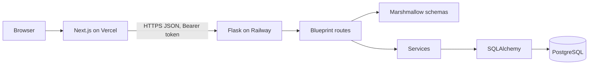
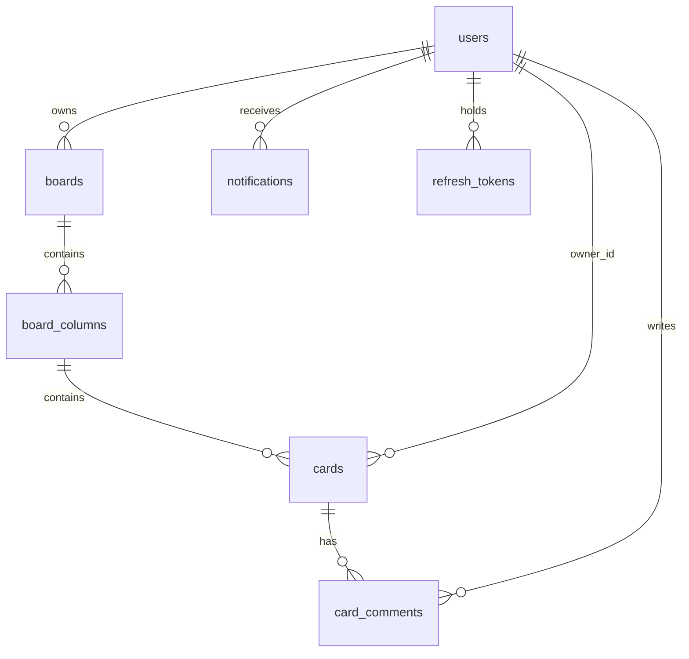
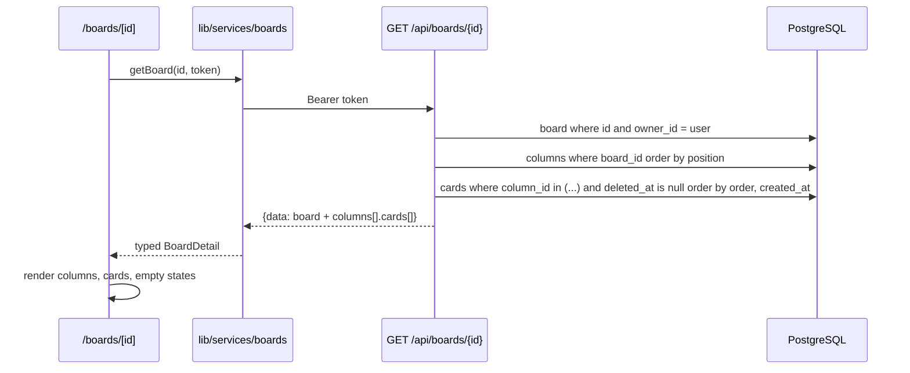

# Design Document: RevoTask (Kanban)

Authoritative copy. `.kiro/specs/` holds an older duplicate set (V-028) and is not maintained.

## 1. Overview

RevoTask is a modular monolith with two separately deployed applications. A Next.js frontend on Vercel calls a Flask REST API on Railway directly from the browser. The API stores data in PostgreSQL through SQLAlchemy. Authentication is a Bearer JWT. Every resource belongs to one user through its board, and every backend service checks that ownership.

This design describes the implemented codebase. All major features (boards, columns, cards, comments, profile, due dates, labels, filter, members, notifications) are built and verified. The design notes remaining open items explicitly.

Key decisions, with the alternative that was rejected:

- **Board read.** `GET /api/boards/{id}` returns board, columns and cards in one response (D2). Rejected: two separate list endpoints, which cost one request per column and need new routes and tests for each.
- **Search.** Runs in the browser over the loaded board (D13). Rejected: a backend search route. The board payload already contains every card, and the MVP has no pagination.
- **Move.** The client sends `{column_id, order}` and then reloads the board. Rejected: trusting local `order` values, because the backend renumbers orders after each move (section 7.3).
- **Navigation shell.** The primary navigation is `AppShell` (collapsible sidebar + `MobileBottomNav`). `Header.tsx` exists in the codebase, but the sidebar (`AppShell` + `Sidebar`) is the main navigation shell. Auth pages live in the `(auth)` route group (`app/(auth)/layout.tsx` provides `AuthBackground`). Dashboard pages live under the root `app/` directory.
- **Prefix.** Target `/api/v1` for all routes (D10), done as one task (P1) with a temporary dual registration.

## 2. Technology stack (locked)

| Layer          | Technology                                                                                                | Source                          |
| -------------- | --------------------------------------------------------------------------------------------------------- | ------------------------------- |
| Frontend       | Next.js 16.4.6, React 19.3.0, TypeScript 5, Tailwind CSS 4.3.3, react-hot-toast                           | `frontend/package.json`         |
| Frontend tests | Jest 30, Testing Library, Playwright 1.65                                                                 | `frontend/package.json`, `e2e/` |
| Backend        | Flask 3.1, Marshmallow 4.4, SQLAlchemy 2.1, Flask-Migrate, PyJWT 2.15, flask-cors 6.0, flasgger, gunicorn | `backend/requirements.txt`      |
| Database       | PostgreSQL                                                                                                | `backend/app/config.py`         |
| Backend tests  | Pytest                                                                                                    | `backend/tests/`                |
| Hosting        | Vercel (frontend), Railway (backend + Postgres)                                                           | `docs/deployment-*.md`          |

No new runtime dependency is introduced by this design, except a shared store for rate limiting (task P3), which needs its own decision before work starts.

## 3. Architecture

The browser calls the Railway origin directly. There are no Vercel rewrites. The backend allows only the origins in `CORS_ALLOWED_ORIGINS`.

Request path in the backend: route handler (decorator `token_required` loads the user) -> Marshmallow `load` -> service function (ownership check, rules, commit) -> serializer function (`*_to_dict`) -> JSON envelope. Errors are `AppException` subclasses or Marshmallow `ValidationError`, converted in `app/common/error_handlers.py`.

Services do not touch Flask request or response objects. Routes do not run queries. This holds in the current code.

## 4. Data model (as implemented)

Source: `backend/app/models/*.py` and migration `e75e73442f21` (the only migration, creates all tables).

| Table            | Columns                                                                                                                                                                                                                                         | Constraints and indexes                                               |
| ---------------- | ----------------------------------------------------------------------------------------------------------------------------------------------------------------------------------------------------------------------------------------------- | --------------------------------------------------------------------- |
| `users`          | `id` UUID PK, `email` String(254), `password_hash` String(255), `name` String(255) null, `timezone` String(64) default `UTC`, `role` String(16) default `member`, `is_active` bool default true, `created_at`, `updated_at`                     | unique index `ix_users_email`; check `role IN ('member','admin')`     |
| `boards`         | `id` UUID PK, `owner_id` FK `users.id` ON DELETE CASCADE, `name` String(100), `is_favorite` BOOLEAN DEFAULT FALSE [Done], `created_at`, `updated_at`                                                                                            | index on `owner_id`. No unique index on name (Planned, R12.5)         |
| `board_columns`  | `id` UUID PK, `board_id` FK `boards.id` ON DELETE CASCADE, `name` String(100), `position` **Float**, `color` VARCHAR(16) DEFAULT `gray` (gray/blue/orange/green/red) [Done], `is_done` BOOLEAN DEFAULT FALSE [Done], `created_at`, `updated_at` | check `position >= 0`; index `(board_id, position)`                   |
| `cards`          | `id` UUID PK, `column_id` FK `board_columns.id` ON DELETE CASCADE, `owner_id` FK `users.id` ON DELETE CASCADE, `title` String(255), `description` Text null, `order` **Float**, `created_at`, `updated_at`, `deleted_at` null                   | check `"order" >= 0`; index `(column_id, order)`; index on `owner_id` |
| `card_comments`  | `id` UUID PK, `card_id` FK `cards.id` ON DELETE CASCADE, `author_id` FK `users.id` ON DELETE CASCADE, `body` Text, `created_at`, `updated_at`                                                                                                   | indexes on `card_id`, `author_id`                                     |
| `notifications`  | `id` UUID PK, `user_id` FK `users.id` ON DELETE CASCADE, `title` String(255), `body` Text null, `is_read` bool default false, `created_at`, `updated_at`                                                                                        | index on `user_id`                                                    |
| `refresh_tokens` | `id` UUID PK, `user_id` FK ON DELETE CASCADE, `token_hash` String(255) unique, `expires_at`, `revoked` bool, `created_at`                                                                                                                       | index `ix_refresh_tokens_user_id`                                     |

Facts that matter for the design:

- `board_columns.position` is a Float in the model, but the column schema accepts an Integer and the service renumbers to 0, 1, 2. Column order is effectively an integer.
- `board_columns.color` is a VARCHAR(16) DEFAULT `gray`. Allowed values: gray/blue/orange/green/red [Done]. Used by `ColumnHeader` to render a colour chip; colour cycles through those five values. See `lib/columnColor.ts`.
- `board_columns.is_done` is a BOOLEAN DEFAULT FALSE [Done]. Used by the Reports page for completion calculation and by board import/export.
- `cards.order` is a Float. The service renumbers it to whole numbers after every move and after the card is created at the end (section 7.3).
- `cards.deleted_at` exists, but `delete_card` calls `db.session.delete`, which removes the row. Only `analytics/service.py` filters on `deleted_at`. Planned: soft delete (D7, task B3).
- Deleting a board, column or card removes children by database cascade (`passive_deletes=True` on the relationships). This is a hard delete.
- Cards have `priority` (nullable, `low|medium|high`, check constraint `ck_cards_priority`), `due_date` (R15), `labels[]` (R16), and `assignee_ids[]` (R18, via `card_assignees`). `status` does not exist (the column is the status; `is_done` is on the column, not the card).
- `boards.is_favorite` is a BOOLEAN DEFAULT FALSE [Done]. Toggled via `boardsService.setFavorite()` PATCH call. The sidebar shows a Favorites section for favorited boards.
- `cards.owner_id` duplicates the board owner. Authorization uses the board join, not `cards.owner_id`.
- Timestamps are `timestamptz`, serialized with `isoformat()`.

## 5. API

### 5.1 Conventions

| Topic                  | Current behaviour                                                                                                                                                                                                                                                                                                                                                                                                                                                                                       |
| ---------------------- | ------------------------------------------------------------------------------------------------------------------------------------------------------------------------------------------------------------------------------------------------------------------------------------------------------------------------------------------------------------------------------------------------------------------------------------------------------------------------------------------------------- |
| Base                   | Browser uses `NEXT_PUBLIC_API_BASE_URL` (origin only) plus the path, for example `https://<railway-host>/api/boards`. `frontend/next.config.ts` rejects a value with a path on Vercel.                                                                                                                                                                                                                                                                                                                  |
| Prefix                 | Split. `/api/v1/...` for cards. `/api/...` for everything else. Target `/api/v1` for all (D10, task P1). `api-contracts.md` section 3.2 shows a base URL that includes `/api/v1`. This repository's `.env.example` holds the origin only. When P1 lands, the frontend path constants carry `/api/v1` and the variable stays an origin.                                                                                                                                                                  |
| Auth                   | `Authorization: Bearer <access_token>`. HS256 JWT with `sub`, `role`, `exp` (15 minutes). `token_required` loads the user, then passes it as the first argument. A missing header, bad token, expired token or unknown user returns 401 `UNAUTHORIZED`.                                                                                                                                                                                                                                                 |
| Success                | `{"data": <object or list>}`. Delete returns 204 with an empty body.                                                                                                                                                                                                                                                                                                                                                                                                                                    |
| Error                  | `{"error": {"code", "message", "details"}}`. `details` is `null` or a field map for validation.                                                                                                                                                                                                                                                                                                                                                                                                         |
| Field names            | `snake_case`. `api-contracts.md` section 5.2 asks for `camelCase`. Drift recorded as V-020 and not changed here.                                                                                                                                                                                                                                                                                                                                                                                        |
| Timestamps             | ISO 8601 from `isoformat()`. The `timestamptz` columns return an offset. `api-contracts.md` asks for `Z` suffix. Not changed.                                                                                                                                                                                                                                                                                                                                                                           |
| Unknown request fields | Rejected with 400 (Marshmallow default).                                                                                                                                                                                                                                                                                                                                                                                                                                                                |
| Pagination             | Notifications only: `page`, `per_page` (max 100), `meta {page, per_page, total}`. `api-contracts.md` asks for `perPage` and `meta.pagination`. V-020.                                                                                                                                                                                                                                                                                                                                                   |
| Error codes in use     | `VALIDATION_ERROR` 400, `UNAUTHORIZED` 401, `INVALID_CREDENTIALS` 401, `BOARD_NOT_FOUND` / `COLUMN_NOT_FOUND` / `CARD_NOT_FOUND` / `COMMENT_NOT_FOUND` / `NOTIFICATION_NOT_FOUND` / `USER_NOT_FOUND` 404, `COMMENT_ACCESS_DENIED` 403, `RESOURCE_CONFLICT` 409, `HTTP_ERROR` (any framework HTTP error, for example 404 unknown URL, 405, 415), `INTERNAL_ERROR` 500. `api-contracts.md` section 7.2 names `UNAUTHENTICATED`, `RESOURCE_NOT_FOUND`, `DUPLICATE_RESOURCE`, `RATE_LIMIT_EXCEEDED`. V-020. |

### 5.2 Route table (canonical routes)

All routes except register, login and health require the Bearer token. "Err" lists the error codes a client must handle in addition to 401 and 500.

| #   | Method | Path (current)                             | Request fields                                                                                                                      | Success                                                                    | Err                                             | Status                   |
| --- | ------ | ------------------------------------------ | ----------------------------------------------------------------------------------------------------------------------------------- | -------------------------------------------------------------------------- | ----------------------------------------------- | ------------------------ |
| 1   | POST   | `/api/auth/register`                       | `name` string 1..255 (trimmed), `email` email, `password` string 8+ with lower, upper, digit                                        | 201 user                                                                   | 400, 409 `RESOURCE_CONFLICT`                    | Done                     |
| 2   | POST   | `/api/auth/login`                          | `email`, `password` (same policy as register, see R1.7)                                                                             | 200 `{access_token, refresh_token, user{id,email,role,timezone}}`          | 400, 401 `INVALID_CREDENTIALS`                  | Done                     |
| 3   | GET    | `/api/health` (public)                     | none                                                                                                                                | 200 `{status, db}`                                                         | none                                            | Done                     |
| 4   | POST   | `/api/boards`                              | `name` 1..100 (trimmed, not blank)                                                                                                  | 201 board                                                                  | 400, 409                                        | Done                     |
| 5   | GET    | `/api/boards`                              | none                                                                                                                                | 200 `[board]` oldest first                                                 | none                                            | Done                     |
| 6   | GET    | `/api/boards/{board_id}`                   | none                                                                                                                                | 200 board with `columns[].cards[]` (D2)                                    | 404 `BOARD_NOT_FOUND`                           | Done                     |
| 7   | PATCH  | `/api/boards/{board_id}`                   | `name` 1..100 optional                                                                                                              | 200 board                                                                  | 400, 404, 409                                   | Done                     |
| 8   | DELETE | `/api/boards/{board_id}`                   | none                                                                                                                                | 204                                                                        | 404                                             | Done                     |
| 9   | POST   | `/api/boards/{board_id}/columns`           | `name` 1..100, `position` int >= 0 optional                                                                                         | 201 column                                                                 | 400, 404                                        | Done                     |
| 10  | PATCH  | `/api/columns/{column_id}`                 | `name` 1..100, `position` int >= 0, both optional                                                                                   | 200 column                                                                 | 400, 404 `COLUMN_NOT_FOUND`                     | Done                     |
| 11  | DELETE | `/api/columns/{column_id}`                 | none                                                                                                                                | 204. 409 `RESOURCE_CONFLICT` while column has cards (D3)                   | 404                                             | Done                     |
| 12  | PATCH  | `/api/boards/{board_id}/columns/reorder`   | `ordered_ids` list of UUID, 1+ items                                                                                                | 200 `[column]` ordered                                                     | 400, 404                                        | Done                     |
| 13  | POST   | `/api/v1/columns/{column_id}/cards`        | `title` 1..255 (trimmed, not blank), `description` 0..2000 default `""`, `priority` low/medium/high optional, `due_date` optional   | 201 card                                                                   | 400, 404 `COLUMN_NOT_FOUND`                     | Done                     |
| 14  | PATCH  | `/api/v1/cards/{card_id}`                  | `title`, `description`, `priority`, `due_date` all optional                                                                         | 200 card                                                                   | 400, 404 `CARD_NOT_FOUND`                       | Done                     |
| 15  | DELETE | `/api/v1/cards/{card_id}`                  | none                                                                                                                                | 204. Sets `deleted_at` (D7); board read excludes soft-deleted cards.       | 404                                             | Done                     |
| 16  | PATCH  | `/api/v1/cards/{card_id}/position`         | `column_id` UUID, `order` float >= 0 (both required)                                                                                | 200 card                                                                   | 400, 404 `CARD_NOT_FOUND` or `COLUMN_NOT_FOUND` | Done                     |
| 17  | GET    | `/api/cards/{card_id}/comments`            | none                                                                                                                                | 200 `[comment]` oldest first                                               | 404                                             | Done                     |
| 18  | POST   | `/api/cards/{card_id}/comments`            | `body` 1..2000 (trimmed, not blank)                                                                                                 | 201 comment                                                                | 400, 404                                        | Done                     |
| 19  | PATCH  | `/api/comments/{comment_id}`               | `body` 1..2000 optional                                                                                                             | 200 comment                                                                | 400, 403 `COMMENT_ACCESS_DENIED`, 404           | Done                     |
| 20  | DELETE | `/api/comments/{comment_id}`               | none                                                                                                                                | 204                                                                        | 403, 404                                        | Done                     |
| 21  | GET    | `/api/users/me`                            | none                                                                                                                                | 200 user                                                                   | none                                            | Done                     |
| 22  | PATCH  | `/api/users/me`                            | `name` 0..255, `timezone` IANA name 0..64, both optional                                                                            | 200 user                                                                   | 400                                             | Done                     |
| 23  | GET    | `/api/notifications?page=&per_page=`       | query ints (per_page capped at 100)                                                                                                 | 200 `[notification]` with `meta`                                           | none                                            | Done (UI: `/inbox`)      |
| 24  | PATCH  | `/api/notifications/{id}/read`             | none                                                                                                                                | 200 notification                                                           | 404                                             | Done (UI: `/inbox`)      |
| 25  | GET    | `/api/analytics/boards/{board_id}/summary` | none                                                                                                                                | 200 `{board_id, total_cards, completed_cards}`                             | 404                                             | Done                     |
| 26  | GET    | `/api/v1/workspace/summary`                | none (Bearer required)                                                                                                              | 200 `{workspace_name, projects (board count), tasks count, members count}` | none                                            | Done                     |
| —   | GET    | `/api/boards/{board_id}/background`        | Board background is stored client-side (localStorage per board via `hooks/useBoardBg.ts`). No backend route exists for backgrounds. | n/a                                                                        | n/a                                             | Done — client-side only  |
| 27  | GET    | `/api/boards/{board_id}/members`           | none                                                                                                                                | 200 `[member]`                                                             | 404                                             | Done (members blueprint) |
| 28  | POST   | `/api/boards/{board_id}/members`           | `email` or `user_id`, `role`                                                                                                        | 201 member                                                                 | 400, 404, 409                                   | Done (members blueprint) |
| 29  | DELETE | `/api/boards/{board_id}/members/{user_id}` | none                                                                                                                                | 204                                                                        | 404                                             | Done (members blueprint) |
| 30  | GET    | `/api/boards/{board_id}/labels`            | none                                                                                                                                | 200 `[label]`                                                              | 404 `BOARD_NOT_FOUND`                           | Done (labels blueprint)  |
| 31  | POST   | `/api/boards/{board_id}/labels`            | `name` string 1..50 trimmed, `color` enum (required)                                                                                | 201 label                                                                  | 400, 404, 409                                   | Done (labels blueprint)  |
| 32  | PATCH  | `/api/labels/{label_id}`                   | `name`, `color`, at least one                                                                                                       | 200 label                                                                  | 400, 404, 409                                   | Done (labels blueprint)  |
| 33  | DELETE | `/api/labels/{label_id}`                   | none                                                                                                                                | 204                                                                        | 404 `LABEL_NOT_FOUND`                           | Done (labels blueprint)  |

Response objects (field names exactly as serialized):

- **user** (register, `GET /users/me`, `PATCH /users/me`): `id`, `email`, `name`, `timezone`, `role`, `is_active`, `created_at`, `updated_at`.
- **board**: `id`, `name`, `user_id`, `is_favorite`, `created_at`, `updated_at`. (`user_id` is the owner.)
- **column**: `id`, `board_id`, `name`, `position`, `color`, `is_done`, `created_at`, `updated_at`.
- **card**: `id`, `column_id`, `owner_id`, `title`, `description`, `order`, `priority` (nullable, `low|medium|high`), `due_date` (R15), `labels[]` (R16), `assignee_ids[]` (R18), `can_move` (computed: true when the caller is the board owner or a member who can modify the card), `deleted_at`, `created_at`, `updated_at`. No `status` (the column is the status).
- **comment**: `id`, `card_id`, `author_id`, `body`, `created_at`, `updated_at`.
- **notification**: `id`, `user_id`, `title`, `body`, `is_read`, `created_at`, `updated_at`.
- **board with contents** (route 6): the board object plus `columns`: a list of column objects ordered by `position`, each with `cards`: a list of card objects ordered by `order`, then `created_at`, excluding rows with `deleted_at`. Adding a field is a non-breaking change (`api-contracts.md` section 15).

#### 5.2.1 Changes made in the Kanban UI work (now committed)

These are in the working tree and covered by pytest (`backend/tests/api/`, `backend/tests/test_comments.py`). Full contract in `docs/api/README.md`.

- Route 6 now returns the board with `columns[].cards[]` as described above (D2). Route 11 returns 409 `RESOURCE_CONFLICT` while the column has non-deleted cards (D3). Route 15 sets `deleted_at` instead of removing the row (D7); every card read filters it out.
- `GET /api/v1/cards` (Bearer, see section 17 route table). Query: `search` (1..100 characters, case-insensitive, matches `title` or `description`, `%` and `_` taken literally), `board_id` (UUID), `mine` (boolean, only cards the caller created), `page` (>= 1, default 1), `per_page` (1..100, default 20). Unknown or repeated keys return 400 `VALIDATION_ERROR`. Only boards the caller owns are searched. Order: board name, column position, card `order`, card id. Response: `data` = card objects plus `board_id`, `board_name`, `column_name`; `meta` = `{page, per_page, total}`. Because `cards_bp` is registered twice (section 5.3), the same route also answers at `GET /api/v1/columns`; no client uses that URL. Used by the board search box (D13) and `/my-tasks` (D8).
- Route 23: `meta` gains `unread_count` (all unread notifications of the caller, not only the current page).
- Notification producer (D6): `POST /api/cards/{card_id}/comments` stages one notification for the board owner in the same commit as the comment, with `title` "New comment on <card title>" and `body` the comment text (both truncated). The owner is notified on their own comments too, because boards have one owner.
- Comment object: adds `author_name` (the author's `name`, or the part of the email before `@` when the name is empty). `author_id` stays.
- Route 2: `user` in the login response adds `name`.
- Routes 27 to 31 (labels) and the `due_date` and `labels` fields on card objects are implemented in section 17 (R15, R16). They are built and verified.
- Route 16: when the requested `order` equals another card's `order` in the destination column, the moved card is placed first (R5.10). Orders are renumbered after the move, so the client reloads the board.

### 5.3 Extra URLs from double registration

`backend/app/__init__.py` registers three blueprints twice. From reading the code (not executed), these additional URLs exist:

| Blueprint     | Intended prefix               | Extra prefix      | Extra URLs that result                                                                                                                                                                                                                                       |
| ------------- | ----------------------------- | ----------------- | ------------------------------------------------------------------------------------------------------------------------------------------------------------------------------------------------------------------------------------------------------------ |
| `cards_bp`    | `/api/v1/cards`               | `/api/v1/columns` | `PATCH`/`DELETE /api/v1/columns/{card_id}`, `PATCH /api/v1/columns/{card_id}/position`. And at the intended prefix, `POST /api/v1/cards/{column_id}/cards`                                                                                                   |
| `columns_bp`  | `/api/boards`, `/api/columns` | each other        | `POST /api/columns/{board_id}/columns`, `PATCH /api/columns/{board_id}/columns/reorder`, and `PATCH`/`DELETE /api/boards/{column_id}`. The last two have the same pattern as the board routes, which are registered first. They are expected to be shadowed. |
| `comments_bp` | `/api/cards`, `/api/comments` | each other        | `PATCH`/`DELETE /api/cards/{comment_id}`, `GET`/`POST /api/comments/{card_id}/comments`                                                                                                                                                                      |

They are not part of the contract. Task P1 registers each blueprint once.

## 6. Frontend

### 6.1 Structure

The repository does not follow the `features/` layout of `structure.md` section 5 (V-018). This design keeps the existing flat layout (`app/`, `components/`, `hooks/`, `lib/`, `context/`) and does not migrate it. New files go next to their siblings.

### 6.2 Pages

| Route          | File                                                 | Guard                              | Current                                                                                                                                                                         | MVP plan                  |
| -------------- | ---------------------------------------------------- | ---------------------------------- | ------------------------------------------------------------------------------------------------------------------------------------------------------------------------------- | ------------------------- |
| `/`            | `app/page.tsx` renders `BoardsGrid`                  | `BoardsGrid` redirects to `/login` | Lists boards with `CreateBoardForm`. Board tiles show star toggle for favorites.                                                                                                | Done (F2). [Done]         |
| `/login`       | `app/(auth)/login/page.tsx`                          | none                               | Works. `router.push("/")` on success. Password visibility toggle, "Register" link, `role="alert"` errors (R29). `app/(auth)/layout.tsx` provides `AuthBackground`.              | Done (R29). [Done]        |
| `/register`    | `app/(auth)/register/page.tsx`                       | none                               | Works. Sends `name`, `email`, `password`. Goes to `/login`. Password visibility toggle, "Sign in" link (R29).                                                                   | Done (R29). [Done]        |
| `/boards/[id]` | `app/boards/[id]/page.tsx` renders `BoardDetailView` | `useRequireAuth`                   | Full Kanban board with columns, cards, card detail dialog, filter bar, drag and drop, and view toggle (Kanban/List/Calendar).                                                   | Done (F4–F9, F11). [Done] |
| `/profile`     | `app/profile/page.tsx`                               | `useRequireAuth`                   | Loads `GET /users/me`, sends `{name, timezone}`.                                                                                                                                | Done (F3, F10). [Done]    |
| `/my-tasks`    | `app/my-tasks/page.tsx` renders `MyTasksList`        | `useRequireAuth`                   | Shows cards assigned to or owned by the current user, grouped by board.                                                                                                         | Done (F12, D8). [Done]    |
| `/inbox`       | `app/inbox/page.tsx`                                 | `useRequireAuth`                   | Paginated notification list; unread filter; per-item mark-read; mark-all-read; `?item=` query param highlight. Component: `app/inbox/page.tsx`.                                 | Done (D6). [Done]         |
| `/notes`       | `app/notes/page.tsx`                                 | `useRequireAuth`                   | Personal notes stored in localStorage; create/edit/pin/delete/search. No backend. Component: `app/notes/page.tsx`.                                                              | Done. [Done]              |
| `/reports`     | `app/reports/page.tsx`                               | `useRequireAuth`                   | Workspace stats dashboard: stat tiles, completion ring, health bar, Refresh. Calls `GET /api/v1/workspace/summary` + card/notification APIs. Component: `app/reports/page.tsx`. | Done. [Done]              |

`app/layout.tsx` wraps all pages in `AuthProvider` (`context/AuthContext.tsx`), `ErrorBoundary` and a single `Toaster`.

### 6.3 Components and hooks

| File                                                                                       | Used today                          | MVP plan                                                                                                                   |
| ------------------------------------------------------------------------------------------ | ----------------------------------- | -------------------------------------------------------------------------------------------------------------------------- |
| `context/AuthContext.tsx`                                                                  | yes                                 | Direct `fetch` in `login` replaced with `apiClient` (F1). `logout()` stays client-only (R9).                               |
| `lib/apiClient.ts`                                                                         | yes (`get`, `post`, `patch`, `del`) | Done. Typed services built on top (F1).                                                                                    |
| `lib/errors.ts`                                                                            | yes (`ApiError`)                    | Done.                                                                                                                      |
| `components/board/BoardsGrid.tsx`                                                          | `/`                                 | Done. `CreateBoardForm` added (F2). Uses `BoardCard` for board tiles. Star toggle for favorites.                           |
| `components/board/BoardCard.tsx`                                                           | `/` tiles                           | Done. Used for cards inside columns. Labels `Open card: <title>` and `Delete card: <title>` used by the e2e journey.       |
| `components/board/BoardDetailView.tsx`                                                     | `/boards/[id]`                      | Done (F4). Full Kanban with filter, drag, view toggle, sort, group-by, import/export.                                      |
| `components/board/ColumnHeader.tsx`                                                        | board page                          | Done (F5). `onRename`, `onColumnDelete`, colour chip (cycles gray/blue/orange/green/red).                                  |
| `components/board/AddCardForm.tsx`                                                         | yes (mounted per column)            | Done (F6). Mounted per column. Supports title and optional description.                                                    |
| `components/board/CardDetailModal.tsx`                                                     | yes (mounted)                       | Done (F7). Edit, delete, comment edit/delete, move-to select, due date, labels, assignees.                                 |
| `components/board/CommentList.tsx`                                                         | via modal                           | Done. Edit and delete callbacks implemented (F7).                                                                          |
| `components/board/FilterBar.tsx`, `hooks/useBoardFilters.ts`, `hooks/useFilterShortcut.ts` | yes (mounted in `BoardDetailView`)  | Done (R17). The board filter bar. Replaced `SearchBar` and `useCardSearch` (both deleted).                                 |
| `hooks/useDragAndDrop.ts`                                                                  | yes (mounted)                       | Done (F8). Payload and mounting fixed.                                                                                     |
| `components/shared/BaseModal.tsx`, `BaseButton.tsx`, `BaseBadge.tsx`                       | yes                                 | Done.                                                                                                                      |
| `components/shared/NotificationBell.tsx`, `hooks/useNotifications.ts`                      | yes (mounted in sidebar)            | Done (D6). Mounted in sidebar/header area.                                                                                 |
| `components/board/MyTasksList.tsx`                                                         | `/my-tasks`                         | Done (F12, D8). Loads `GET /api/v1/cards?mine=true`. Not removed.                                                          |
| `hooks/useRequireAuth.ts`                                                                  | yes                                 | Done. Used by `/`, `/boards/[id]`, `/profile`, `/my-tasks`, `/inbox`, `/notes`, `/reports`.                                |
| `components/shared/Header.tsx`                                                             | yes (exists)                        | Done. The sidebar (`AppShell` + `Sidebar`) is now the primary navigation shell. `Header.tsx` exists for supplementary use. |
| `components/board/CreateBoardForm.tsx`                                                     | yes                                 | Done (F2).                                                                                                                 |
| `components/board/AddColumnForm.tsx`                                                       | n/a                                 | Not created as a separate component; the add-column form lives inline in `BoardDetailView`.                                |
| `lib/services/{boards,columns,cards,comments,users,labels,members,notifications}.ts`       | yes                                 | Done. All service modules implemented (F1, F15, R18).                                                                      |
| `lib/types/api.ts`                                                                         | yes                                 | Done. TypeScript types matching section 5.2 response objects.                                                              |
| `lib/apiPaths.ts`                                                                          | yes                                 | Done. Centralised path constants.                                                                                          |
| `lib/cardOrder.ts`                                                                         | yes                                 | Done. Pure function computing the new `order` from neighbours (F8).                                                        |

Status after the Kanban UI work (now committed and live):

- Built as planned: `CreateBoardForm`, board page on one request with `BoardColumn` (add column, rename, delete with a 409 message), `AddCardForm` per column, `CardDetailModal` (edit, Move to column, delete, comments with `author_name`, edit and delete own comments), drag and drop through `useDragAndDrop` + `computeCardOrder`, profile with `{name, timezone}`, `lib/types/api.ts`, `lib/apiPaths.ts`, `lib/services/*Service.ts`. No raw `fetch` remains outside `lib/apiClient.ts`.
- Navigation shell: the primary navigation is `AppShell` (sidebar + `MobileBottomNav`). `Header.tsx` exists but the sidebar (`Sidebar.tsx` + `SidebarNav.tsx`) replaced it as the main navigation shell. `SidebarNav.tsx` links to `/boards`, `/my-tasks`, `/profile`, `/notes`, `/inbox`, `/reports`. `NotificationBell` is mounted in the sidebar/header area (D6).
- `/my-tasks` is kept and `MyTasksList` loads `GET /api/v1/cards?mine=true` (D8). `FilterBar` + `useBoardFilters` + `useFilterShortcut` are the board filter. The filter bar calls `GET /api/v1/cards?search=&board_id=` (D13) and opens the chosen card in the dialog.
- Unauthenticated pages redirect to `/login?next=<path>` and login returns to that path. A reload still requires login again (D4).

### 6.4 Additional frontend features

The following features are implemented and committed. They were not part of the original MVP plan.

| Feature                     | Key files                                                                                  | Description                                                                                                            | Status             |
| --------------------------- | ------------------------------------------------------------------------------------------ | ---------------------------------------------------------------------------------------------------------------------- | ------------------ |
| **Board favorites**         | `lib/services/boardsService.ts` (`setFavorite()`), `Sidebar.tsx`                           | PATCH call toggles `boards.is_favorite`. Sidebar shows Favorites section. `BoardsGrid` shows star toggle.              | Done               |
| **Board background picker** | `components/board/BackgroundPicker.tsx`, `lib/board-backgrounds.ts`, `hooks/useBoardBg.ts` | Board-scoped background color/image picker. Stored in localStorage per board.                                          | Done               |
| **Board list view**         | `components/board/BoardListView.tsx`                                                       | Renders cards as rows grouped by column. View toggle in `BoardDetailView` (Kanban/List/Calendar).                      | Done               |
| **Board import/export**     | `lib/boardImportExport.ts`                                                                 | Export downloads JSON; import creates columns and cards. UI in `BoardDetailView`.                                      | Done               |
| **Card sort controls**      | `lib/sortCards.ts`                                                                         | Sort dropdown in `BoardDetailView` (Manual/Due date/Priority/Created/Title).                                           | Done               |
| **Card group-by-priority**  | `lib/groupCards.ts`                                                                        | Group toggle in `BoardDetailView` (None/Priority).                                                                     | Done               |
| **Column colour control**   | `lib/columnColor.ts`, `components/board/ColumnHeader.tsx`                                  | `ColumnHeader` renders colour chip; colour cycles through gray/blue/orange/green/red. Stored in `board_columns.color`. | Done               |
| **Column is_done flag**     | `board_columns.is_done`                                                                    | Used by Reports page for completion calculation and by `boardImportExport`.                                            | Done               |
| **WorkspaceSwitcher**       | `components/shared/WorkspaceSwitcher.tsx`                                                  | Shows workspace name + stats popup in sidebar. Currently displays a placeholder message.                               | Done — placeholder |
| **Sidebar navigation**      | `components/shared/sidebar/SidebarNav.tsx`                                                 | Nav links to /boards, /my-tasks, /profile, /notes, /inbox, /reports. Constants in `sidebar/constants.ts`.              | Done               |

### 6.4 State

- Auth: `AuthContext` holds `token` and `currentUser` in React state. Nothing is persisted (D4). A reload clears them.
- Board page: `BoardDetailView` owns `{status, board, columns[].cards[]}` from one request. Mutations call a service, then update local state or reload the board (section 7). The search text is local state and filters the rendered cards only.
- Errors: every failed call goes through `ApiError`. `401` redirects to `/login`. Other errors show a toast or an inline `role="alert"` message. No error becomes an empty state.

## 7. Data flows

### 7.1 Read a board (D2)

Rules: three queries regardless of column count (N4.1). A missing or foreign board returns 404 `BOARD_NOT_FOUND` before the other queries run. A board with no columns returns `columns: []`. A column with no cards returns `cards: []`.

### 7.2 Create flows

- Create board: `CreateBoardForm` -> `POST /api/boards {name}` -> append to list. On 409 the form shows the message and keeps the name.
- Add column: `AddColumnForm` -> `POST /api/boards/{id}/columns {name}` -> append column with `cards: []`.
- Add card: `AddCardForm` -> `POST /api/v1/columns/{column_id}/cards {title, description?}` -> append to the column.

### 7.3 Move a card

The backend `move_card` sets `column_id` and `order` from the request, then renumbers every card in the destination column, and in the source column when it differs, to `0.0, 1.0, 2.0, ...` sorted by `(order, created_at)`.

Consequence: after any move, the stored orders no longer equal the values the client computed. A client that keeps its local `order` values and computes the next midpoint from them can place the next card in the wrong spot, because the server compares the midpoint with the renumbered values.

Design: after the request settles (success or failure), `BoardDetailView` reloads the board (section 7.1) and replaces its state. Between the drop and the reload the UI shows the optimistic position. On failure the reload restores the previous state and a toast shows the error.

New `order` on drop (`lib/cardOrder.ts`), with neighbours taken from the target column as currently rendered (excluding the dragged card):

| Drop position                       | `order`                   |
| ----------------------------------- | ------------------------- |
| Empty column                        | `0.0`                     |
| Before the first card (first.order) | `first.order / 2`         |
| Between a and b                     | `(a.order + b.order) / 2` |
| After the last card (last.order)    | `last.order + 1.0`        |

Tie at the top: after any move the server renumbers the column to 0, 1, 2, so the first card always has order 0, and the client value for a drop before it is  / 2 = 0. The new card then ties with the first card. The backend therefore breaks ties in favour of the moved card (R5.10, task B5): in the renumbering sort, the moved card comes before another card with the same order. A test drops a card at the top and expects it first after a reload.

Second backend rule (R5.3): the destination column must belong to the same board as the card (task B5).

### 7.4 Delete flows

- Card (D7): `DELETE /api/v1/cards/{id}`, confirmation first. Backend sets `deleted_at`. The board read filters it.
- Column (D3): `DELETE /api/columns/{id}`. 409 while it has non-deleted cards. The UI shows "Move or delete this column's cards first."
- Board (D1): `DELETE /api/boards/{id}`, confirmation names the board and card count. Card count comes from the board read, so the confirmation is available only on the board page. The list page shows a count-less confirmation ("Delete board X and everything in it?").

### 7.5 Session

Login stores `access_token` and `user` in React state. Nothing is written to browser storage. Reload clears the state, and each guarded page redirects to `/login` (D4). Logout clears the state. The access token stays valid on the server until it expires (15 minutes). Server-side revocation needs R9.4.

## 8. Contract mismatches found and the resolution chosen

From `.agents/tasks/requirements-gap-report.md` section 4, re-checked against the code.

| #   | Frontend today                                                                          | Backend today                                                      | Resolution                                                                      | Task    |
| --- | --------------------------------------------------------------------------------------- | ------------------------------------------------------------------ | ------------------------------------------------------------------------------- | ------- |
| 5   | `GET /api/boards/{id}/columns` (`BoardDetailView`)                                      | Route does not exist (405)                                         | Remove the call. Use the embedded board read (D2).                              | B1, F4  |
| 6   | `GET /api/v1/cards?column_id=` per column                                               | Route does not exist (404)                                         | Same as above.                                                                  | B1, F4  |
| 6a  | Card field `position`                                                                   | `order`                                                            | Frontend types use `order`. Backend unchanged.                                  | F4, F8  |
| 7   | `GET /api/cards?assignee=me` (`MyTasksList`)                                            | Route and assignee do not exist                                    | Remove page and component (D8).                                                 | F12     |
| 8   | `GET /api/cards?search=&assignee=&due_date_from=&due_date_to=&label=` (`useCardSearch`) | Route and those fields do not exist                                | Client-side search on title and description (D9, D13). Remove the hook's fetch. | F11     |
| 9   | Notification fields `message`, `read`, `createdAt` (`useNotifications`)                 | `title`, `body`, `is_read`, `created_at`                           | Out of MVP (D6). When it returns, the frontend adapts to the backend shape.     | F1, F13 |
| 10  | `PATCH /api/users/me {email, timezone}`                                                 | Accepts `name`, `timezone` only                                    | Send `{name, timezone}`. Email read-only (D5).                                  | F10     |
| 11  | `PATCH /api/v1/cards/{id}/position {column_id, position}`                               | Requires `{column_id, order}`                                      | Send `order`. Add contract test.                                                | F8, C1  |
| 2   | Login response `user` has no `name`                                                     | `login` returns `id`, `email`, `role`, `timezone`                  | No backend change. `/profile` loads `GET /api/users/me`.                        | F10     |
| new | `priority`, `status` sent by nobody                                                     | Accepted and dropped by card schemas                               | Reject them (R4.4). No consumer exists.                                         | B8      |
| new | Frontend assumes sessions survive reload                                                | They do not (V-009)                                                | Documented limitation (R9.1). e2e logs in again.                                | E1      |
| new | `.env.example` and Vercel use an origin as base URL                                     | `api-contracts.md` shows base URL with `/api/v1`                   | Keep origin. Put the prefix in `lib/apiPaths.ts`.                               | P1      |
| new | Path ids are parsed with `uuid.UUID(value)` in every route                              | An invalid id raises `ValueError`, handled as 500 `INTERNAL_ERROR` | Use the `<uuid:...>` converter, so a bad id is a 404. (R10.11)                  | B11     |

## 9. Error handling

| Operation                                      | Failure                                                           | Recoverable                | Caller receives                                                                                                                     | Logged                                     |
| ---------------------------------------------- | ----------------------------------------------------------------- | -------------------------- | ----------------------------------------------------------------------------------------------------------------------------------- | ------------------------------------------ |
| Any protected route                            | Missing, malformed, expired or unknown-user token                 | Yes (log in again)         | 401 `UNAUTHORIZED`, message "Authentication required."                                                                              | No                                         |
| Any write route                                | Body fails schema (type, length, unknown field, blank after trim) | Yes (fix input)            | 400 `VALIDATION_ERROR`, `details` = field map                                                                                       | No                                         |
| Any route                                      | Body not JSON                                                     | Yes                        | 415 `HTTP_ERROR` from Flask                                                                                                         | No                                         |
| Any route                                      | Path id not a UUID                                                | Yes                        | Current: 500 `INTERNAL_ERROR`. Planned: 404 `HTTP_ERROR` (B11)                                                                      | Current: error with stack trace            |
| Any route                                      | Unknown URL or method                                             | Yes                        | 404 or 405 `HTTP_ERROR`                                                                                                             | No                                         |
| Register                                       | Email exists                                                      | Yes                        | 409 `RESOURCE_CONFLICT`                                                                                                             | Yes, `error` level with type, code, status |
| Login                                          | Unknown email or wrong password                                   | Yes                        | 401 `INVALID_CREDENTIALS`                                                                                                           | Yes (as above)                             |
| Board create or rename                         | Name used by the user (case-insensitive)                          | Yes                        | 409 `RESOURCE_CONFLICT`                                                                                                             | Yes                                        |
| Board, column, card, comment, analytics routes | Resource missing or not owned                                     | Yes                        | 404 `*_NOT_FOUND`                                                                                                                   | Yes                                        |
| Comment edit and delete                        | Not the author                                                    | Yes                        | Current 403 `COMMENT_ACCESS_DENIED`. Planned 404 (B6)                                                                               | Yes                                        |
| Column delete                                  | Column has cards (Planned, D3)                                    | Yes (move or delete cards) | 409 `RESOURCE_CONFLICT`, message "Column still has cards"                                                                           | Yes                                        |
| Move card                                      | Destination column not owned or on another board                  | Yes                        | 404 `COLUMN_NOT_FOUND`                                                                                                              | Yes                                        |
| Any write                                      | Database error on commit                                          | Not by the caller          | Session rolled back. 500 `INTERNAL_ERROR`, message "An unexpected server error occurred"                                            | Yes, `logger.exception` with stack trace   |
| Any write                                      | Two concurrent board creates with the same name                   | Yes                        | One succeeds. Without the unique index (R12.5) both may. With it, the loser gets a database error that the service must map to 409. | Yes                                        |
| Frontend                                       | 401 from any call                                                 | Yes                        | Redirect to `/login`, token cleared                                                                                                 | No                                         |
| Frontend                                       | Network failure or timeout                                        | Yes                        | Inline error with a Retry control, typed input kept                                                                                 | No                                         |
| Frontend                                       | Optimistic move fails                                             | Yes                        | State reloaded from server, toast with the message                                                                                  | No                                         |

Logging today: `AppException` is logged at `error` level with `error_type`, `error_code`, `status_code`. Validation errors and HTTP errors are not logged. There is no request id, no user id and no log of 401s from `token_required`. N1.10 is Planned.

## 10. Input validation

Marshmallow schemas in each blueprint's `schema.py` own request validation. The service owns business rules. The database owns constraints. The frontend validates for usability only.

| Input                              | Required                  | Type and limits                                                                                                  | On failure                          |
| ---------------------------------- | ------------------------- | ---------------------------------------------------------------------------------------------------------------- | ----------------------------------- |
| `name` (register)                  | yes                       | string 1..255 after trim                                                                                         | 400, field `name`                   |
| `email`                            | yes                       | valid email; stored lowercase                                                                                    | 400                                 |
| `password`                         | yes                       | string 8+, lower, upper, digit                                                                                   | 400 with policy message             |
| `name` (board, column)             | board, column create: yes | string 1..100 after trim, not blank                                                                              | 400, field `name`                   |
| `position` (column)                | no                        | integer >= 0                                                                                                     | 400                                 |
| `ordered_ids`                      | yes                       | non-empty list of UUID                                                                                           | 400. Unknown id for this board: 404 |
| `title` (card)                     | create: yes               | string 1..255 after trim, not blank                                                                              | 400                                 |
| `description` (card)               | no                        | string up to 2000, default `""`                                                                                  | 400                                 |
| `column_id` (move)                 | yes                       | UUID                                                                                                             | 400                                 |
| `order` (move)                     | yes                       | float >= 0                                                                                                       | 400                                 |
| `body` (comment)                   | create: yes               | string 1..2000 after trim, not blank                                                                             | 400                                 |
| `timezone`                         | no                        | IANA name, up to 64                                                                                              | 400                                 |
| `page`, `per_page` (notifications) | no                        | ints. `per_page` capped at 100. A non-integer value falls back to the default. Negative values are not rejected. | Not validated today                 |
| Path ids                           | yes                       | UUID                                                                                                             | Planned 404 (B11)                   |
| Search text (frontend)             | no                        | 0..100 characters, trimmed                                                                                       | Input `maxLength=100`               |

Whitespace rules: `name`, `title`, `body` are trimmed and a blank result is rejected.

Known gap: `UpdateUserSchema.name` has no minimum length, so an empty name is accepted.

## 11. Where each invariant is enforced

| Invariant                                        | Layer                                                     | Why                                                                                                      |
| ------------------------------------------------ | --------------------------------------------------------- | -------------------------------------------------------------------------------------------------------- |
| A user only touches resources on boards they own | Service (query joins the board and filters `owner_id`)    | Needs the user and the resource together. Routes stay thin. A frontend check is not a security boundary. |
| Board name unique per user (case-insensitive)    | Service now. Database unique index added (R12.5)          | The service gives a clear 409. The index closes the race.                                                |
| Column positions are 0..n-1 per board            | Service (`_renormalise_column_positions`)                 | Needs all siblings. A check constraint only enforces `>= 0`.                                             |
| Card order is non-negative                       | Database check constraint and schema                      | Defence in depth.                                                                                        |
| Card order is consistent after a move            | Service, one transaction                                  | Both columns update together.                                                                            |
| A moved card stays in its board                  | Service (Planned, B5)                                     | Needs both columns.                                                                                      |
| A column with cards cannot be deleted            | Service (Planned, B2)                                     | Needs a count. The database cascade would otherwise delete cards.                                        |
| Card delete hides the card everywhere            | Service queries filter `deleted_at IS NULL` (Planned, B3) | One helper used by board read, comments, search source, analytics, move and update.                      |
| Only the author edits or deletes a comment       | Service                                                   | Needs `author_id` and the user.                                                                          |
| Passwords are never returned                     | Serializer (`User.to_dict` has no hash)                   | One place.                                                                                               |
| Required production secrets exist                | `ProductionConfig.init_app`                               | The app does not start without them.                                                                     |

## 12. Security notes

Done in code (read, not run): Bearer JWT with `exp`, algorithm allowlist `["HS256"]` on decode; CORS allowlist without wildcard and without credentials; ownership joins on every board, column, card and analytics query; envelope that hides stack traces; token kept in memory (V-010 fixed); no `dangerouslySetInnerHTML` in `app`, `components`, `hooks`.

Open or Planned:

- No rate limiting (V-011, N1.3). A shared store is required because Railway runs several gunicorn workers.
- No security headers (N1.4). Add in `app/__init__.py` (`after_request`) for the API and in `frontend/next.config.ts` for pages. CSP must be tested with the app before it ships.
- No request body limit (N1.5). Set `MAX_CONTENT_LENGTH`.
- Swagger UI and `apispec` are served by flasgger defaults (N1.6). Disable or protect them in production.
- Password hashing is the Werkzeug default (V-013, N1.8). Switch to Argon2id or bcrypt, with rehash on login.
- Comment edit and delete answer 403 (R6.5) and skip the board check.
- `HS256` shared secret and 15-minute access token are fine for the MVP. The refresh token returned in the login body is unused. Remove it from the response or implement R9.4. Until then it should not be returned (B12).
- CSRF is not needed while the Bearer token lives in memory and cookies are not used. It becomes required with R9.4.
- Logout does not revoke the access token (R1.12).

## 13. Traceability

Legend for tests. `be:` = `backend/tests/`, `fe:` = `frontend/`, `e2e:` = `e2e/tests/`. `(new)` = does not exist yet. Existing test files were listed, not run, for this document. "FE" = frontend. Route numbers refer to section 5.2.

### 13.1 Functional requirements

| Criteria               | Flask route(s)                                              | Next.js page / component                                   | Tests                                                                                                                                                  |
| ---------------------- | ----------------------------------------------------------- | ---------------------------------------------------------- | ------------------------------------------------------------------------------------------------------------------------------------------------------ | ------ | ------------------------------------- |
| R1.1, R1.2, R1.3, R1.4 | 1                                                           | `/register` (`app/register/page.tsx`)                      | be: `api/test_auth_routes.py` (exists); `test_auth_service.py` (exists)                                                                                |
| R1.5, R1.6             | 2                                                           | `/login`, `AuthContext.login`                              | be: `test_auth_service.py` (exists, service level); `api/test_auth_routes.py` login cases (new); fe: `context/__tests__/AuthContext.test.tsx` (exists) |
| R1.7                   | 2                                                           | none                                                       | be: `api/test_auth_routes.py` weak-password login returns 401 (new)                                                                                    |
| R1.8                   | 4 to 25                                                     | none                                                       | be: `security/test_authorization.py` loops over all protected routes without a token (new)                                                             |
| R1.9, R1.10            | none                                                        | `useRequireAuth`, `/profile`, `/login`                     | fe: `hooks/__tests__/useRequireAuth.test.tsx` (exists); `app/profile/__tests__` (new); e2e: `auth.spec.ts` (exists)                                    |
| R1.11, R1.12           | none                                                        | `components/shared/Header.tsx` (new), `AuthContext.logout` | fe: `components/shared/__tests__/Header.test.tsx` (new); e2e: `auth.spec.ts` logout case (exists, cannot pass until the button exists)                 |
| R1.13                  | 1                                                           | none                                                       | be: `api/test_auth_routes.py` `test_register_response_never_contains_password_or_hash` (exists)                                                        |
| R2.1, R2.2             | 4                                                           | `CreateBoardForm` (new) on `/`                             | be: `api/test_board_routes.py` (new); fe: `components/board/__tests__/CreateBoardForm.test.tsx` (new)                                                  |
| R2.3                   | 5                                                           | `BoardsGrid`                                               | fe: `components/board/__tests__/BoardsGrid.test.tsx` (exists); be: `api/test_board_routes.py` list isolates users (new)                                |
| R2.4                   | 4                                                           | `CreateBoardForm`, `BoardsGrid`                            | fe: `CreateBoardForm.test.tsx` payload and 409 (new); e2e: `kanban-journey.spec.ts` (exists, to rewrite)                                               |
| R2.5                   | 6                                                           | none (data source for `BoardDetailView`)                   | be: `api/test_board_routes.py` shape, ordering, soft-deleted excluded, query count (new)                                                               |
| R2.6                   | 6                                                           | `BoardDetailView`                                          | fe: `components/board/__tests__/BoardDetailView.test.tsx` (exists, to rewrite)                                                                         |
| R2.7                   | 6, 7, 8                                                     | `BoardDetailView` error state                              | be: `security/test_authorization.py` other user's board returns 404 (new)                                                                              |
| R2.8, R2.9             | 7                                                           | `BoardDetailView` header rename (new)                      | be: `api/test_board_routes.py` (new); fe: new test                                                                                                     |
| R2.10, R2.11           | 8                                                           | delete control with confirmation (new)                     | be: `integration/test_board_delete.py` children unreadable (new); fe: new test                                                                         |
| R3.1, R3.2             | 9                                                           | `AddColumnForm` (new)                                      | be: `api/test_column_routes.py` (new); fe: new test                                                                                                    |
| R3.3, R3.6             | 10                                                          | `ColumnHeader`                                             | be: `api/test_column_routes.py` (new); fe: `ColumnHeader.test.tsx` (new)                                                                               |
| R3.4                   | 12                                                          | `ColumnHeader` move left and right (new)                   | be: `api/test_column_routes.py` partial and foreign ids (new)                                                                                          |
| R3.5, R3.7             | 11                                                          | `ColumnHeader` delete, toast                               | be: `api/test_column_routes.py` 409 with cards, 204 when empty (new); fe: new test                                                                     |
| R3.8                   | 9 to 12                                                     | none                                                       | be: `security/test_authorization.py` (new)                                                                                                             |
| R4.1, R4.2, R4.8       | 13                                                          | `AddCardForm`                                              | be: `api/test_card_routes.py` (new); fe: `AddCardForm.test.tsx` (new)                                                                                  |
| R4.3, R4.6, R4.7       | 14                                                          | `CardDetailModal`                                          | be: `api/test_card_routes.py` (new); fe: `CardDetailModal.test.tsx` (new)                                                                              |
| R4.4                   | 13, 14                                                      | none                                                       | be: `api/test_card_routes.py` priority accepted (`low                                                                                                  | medium | high`or`null`), status rejected (new) |
| R4.5                   | 15                                                          | `CardDetailModal` delete with confirmation                 | be: `api/test_card_routes.py` and `integration/test_card_soft_delete.py` (new)                                                                         |
| R5.1, R5.2, R5.4       | 16                                                          | none                                                       | be: `test_cards_service.py` move tests (exist); `api/test_card_routes.py` (new)                                                                        |
| R5.3, R5.10            | 16                                                          | none                                                       | be: `test_cards_service.py` cross-board move rejected, tie goes to the moved card (new)                                                                |
| R5.5, R5.6, R5.9       | 16, 6                                                       | `useDragAndDrop`, `BoardDetailView`, `lib/cardOrder.ts`    | fe: `lib/__tests__/cardOrder.test.ts` and `hooks/__tests__/useDragAndDrop.test.tsx` assert the exact body `{column_id, order}` (new)                   |
| R5.7                   | 6, 16                                                       | `BoardDetailView`                                          | e2e: `kanban-journey.spec.ts` log in again and compare positions (to rewrite)                                                                          |
| R5.8                   | 16                                                          | `CardDetailModal` move-to select                           | fe: new test; e2e: keyboard move (new)                                                                                                                 |
| R6.1, R6.2             | 17, 18                                                      | `CardDetailModal`, `CommentList`                           | be: `test_comments.py` (exists: create 201, missing body 400, 401, other user 403 or 404); list ordering (new); fe: `CommentList.test.tsx` (exists)    |
| R6.3, R6.4             | 19, 20                                                      | `CommentList` edit and delete (new)                        | be: `api/test_comment_routes.py` (new); fe: new test                                                                                                   |
| R6.5                   | 19, 20                                                      | none                                                       | be: `security/test_authorization.py` other user's comment returns 404 (new)                                                                            |
| R6.6                   | 17, 18                                                      | none                                                       | be: `test_comments.py` (exists)                                                                                                                        |
| R6.7                   | 17 to 20                                                    | `CardDetailModal`                                          | fe: new test; e2e: `kanban-journey.spec.ts` (to rewrite)                                                                                               |
| R7.1, R7.2             | 21, 22                                                      | none                                                       | be: `api/test_user_routes.py` (new)                                                                                                                    |
| R7.3, R7.4, R7.5       | 21, 22                                                      | `/profile`                                                 | fe: `app/profile/__tests__/page.test.tsx` asserts body `{name, timezone}` (new)                                                                        |
| R8.1 to R8.6           | none (client side)                                          | `FilterBar`, `BoardDetailView`                             | fe: `components/board/__tests__/FilterBar.test.tsx` and `BoardDetailView.test.tsx` (new)                                                               |
| R9.1, R9.3             | 2                                                           | `AuthContext`, `useRequireAuth`                            | fe: `AuthContext.test.tsx` (exists), `useRequireAuth.test.tsx` (exists); e2e: reload goes to `/login` (new)                                            |
| R9.2                   | none                                                        | `AuthContext`                                              | fe: test that no storage API is called (new)                                                                                                           |
| R9.4, R9.5             | planned `/api/v1/auth/refresh`, `/logout`; route 2 for R9.5 | none                                                       | R9.5: be: `api/test_auth_routes.py` login body has no `refresh_token` (new). R9.4: Planned with P2                                                     |
| R10.1, R10.2, R10.3    | all                                                         | none                                                       | be: `unit/test_error_handlers.py` (new)                                                                                                                |
| R10.4, R10.5           | all                                                         | `lib/apiPaths.ts` (new)                                    | be: `api/test_url_map.py` lists `app.url_map` and fails on aliases (new)                                                                               |
| R10.6, R10.7           | none                                                        | `lib/apiClient.ts`, `lib/services/*`                       | fe: `lib/__tests__/apiClient.test.ts` and service tests (new)                                                                                          |
| R10.8                  | all routes with a body                                      | all `lib/services/*`                                       | be: `api/test_contract_payloads.py` (new). fe: `lib/__tests__/contracts.test.ts` (new). Both read `docs/api/contract-samples.json` (new)               |
| R10.9, R10.10          | all                                                         | none                                                       | Document check in review. No automated test.                                                                                                           |
| R10.11                 | 6 to 25                                                     | none                                                       | be: `api/test_error_handling.py` invalid id returns 404 (new)                                                                                          |
| R11.1 to R11.4         | 4 to 25                                                     | none                                                       | be: `security/test_authorization.py` (new). Existing partial: `test_comments.py`                                                                       |
| R11.5                  | none                                                        | `useRequireAuth`                                           | covered by R11.1 tests                                                                                                                                 |
| R12.1, R12.2, R12.4    | all writes                                                  | none                                                       | be: `integration/test_*_database.py` (new). Existing partial: `test_cards_service.py`                                                                  |
| R12.3                  | 9, 16                                                       | none                                                       | be: `integration/test_constraints.py` negative position (new)                                                                                          |
| R12.5                  | 4                                                           | none                                                       | be: `integration/test_board_database.py` duplicate insert fails (new)                                                                                  |
| R12.6                  | none                                                        | none                                                       | Not testable in the repository. Verified in Railway settings (manual).                                                                                 |
| R13.1, R13.2           | 25                                                          | none                                                       | be: `api/test_analytics_routes.py` (new)                                                                                                               |
| R14.1, R14.2           | 23, 24                                                      | none                                                       | be: `api/test_notification_routes.py` (new)                                                                                                            |
| R14.3, R14.4           | none                                                        | none                                                       | Review check.                                                                                                                                          |

### 13.2 Non-functional requirements

| Criteria     | Implementation location                                                              | Tests                                                                                             |
| ------------ | ------------------------------------------------------------------------------------ | ------------------------------------------------------------------------------------------------- |
| N1.1         | `app/__init__.py` (`cors.init_app`), `app/config.py`                                 | be: `api/test_cors_health.py` (exists)                                                            |
| N1.2         | `ProductionConfig.init_app`                                                          | be: `unit/test_config.py` (exists)                                                                |
| N1.3         | Planned P3                                                                           | be: 429 after the limit (new)                                                                     |
| N1.4         | Planned P5 in `app/__init__.py` and `frontend/next.config.ts`                        | be: headers present (new); e2e: page loads with CSP (new)                                         |
| N1.5         | Planned P5                                                                           | be: oversized body returns 413 (new)                                                              |
| N1.6         | Planned P4                                                                           | be: `/apidocs/` returns 404 or 401 in production config (new)                                     |
| N1.7         | all components                                                                       | fe: test with `<script>` in a title renders as text (new)                                         |
| N1.8         | Planned P7 in `auth/service.py`                                                      | be: `test_auth_service.py` hash prefix (new)                                                      |
| N1.9         | Planned with P2                                                                      | Planned                                                                                           |
| N1.10        | Planned P6                                                                           | be: log record test (new)                                                                         |
| N2.1 to N2.4 | `components/board/*`, `components/shared/BaseModal.tsx`                              | fe: role and label queries in each component test; e2e: keyboard path (new); manual keyboard pass |
| N3.1         | board page layout                                                                    | e2e: viewport 375 and 1280 (new)                                                                  |
| N4.1         | route 6                                                                              | be: query-count assertion (new)                                                                   |
| N4.2         | none                                                                                 | No measurement. Not tested.                                                                       |
| N4.3         | none                                                                                 | Review check.                                                                                     |
| N5.1 to N5.4 | `backend/Procfile`, `docs/deployment-*.md`, `frontend/next.config.ts`, `/api/health` | be: `api/test_cors_health.py` health test (exists). Deployment steps are manual checks.           |
| N6.1 to N6.4 | `backend/tests`, `frontend`, `e2e`                                                   | CI: `.github/workflows/backend-ci.yml`, `frontend-ci.yml`, `playwright.yml` (exist)               |

### 13.3 The critical journey

The end-to-end test `e2e/tests/kanban-journey.spec.ts` (rewritten with Page Objects in E1) covers, in order: register, log in, create a board, open it, add two columns, add a card, open the card, add and edit and delete a comment, drag the card to the second column, log out, log in again, open the board, and assert the card is in the second column at the same position. The reload step of the existing file is replaced by a second login, because of R9.1.

### 13.4 Due dates, labels and board filter (R15 to R17)

Route numbers 27 to 31 are defined in section 17.2. Test paths are planned; none exists yet. `be:` = `backend/tests/`, `fe:` = `frontend/`, `e2e:` = `e2e/tests/`.

| Criteria               | Flask route(s)        | Next.js page / component                                                      | Tests                                                                                                                                                                                                                                                                                 |
| ---------------------- | --------------------- | ----------------------------------------------------------------------------- | ------------------------------------------------------------------------------------------------------------------------------------------------------------------------------------------------------------------------------------------------------------------------------------- |
| R15.1, R15.2, R15.3    | 13, 14                | `CardDetailModal` due date field                                              | be: `api/test_card_due_date.py` 201 with value, 200 set, 200 omitted unchanged, 200 null clears, persistence on re-read                                                                                                                                                               |
| R15.4, R15.5, R15.6    | 13, 14                | none                                                                          | be: `api/test_card_due_date.py` bad string, date only (400 with `details.due_date`, no message asserted), naive, year 1999, year 2101, `9999-12-31T23:59:59-05:00` and `0001-01-01T00:00:00+05:00` (400, not 500), `+07:00` conversion, unknown field                                 |
| R15.7, R15.8           | 6, 13, 14, 16, 26     | none                                                                          | be: `api/test_card_due_date.py` `Z` format and seconds precision in each response; `api/test_board_routes.py` and `test_card_list_routes.py` contain `due_date`                                                                                                                       |
| R15.9, R15.10          | 14, 16                | none                                                                          | be: `security/test_authorization.py` other user's card 404 and unchanged, no token 401; `test_cards_service.py` move keeps `due_date`                                                                                                                                                 |
| R15.11                 | none                  | none                                                                          | be: `integration/test_due_date_migration.py` upgrade, downgrade, upgrade on a temporary database created by the fixture of section 17.4; model and migration have no autogenerate diff; skipped with a visible reason (report "not verified") when `CREATE DATABASE` is not permitted |
| R15.12, R15.13, R15.14 | 14                    | `CardDetailModal`, `DueDateField`                                             | fe: `components/board/__tests__/CardDetailModal.test.tsx` exact payloads `{due_date}` and `{due_date: null}`, disabled states, error kept; `lib/services/__tests__/contract.test.ts`                                                                                                  |
| R15.15, R15.18         | none                  | `lib/dueDate.ts`, `hooks/useNow.ts`                                           | fe: `lib/__tests__/dueDate.test.ts` each state and the boundaries now, now+24h, now-1ms; `hooks/__tests__/useNow.test.tsx` with fake timers                                                                                                                                           |
| R15.16, R15.17         | none                  | `DueDateBadge`, `BoardCard`, `MyTasksList`                                    | fe: `components/board/__tests__/DueDateBadge.test.tsx` icon and text per state, `title`; `BoardCard.test.tsx` (badge outside the `aria-label` button, click still opens), `MyTasksList.test.tsx` (past date shows "Overdue"); e2e: `due-dates.spec.ts` badge after reload             |
| R16.1, R16.2, R16.3    | 27, 28                | `LabelManager`                                                                | be: `api/test_label_routes.py` list order, create 201, validation cases, unknown field                                                                                                                                                                                                |
| R16.4, R16.5           | 28, 29                | `LabelManager`                                                                | be: `api/test_label_routes.py` 409 case-insensitive, same name on another board, case-only rename, empty PATCH 400; `unit/test_label_service.py`                                                                                                                                      |
| R16.6, R16.14          | 30, 8                 | `LabelManager` delete                                                         | be: `integration/test_label_database.py` cascade on label delete, board delete, soft-deleted card keeps rows, cards stay                                                                                                                                                              |
| R16.7, R16.8, R16.9    | 31                    | `LabelPicker`                                                                 | be: `api/test_card_labels.py` replace, clear, cross-board 404, other user's label 404, duplicate 400, 21 ids 400, non-UUID 400, nothing changed after failure                                                                                                                         |
| R16.10, R16.11, R16.12 | 6, 13, 14, 16, 26, 31 | none                                                                          | be: `api/test_board_routes.py` `labels` and card `labels` order; query count over `boards`, `board_columns`, `cards`, `card_labels` and `labels` equals 5 with two data sizes and with 200 labels (section 17.2); `test_card_list_routes.py` same pair                                |
| R16.13                 | 27 to 31              | none                                                                          | be: `security/test_authorization.py` loop over routes 27 to 31: no token 401, other user 404, bad UUID path 404                                                                                                                                                                       |
| R16.15                 | none                  | none                                                                          | be: `integration/test_label_migration.py` upgrade, downgrade, upgrade (fixture of section 17.4); constraint names equal the table in 17.2; `pg_indexes` shows the `lower(name)` unique index; constraint tests (`ck_labels_color`, unique `lower(name)`, composite key)               |
| R16.16, R16.19         | none                  | `LabelPill`, `lib/labelColors.ts`, `globals.css`                              | fe: `lib/__tests__/labelColors.test.ts` computes contrast for the 8 pairs (>= 4.5); `LabelPill.test.tsx` text, `title`; `MyTasksList.test.tsx` two labels show both names; review check: no hex in `components/`                                                                      |
| R16.17, R16.18, R16.20 | 27 to 31              | `LabelPicker`, `LabelManager`, `CardDetailModal`, `BoardDetailView`           | fe: `LabelPicker.test.tsx` keyboard, Escape, exact `{label_ids}`; `LabelManager.test.tsx` create, rename, recolour, delete confirmation, 409; `labelsService.test.ts`; e2e: `labels.spec.ts`                                                                                          |
| R17.1, R17.12, R17.15  | none                  | `FilterBar`                                                                   | fe: `components/board/__tests__/FilterBar.test.tsx` names, collapse button, status text unchanged until 300 ms after the last keystroke (fake timers); e2e: `board-filter.spec.ts` 375 px with the bar open, no horizontal overflow                                                   |
| R17.2 to R17.5, R17.14 | none                  | `lib/filterCards.ts`                                                          | fe: `lib/__tests__/filterCards.test.ts` keyword, labels ANY, each due option with an injected `now`, combinations, empty, input not mutated                                                                                                                                           |
| R17.6, R17.7, R17.8    | none                  | `BoardDetailView`, `BoardColumn`, `FilterBar`                                 | fe: `BoardDetailView.test.tsx` hidden cards not rendered, "x of y" (`ColumnHeader.test.tsx`), the empty message shown once as `role="status"`, no "No cards in this column." for a column that has hidden cards, Clear                                                                |
| R17.9                  | none                  | `hooks/useBoardFilters.ts`, `lib/filterParams.ts`, `app/boards/[id]/page.tsx` | fe: `lib/__tests__/filterParams.test.ts` parse and serialise, invalid values ignored; `hooks/__tests__/useBoardFilters.test.tsx` URL replace after 300 ms; initial URL with a label id and `validLabelIds=[]` makes no `router.replace` call; 150-character `q` is cut to 100         |
| R17.10                 | 16                    | `BoardColumn`, `BoardCard`, `CardDetailModal`                                 | fe: `BoardColumn.test.tsx` cards not draggable and no drop handler while filtered; `BoardDetailView.test.tsx` Move to column sends `order` from the complete column                                                                                                                   |
| R17.11                 | none                  | `hooks/useFilterShortcut.ts`                                                  | fe: `hooks/__tests__/useFilterShortcut.test.tsx` focuses; ignored in input, textarea, select, contenteditable, with modifiers, with a dialog open                                                                                                                                     |
| R17.13                 | none                  | `BoardDetailView`, `FilterBar`                                                | fe: test that filtering calls no service; `FilterBar.test.tsx` unchanged                                                                                                                                                                                                              |

## 14. Testability notes

- Services take a user object and ids, so they run under Pytest with the existing `conftest.py` fixtures (`make_user`, `make_board`, `make_column`, `make_card`) and a PostgreSQL test database (`TEST_DATABASE_URL`).
- Authorization and shape checks belong to API tests with the Flask test client. Database constraints and cascades need PostgreSQL, not SQLite (`testing.md` section 6.2).
- `lib/cardOrder.ts` and the search filter are pure functions and get unit tests.
- Contract tests share one file of sample payloads so frontend and backend cannot drift (V-032).
- Drag and drop in Playwright uses `locator.dragTo`. The keyboard path (R5.8) is the stable alternative.

## 15. Deviations from steering documents (reported, not fixed here)

| Document                         | Deviation                                                                                                                                                                                                                                                                                            | Reference                                  |
| -------------------------------- | ---------------------------------------------------------------------------------------------------------------------------------------------------------------------------------------------------------------------------------------------------------------------------------------------------- | ------------------------------------------ |
| `api-contracts.md` 3.2           | Prefix split                                                                                                                                                                                                                                                                                         | V-019, P1                                  |
| `api-contracts.md` 5.2, 6.2, 7.2 | `snake_case` fields, `meta` shape, error codes                                                                                                                                                                                                                                                       | V-020                                      |
| `api-contracts.md` 4.3           | Move is `PATCH /cards/{id}/position {column_id, order}`, the canonical table says `PATCH /cards/{id}/move {targetColumnId, position}`. Column reorder body is `ordered_ids`, canonical is `items[{id, position}]`. No `GET /cards`, `GET /boards/{id}/columns`, `POST /auth/logout`, `GET /auth/me`. | This design keeps the implemented contract |
| `structure.md` 5                 | No `features/`, no `lib/api/`, `AuthContext` in `context/`                                                                                                                                                                                                                                           | V-018                                      |
| `structure.md` 6.1, `backend.md` | `schema.py` instead of `schemas.py`                                                                                                                                                                                                                                                                  | V-022                                      |
| `structure.md` 7                 | e2e has no Page Objects                                                                                                                                                                                                                                                                              | V-026, E1                                  |
| `security.md` 3.2                | Password hash algorithm                                                                                                                                                                                                                                                                              | V-013, P7                                  |
| `security.md` 10, 11             | No security headers, no rate limiting                                                                                                                                                                                                                                                                | V-011, P5, P3                              |
| `database.md`                    | No unique index for board name per user                                                                                                                                                                                                                                                              | R12.5, B9                                  |

## 16. Responses to the earlier review

Not applicable. This is the first version of the Kanban design, not a revision after a design review. (Section 17 was added later for due dates, labels and the board filter. No review of it exists yet.)

## 17. Due dates, labels and board filter (R15 to R17)

Verified against the working tree on 2026-11-24 (read, not run): `Card` has no `due_date`; `card_to_dict` lives in `blueprints/cards/schema.py` and is used by create, update, move, list and the board read; `get_board_detail` runs three queries; `cards_bp` is registered twice (section 5.3); the only migration is `e75e73442f21`; Next.js is 16.4.6 and its docs recommend a `Suspense` boundary around a component that calls `useSearchParams` (`frontend/node_modules/next/dist/docs/01-app/03-api-reference/04-functions/use-search-params.md`).

Overview. Three features ship in order, each leaving the test suites green. Phase 1 adds one nullable column and one optional card field. Phase 2 adds two tables, one blueprint with five routes, and a `labels` list on cards and on the board read. Phase 3 adds only frontend code that filters the cards already loaded. No new runtime dependency is added to either application. The stack stays as in section 2 and is locked.

### 17.1 Phase 1: due dates

**Data model.** `cards.due_date`: `DateTime(timezone=True)`, nullable, no default, no index (the filter runs in the browser and no query sorts by it). Field added to `app/models/card.py`.

**Backend.** `CreateCardSchema` and `UpdateCardSchema` gain `due_date = fields.DateTime(format="iso", allow_none=True)`. The existing `load` override in each schema then normalises the value: a datetime without `tzinfo` raises `ValidationError({"due_date": ["Due date must include a UTC offset, for example Z or +07:00."]})`; an aware value is range-checked first, then converted to UTC with its microseconds set to 0. The order matters because `astimezone(utc)` raises `OverflowError` for values near year 1 or 9999 (for example `9999-12-31T23:59:59-05:00`), which the global handler would turn into a 500. The rule is: (1) reject when `value.year < 1999 or value.year > 2101` (a margin that is always safe to convert); (2) convert inside `try/except OverflowError`, raising the same `ValidationError`; (3) re-check `2000 <= utc_value.year <= 2100`. All three raise `ValidationError({"due_date": ["Due date must be between the years 2000 and 2100."]})`. A string that does not parse as ISO 8601 is rejected by Marshmallow with 400. A date without time (`2026-12-01`) parses to a naive datetime in marshmallow 4.4.0 and is rejected by the naive rule above, so it also returns 400 with `details.due_date`; tests assert the status and the field, not the message. Services: `create_card` copies `data.get("due_date")`; `update_card` assigns `card.due_date = data["due_date"]` only when `"due_date" in data`, which is how omitted (unchanged) and `null` (clear) differ. `card_to_dict` adds `"due_date": format_utc(card.due_date)`, where `format_utc` (new, `app/utils/time.py`, with a new `app/utils/__init__.py`; the module is not called `datetime` to avoid confusion with the standard library) returns `None` or `dt.astimezone(timezone.utc).strftime("%Y-%m-%dT%H:%M:%SZ")`. Using `app/utils` keeps `app/common` free of feature code. The `priority` and `status` handling in these schemas is not touched.

**Routes (changes to existing routes).**

| #   | Method | Path                                | Request change                                                 | Response change                                    |
| --- | ------ | ----------------------------------- | -------------------------------------------------------------- | -------------------------------------------------- |
| 13  | POST   | `/api/v1/columns/{column_id}/cards` | optional `due_date` string or `null`                           | card gains `due_date`                              |
| 14  | PATCH  | `/api/v1/cards/{card_id}`           | optional `due_date` string or `null`. Omitted means unchanged. | card gains `due_date`                              |
| 6   | GET    | `/api/boards/{board_id}`            | none                                                           | each card gains `due_date`                         |
| 16  | PATCH  | `/api/v1/cards/{card_id}/position`  | none                                                           | card gains `due_date`, value unchanged by the move |
| 26  | GET    | `/api/v1/cards`                     | none                                                           | each card gains `due_date`                         |

All changes are additive. Existing clients keep working because they ignore unknown response fields and never send the new field.

**Frontend.**

- `lib/types/api.ts`: `Card.due_date: string | null`.
- `lib/dueDate.ts` (new, pure): `getDueState(dueIso: string | null, now: Date): "none" | "overdue" | "soon" | "upcoming"` with `overdue` if `due < now`, `soon` if `due - now <= 24 h`, else `upcoming`. `isoToLocalInput(iso)` returns the `YYYY-MM-DDTHH:mm` string in browser local time. `localInputToIso(value)` returns the UTC ISO string with `Z` and no milliseconds, or `null` for an empty or invalid value or a year outside 2000..2100. `formatDue(iso, locale?)` uses `Intl.DateTimeFormat(undefined, { dateStyle: "medium", timeStyle: "short" })`. A local time that does not exist (spring-forward gap) is shifted by the browser's `Date` rules and the shifted value is what is saved.
- `hooks/useNow.ts` (new): returns a `Date` that is refreshed every 60 000 ms with one `setInterval`, cleared on unmount. `BoardDetailView` and `MyTasksList` call it once and pass `now` down, so there is one timer per page, not one per card.
- `components/board/DueDateBadge.tsx` (new): props `dueDate`, `now`. Renders nothing for `none`. Otherwise `BaseBadge` with an inline SVG icon (`aria-hidden`) and text: "Overdue", "Due soon", or "Due <formatDue>". The `title` attribute holds the full local date and time. `BaseBadge` already has the variants `default`, `primary`, `success`, `warning` and `danger`, so the mapping is fixed: `overdue` uses `danger`, `soon` uses `warning`, `upcoming` uses `default`. `BaseBadge` is not changed. `DueDateBadge.test.tsx` asserts that the three states render three different variant class sets, each with the icon and the text. No new hex value.
- `components/board/DueDateField.tsx` (new, used by `CardDetailModal`): a `<label>` "Due date" tied to `<input type="datetime-local" min="2000-01-01T00:00" max="2100-12-31T23:59">`, a `BaseButton` "Save due date" (disabled while the value is empty or unchanged) and a `BaseButton` "Remove due date" (disabled when the card has none). Errors render in a `role="alert"` element and keep the typed value. Props: `value`, `onSave(iso)`, `onRemove()`. The modal calls `cardsService.updateCard(id, {due_date})`.
- `lib/services/cardsService.ts`: the update payload type gains `due_date?: string | null`.

- `components/board/BoardCard.tsx` (changed): in the button branch, render `{meta && 
{meta}
}` as a sibling after the `<button>`, not inside it, so the badge and the label pills are not hidden by the button's `aria-label`. The `href` branch already renders `meta` outside the link and stays as is. The `pr-10` padding for the delete control stays on the button; the meta `div` gets the same right padding when `onCardDelete` is set. `BoardColumn` still builds the `meta` node it passes to `BoardCard`: the label pills first, then `DueDateBadge`. `BoardCard.test.tsx` asserts that the badge is outside the `aria-label` button and that clicking the button still opens the card.
- `components/board/MyTasksList.tsx` (changed): it does not use `BoardCard`. Inside its existing row `<li>`, it renders `DueDateBadge` and the `LabelPill`s next to the column badge, in a wrapping flex container (`flex-wrap`), so the row stays usable at 375 px. It calls `useNow()` once in the list and passes `now` down.
- Typed test fixtures: all typed `Card`, `CardListItem` and `BoardDetail` fixtures under `frontend/` (component, `MyTasksList`, `useCardSearch` and service tests, not only the board component tests) gain `due_date: null` and, in phase 2, `labels: []`, because the fields become required in `lib/types/api.ts` (`CardListItem extends Card`). `npx tsc --noEmit` must stay green.

**Edge cases.** A card with a due date in a column it is moved to keeps the date (server unchanged). A due date exactly at `now` is `soon`. A server value with `+00:00` (older rows cannot exist, but a future serializer change might) parses the same as `Z` because the helper uses `new Date(iso)`. Two browsers in different zones show different local text for the same instant; this is intended (D16).

### 17.2 Phase 2: labels

**Data model.**

| Table         | Columns                                                                                                                                                         | Constraints and indexes                                                                                                                                                                                                                                                                    |
| ------------- | --------------------------------------------------------------------------------------------------------------------------------------------------------------- | ------------------------------------------------------------------------------------------------------------------------------------------------------------------------------------------------------------------------------------------------------------------------------------------ |
| `labels`      | `id` UUID PK (app generated), `board_id` FK `boards.id` ON DELETE CASCADE, `name` String(50), `color` String(16), `created_at`, `updated_at` (as in `board.py`) | `ck_labels_color` (`color IN ('blue','sky','graphite','silver','red','orange','green','purple')`), `ck_labels_name_not_blank` (`length(btrim(name)) BETWEEN 1 AND 50`), unique index `uq_labels_board_id_lower_name` on `(board_id, lower(name))`, which also serves lookups by `board_id` |
| `card_labels` | `card_id` FK `cards.id` ON DELETE CASCADE, `label_id` FK `labels.id` ON DELETE CASCADE                                                                          | composite PK `(card_id, label_id)` (covers `card_id` lookups), index `ix_card_labels_label_id`                                                                                                                                                                                             |

Model files: `app/models/label.py` (class `Label` and the `card_labels` association `Table`), exported in `app/models/__init__.py`. `Card.labels` is a `relationship("Label", secondary=card_labels, passive_deletes=True)`. `Label.board_id` relationship is `passive_deletes=True` on `Board.labels`. The functional unique index is declared in `Label.__table_args__` with `Index("uq_labels_board_id_lower_name", "board_id", func.lower(name), unique=True)`, so autogenerate sees the same definition as the migration. The `created_at` and `updated_at` defaults copy `board.py`. Constraint and index names follow `guidelines/database.md` ("snake*case Table and Column Naming": `pk*<table>`, `fk*<table>*<col>_<ref>`, `uq_<table>_<col>`, `ix_<table>_<col>`, `ck_<table>_<desc>`; checked, the nine names match the pattern, and `uq_labels_board_id_lower_name`extends`uq_<table>\_<col>`with`lower_name` for the functional index) and are fixed here, and the model and the migration both pass them explicitly (`name=`on every`PrimaryKeyConstraint`, `ForeignKey`, `CheckConstraint`and`Index`):

| Object                             | Name                             |
| ---------------------------------- | -------------------------------- |
| `labels` primary key               | `pk_labels`                      |
| `labels.board_id` foreign key      | `fk_labels_board_id_boards`      |
| `labels` check, colour             | `ck_labels_color`                |
| `labels` check, name               | `ck_labels_name_not_blank`       |
| `labels` unique functional index   | `uq_labels_board_id_lower_name`  |
| `card_labels` primary key          | `pk_card_labels`                 |
| `card_labels.card_id` foreign key  | `fk_card_labels_card_id_cards`   |
| `card_labels.label_id` foreign key | `fk_card_labels_label_id_labels` |
| `card_labels` index on `label_id`  | `ix_card_labels_label_id`        |

No global `naming_convention` is added to `db` because it would rename existing objects. Known deviation: the existing models and migration `e75e73442f21` keep their unnamed primary and foreign keys. Autogenerate may skip expression-based indexes, so a clean autogenerate diff is not enough proof: B15 also compares the migrated database (`\d labels` or `pg_indexes`) with the expected `CREATE UNIQUE INDEX uq_labels_board_id_lower_name ... (board_id, lower((name)::text))`.

**Blueprint.** `backend/app/blueprints/labels/` with `__init__.py`, `routes.py`, `schema.py`, `service.py`, registered once with `url_prefix="/api"` in `_register_blueprints`. Route rules are `/boards/<uuid:board_id>/labels`, `/labels/<uuid:label_id>` and `/v1/cards/<uuid:card_id>/labels`. Registering once at `/api` avoids the alias URLs that the doubly registered `cards_bp` would create (section 5.3), and does not depend on task P1. The `<uuid:...>` converters make a malformed id a 404 (R16.13). All routes use `@token_required`. The service resolves ownership through the board: a label is loaded with a join `labels -> boards` filtered by `boards.owner_id == user.id`. A card is loaded through the existing helper in `cards/service.py`, which this change exposes as `get_owned_card(user, card_id)` (a thin public wrapper of `_get_owned_card`, which also excludes soft-deleted cards).

**Routes.**

| #   | Method | Path                             | Request fields                                                            | Success                                 | Err                                                 |
| --- | ------ | -------------------------------- | ------------------------------------------------------------------------- | --------------------------------------- | --------------------------------------------------- |
| 27  | GET    | `/api/boards/{board_id}/labels`  | none                                                                      | 200 `[label]`                           | 404 `BOARD_NOT_FOUND`                               |
| 28  | POST   | `/api/boards/{board_id}/labels`  | `name` string 1..50 trimmed not blank (required), `color` enum (required) | 201 label                               | 400, 404 `BOARD_NOT_FOUND`, 409 `RESOURCE_CONFLICT` |
| 29  | PATCH  | `/api/labels/{label_id}`         | `name`, `color`, at least one                                             | 200 label                               | 400, 404 `LABEL_NOT_FOUND`, 409                     |
| 30  | DELETE | `/api/labels/{label_id}`         | none                                                                      | 204. Hard delete, associations cascade. | 404 `LABEL_NOT_FOUND`                               |
| 31  | PUT    | `/api/v1/cards/{card_id}/labels` | `label_ids` list of UUID, 0..20 items, no duplicates (required)           | 200 card (with `labels`)                | 400, 404 `CARD_NOT_FOUND`, 404 `LABEL_NOT_FOUND`    |

Routes 27 to 31 are defined here and only here; section 5.2 carries a one-line pointer to this table.

Objects: **label** = `id`, `board_id`, `name`, `color`, `created_at`, `updated_at`. **card label** (inside a card) = `id`, `name`, `color`. Card objects gain `labels` (sorted); the board object from route 6 gains `labels` (list of label objects). Sorting is done in Python after load, by `(name.lower(), name, id)`, so the order does not depend on the database collation. New exceptions in `app/common/exceptions.py`: `LabelNotFoundException` (404, `LABEL_NOT_FOUND`). Conflicts reuse `ResourceConflictException` ("A label with that name already exists.").

**Service rules.**

- `create_label`: resolve the owned board, pre-check the name with `func.lower(Label.name) == name.lower()` for a clear 409, insert, commit. A concurrent insert that hits `uq_labels_board_id_lower_name` raises `IntegrityError`, which the service rolls back and converts to the same 409.
- `update_label`: same pre-check excluding the label itself, so a case-only rename is allowed. Same `IntegrityError` mapping.
- `delete_label`: delete the row, commit. The database removes `card_labels` rows. `Card.updated_at` is not touched.
- `set_card_labels` does not change `Card.updated_at` either: only the association table changes, so SQLAlchemy's `onupdate` does not fire. `test_card_labels.py` asserts `updated_at` is unchanged after a replace.
- Return shapes (review iteration 2, finding 3). `get_board_detail` returns a 4-tuple `(board, columns, cards_by_column, labels)`. `board_detail_to_dict(board, columns, cards_by_column, labels)` adds `"labels": [label_to_dict(l) ...]` to the board object. The caller to update is `boards/routes.py` (line 112, the unpacking, and line 115, the call), plus every existing test that unpacks the 3-tuple or calls `board_detail_to_dict` (found with `grep get_board_detail backend/tests`).
- `set_card_labels`: load the card (404 if not owned), load all labels with `id IN label_ids AND board_id = <card's board id>` in one query, and if fewer rows than `len(label_ids)` come back, raise `LabelNotFoundException` before any change. Then `card.labels = labels`, commit. If the commit raises `IntegrityError` (a label was deleted between the check and the commit), roll back and raise `LabelNotFoundException`. The card's board id comes from its column (`cards -> board_columns.board_id`).
- Query counts. `get_board_detail` adds `selectinload(Card.labels)` to its card query and one `select(Label)` for the board: board, columns, cards, card labels, board labels = 5 queries, fixed. `list_cards` adds the same `selectinload`. The existing test `test_get_board_uses_three_board_queries` counts only statements containing `FROM boards`, `FROM board_columns` or `FROM cards`. `selectinload` on the many-to-many emits `SELECT card_labels.card_id, labels.id ... FROM card_labels JOIN labels ...`, and the board labels query is `FROM labels`, so the old filter would still report 3 and would not notice a lazy-load N+1. The test is therefore renamed and rewritten: it counts every SELECT whose text contains `FROM boards`, `FROM board_columns`, `FROM cards`, `FROM card_labels` or `FROM labels`, and asserts `== 5` for a board with 3 columns x 2 cards and several labels attached. A second case with more cards and more labels (and one with 200 labels on the board, see D21) asserts the same count. `list_cards` (route 26) gets the same pair of tests with its own expected count (cards and card labels, plus the column and board joins it already uses; the expected number is measured and written in the test). Single-card responses (create, update, move, route 31) lazy-load `labels` once.

**Frontend.**

- `lib/types/api.ts`: `LabelColor` union of the 8 keys; `Label`; `CardLabel`; `Card.labels: CardLabel[]`; `BoardDetail.labels: Label[]`.
- `lib/apiPaths.ts` and `lib/services/labelsService.ts` (new): `listLabels`, `createLabel({name, color})`, `updateLabel(id, {name?, color?})`, `deleteLabel(id)`; `cardsService.setCardLabels(cardId, labelIds)` sends exactly `{label_ids}`.
- `lib/labelColors.ts` (new): `LABEL_COLORS: Record<LabelColor, { name: string; className: string }>` where `className` is built from CSS variables `--label-<key>-bg` and `--label-<key>-fg` declared in `app/globals.css` (for example `bg-[var(--label-blue-bg)] text-[var(--label-blue-fg)]`). The hex values exist only in `globals.css`. `labelColors.test.ts` parses `globals.css`, computes the WCAG contrast ratio for each pair and asserts at least 4.5. The measured ratios go into the final report.
- `components/board/LabelPill.tsx` (new): text pill with the colour classes, `truncate max-w-[10rem]`, `title={name}`.
- `components/board/LabelPicker.tsx` (new): a `BaseButton` "Labels" with `aria-haspopup="listbox"` and `aria-expanded`. The panel holds `role="listbox"` with `aria-multiselectable="true"` and one `role="option"` with `aria-selected` per board label (swatch, colour name and label name as text). `aria-activedescendant` follows Arrow Up and Down, Space and Enter toggle the active option, Home and End jump. The choice is staged locally. "Apply" sends `setCardLabels` with the staged ids in board order. Escape closes without sending and returns focus to the button. A failed request keeps the panel open with a `role="alert"` message.
- `components/board/LabelManager.tsx` (new, a section of the card dialog): create form (name input with a counter to 50, colour as a `radiogroup` with the colour name as text), a list of labels each with Rename/Recolour (inline edit) and Delete. Delete copies the existing card-delete pattern of `CardDetailModal`, which opens a second `BaseModal` and hides the card dialog while it is open (`isOpen={isOpen && !confirmingDelete}`): a `BaseModal` titled `Delete label "X"?` with the text "It will be removed from N cards." (N is counted from the loaded board cards) and Cancel and Confirm `BaseButton`s. On Cancel or after Confirm the card dialog returns and focus goes back to the Delete button of that label (to the Labels section heading when the label no longer exists). `LabelManager.test.tsx` asserts the title, the count text and the focus return. On 409 it shows "A label with that name already exists." and keeps the typed value.
- `BoardDetailView` reloads the board after each label mutation or label set change (R16.20) and passes `board.labels` to `CardDetailModal`. `BoardColumn` renders the `LabelPill`s inside the `meta` node it passes to `BoardCard` (title first, pills below it outside the button, then the due badge, see 17.1). `MyTasksList` renders the pills directly in its row `<li>` (17.1). `BoardDetailView`'s `ViewState.success` gains `labels: Label[]`, and `getBoard` maps `labels` from the response.

**Edge cases.** Deleting a label that is selected in an open picker: Apply returns 404 `LABEL_NOT_FOUND`; the UI reloads the board and shows "That label no longer exists." Renaming a label to a name that differs only in case from another label: 409. A card in the soft-deleted state keeps its `card_labels` rows, which are removed with the card row only if the card is ever hard-deleted (user deletion cascade). Moving a card never changes its labels. A board without labels returns `labels: []`.

### 17.3 Phase 3: board filter

No backend change. The data source is the one board read.

**Pure functions** in `lib/filterCards.ts`:

- `type DueFilter = "any" | "overdue" | "24h" | "7d" | "none"`; `interface CardFilters { keyword: string; labelIds: string[]; due: DueFilter }`.
- `matchesFilters(card, filters, now): boolean` and `filterColumns(columns, filters, now)` which returns new column objects with `cards` filtered and a `total` per column; inputs are never mutated.
- Keyword: `trim()`, empty means no filter, then `title.toLowerCase().includes(k)` or the same for `description` (null-safe). Labels: no ids means no filter, otherwise the card matches when `card.labels.some(l => labelIds.includes(l.id))` (ANY, D15). Due: `overdue` is `due < now`; `24h` is `now <= due <= now + 24 h`; `7d` is `now <= due <= now + 7 d`; `none` is `due === null`; a null due date never matches `overdue`, `24h` or `7d`. All three filters combine with AND.
- `lib/filterParams.ts`: `parseFilterParams(searchParams, validLabelIds): CardFilters` and `toSearchParams(filters, existing): URLSearchParams`. `q` is trimmed and cut to its first 100 characters (R17.9; `filterParams.test.ts` has a 150-character case), `labels` is split on commas, kept only when each id matches a UUID pattern and is in `validLabelIds` (at most 20), and `due` is kept only when it is one of the four non-default values. Everything else is dropped without an error. Empty filters write no keys, and keys that are not filter keys are kept.

**State and URL.** `hooks/useBoardFilters.ts` reads `useSearchParams()` and uses `useRouter().replace(url, { scroll: false })`. The keyword is held in local state for instant typing, and the URL is updated 300 ms after the last keystroke (debounce through the existing `hooks/useDebounce` pattern or a small timer in the hook). Label and due changes write the URL at once. `app/boards/[id]/page.tsx` wraps the component tree that uses the hook in `<Suspense fallback={...}>`, as the installed Next.js docs recommend. `Clear filters` removes `q`, `labels` and `due`. The parsed filters are validated against `board.labels` to compute the effective filters, but `useBoardFilters` never rewrites the URL because a value is invalid. `BoardDetailView` calls its hooks before the loading and error returns, so `board.labels` is empty on the first render. While the board is not loaded the effective label list is empty and the URL stays untouched, so a reload with `?labels=<id>` keeps the id and applies it once the board arrives. A deleted label stays in the URL until the next user action rewrites the query, and is ignored meanwhile. The hook test: initial URL with a label id, `validLabelIds=[]`, no `router.replace` call.

Which values drive what. The card filter uses the immediate keyword (the local state), so cards react while typing. Only the URL write and the status text "N of M cards shown" wait for the 300 ms pause. The filter uses the same `now` from `useNow` as the badges, so the due options and the badges agree. A fake-timer case in `FilterBar.test.tsx` asserts that the status text does not change until 300 ms after the last keystroke.

**Components.**

- `components/board/FilterBar.tsx` (new): keyword `<input type="search">` with a visible `<label>` "Filter cards" and `aria-keyshortcuts="f"` (hint "Press f"), label multi-select (a `BaseButton` that opens the same listbox pattern as `LabelPicker`, ANY wording: "Cards with any of these labels"), due `<select>` with the five options, and a `BaseButton` "Clear filters". Below 768 px (`md`) the bar is collapsed behind a `BaseButton` "Filters" with `aria-expanded`, `aria-controls` and the active filter count. The bar renders the drag notice (R17.10) and the polite status text "N of M cards shown" (R17.15), which updates from the debounced keyword.
- `ColumnHeader` (changed, with `ColumnHeader.test.tsx`) gets optional props `visibleCount` and `totalCount`. Today `BoardColumn` passes `cardCount={cards.length}`. While filters are active the header shows "x of y" (x = `visibleCount`, y = `totalCount`); otherwise it shows the existing count and nothing else.
- `BoardColumn` shows "x of y" through `ColumnHeader` only while filters are active and receives `dragEnabled`. With `dragEnabled=false` its cards render without `draggable` and the column has no `onDragOver` or `onDrop`. `BoardDetailView` computes `dragEnabled = activeCount === 0`. The existing text "No cards in this column." shows only when the column has no cards at all. A column that has cards but none visible shows no empty text.
- `BoardDetailView` renders "No cards match these filters." once, as a `role="status"` block between the filter bar and the columns, when a filter is active, the board has at least one card and no card is visible (R17.7). The columns stay so the counts remain readable.
- `hooks/useFilterShortcut.ts`: `keydown` listener on `document`. It ignores events that are `defaultPrevented`, `repeat`, or carry `ctrlKey`, `metaKey` or `altKey`; it ignores targets that are `input`, `textarea`, `select` or `isContentEditable`; and it ignores the key while `document.querySelector('[role="dialog"][aria-modal="true"]')` exists. Otherwise, on `key === "f"` it calls `preventDefault()`, opens the bar if collapsed and focuses the keyword input. It is registered only while the board page is mounted.

**Drag while filtered (D14).** `useDragAndDrop` and `computeCardOrder` are not changed. The safer option was chosen over midpoint-against-full-list because a drop target between two visible cards has no unambiguous place among hidden cards, and the UI cannot show where the card will land. The "Move to column" control in `CardDetailModal` appends to the destination column using the complete, unfiltered column from board state, so it keeps working. A card opened from a filtered view stays open if an edit makes it stop matching, because the dialog is bound to the card id in the full data.

**Known accessibility deviation.** WCAG 2.1.4 (Character Key Shortcuts) asks for a way to turn a single-character shortcut off or remap it unless it is active only while a component has focus. The brief fixes the `f` shortcut and no setting is built. The mitigations are: it never fires in text fields, with modifier keys, or in a dialog; the hint is visible; and it only exists on the board page. The review should record this as a risk. A toggle in the filter bar is the smallest fix if the product owner wants one.

### 17.4 Migration plan

Two Alembic migrations, in this order, both created with `flask db migrate`, then read and edited by hand:

1. `add_cards_due_date` (phase 1), `down_revision = 'e75e73442f21'`: `op.add_column("cards", sa.Column("due_date", sa.DateTime(timezone=True), nullable=True))`. Downgrade: `op.drop_column("cards", "due_date")`.
2. `add_labels_and_card_labels` (phase 2), `down_revision` = revision of migration 1: create `labels`, its check constraints and the functional unique index, then `card_labels` and its index. Downgrade: drop `card_labels`, then `labels` (this order because of the foreign key).

Phase 3 has no migration.

Why two and not one: each phase must leave the suites green and can then be deployed alone. Rolling back phase 2 must not drop the due dates that users already entered. One combined migration would tie those two risks together. The cost is one more revision file.

Backward compatibility with the code that is already deployed. Railway runs `flask db upgrade` before the new code starts, so the old code serves requests against the new schema for a short time. Migration 1 adds a nullable column with no default. The old `Card` model lists its columns explicitly, so its SELECT and INSERT statements ignore the new column. In PostgreSQL 11 and later this `ADD COLUMN` changes only the catalog and does not rewrite the table. Migration 2 only creates tables and indexes that the old code never references. Cascades from `boards` and `cards` to the new tables only add work to deletes. Neither migration renames, drops or retypes an existing object.

Downgrade notes. `drop_column` deletes all stored due dates, and dropping `labels` deletes all labels. Both are acceptable for a rollback. If the migration is downgraded, the application code must be rolled back first, because the new code selects the dropped objects. Verification for each migration, on a dedicated local PostgreSQL test database whose URL is derived in-process and never printed: `upgrade`, `downgrade`, `upgrade`, then a check that `flask db migrate` finds no differences (`alembic check` or an empty autogenerate), and the constraint tests listed in section 13.4. Production is not touched.

Mechanism of the migration tests. `backend/tests/conftest.py` builds the schema with `db.metadata.create_all` on the shared `TEST_DATABASE_URL`, and `migrations/env.py` takes its engine from `current_app`, so running the migrations on the shared database would fail because the tables already exist. The tests in `backend/tests/integration/` (a new folder, created with an `__init__.py` if the other test folders have one) use a fixture `migration_app` that: (1) connects to the server of `TEST_DATABASE_URL` with `AUTOCOMMIT` and runs `CREATE DATABASE revotask_mig_<uuid8>`; (2) builds a Flask app whose `SQLALCHEMY_DATABASE_URI` points at that new database; (3) runs `flask_migrate.upgrade()`, `downgrade()` and `upgrade()` inside `app.app_context()` and inspects the schema (columns, constraints, `pg_indexes`); (4) compares `alembic.autogenerate.compare_metadata` with the model metadata and expects an empty diff; (5) in teardown disposes the engine and runs `DROP DATABASE`. If `CREATE DATABASE` is not permitted, the fixture calls `pytest.skip("CREATE DATABASE not permitted ...")` with a visible reason, and the report must then list the migration tests as "not verified", not as passed. The URL and password are never printed or written. The `backend/tests/security/` folder is also new (as in `structure.md` section 6) and `conftest.py` gains `make_label` and card-label association helpers.

### 17.5 Error handling, validation and invariants

Failures of the new operations. Logging follows section 9: `AppException` is logged at `error` level with type, code and status; validation errors are not logged.

| Operation                            | Failure                                                         | Recoverable         | Caller receives                                                          | Logged                |
| ------------------------------------ | --------------------------------------------------------------- | ------------------- | ------------------------------------------------------------------------ | --------------------- |
| Create or patch card with `due_date` | Not a date-time, naive, or year outside 2000..2100              | Yes (fix input)     | 400 `VALIDATION_ERROR`, `details.due_date`                               | No                    |
| Patch card                           | Card missing or board not owned                                 | Yes                 | 404 `CARD_NOT_FOUND`                                                     | Yes                   |
| Label routes 27 to 31                | Missing or invalid token                                        | Yes (log in again)  | 401 `UNAUTHORIZED`                                                       | No                    |
| Routes 27, 28                        | Board missing or not owned                                      | Yes                 | 404 `BOARD_NOT_FOUND`                                                    | Yes                   |
| Routes 29, 30                        | Label missing, or its board not owned                           | Yes                 | 404 `LABEL_NOT_FOUND`                                                    | Yes                   |
| Route 31                             | Card missing or not owned                                       | Yes                 | 404 `CARD_NOT_FOUND`                                                     | Yes                   |
| Route 31                             | Any label id not on the card's board, or unknown                | Yes (reload labels) | 404 `LABEL_NOT_FOUND`. Nothing changes.                                  | Yes                   |
| Routes 28, 29                        | Name used on the board (case-insensitive), or unique-index race | Yes (pick another)  | 409 `RESOURCE_CONFLICT`, "A label with that name already exists."        | Yes                   |
| Routes 28, 29, 31                    | Body fails schema (type, length, enum, duplicates, unknown key) | Yes                 | 400 `VALIDATION_ERROR`, `details` field map                              | No                    |
| Routes 27 to 31                      | Path id not a UUID                                              | Yes                 | 404 `HTTP_ERROR` (converter)                                             | No                    |
| Routes 28 to 31                      | Database error on commit (not an integrity case above)          | No                  | Session rolled back. 500 `INTERNAL_ERROR`, generic message.              | Yes, with stack trace |
| Frontend label or due date request   | Network failure or non-2xx                                      | Yes                 | `role="alert"` message in the control, typed value kept, no state change | No                    |
| Frontend filter URL                  | Invalid `q`, `labels` or `due`                                  | Yes                 | Value ignored. No message.                                               | No                    |

Validation rules for external input.

| Input                         | Required    | Type and limits                                                                                  | On failure                 |
| ----------------------------- | ----------- | ------------------------------------------------------------------------------------------------ | -------------------------- |
| `due_date` (routes 13, 14)    | no          | ISO 8601 date-time with offset, or `null`. UTC year 2000..2100. Fractions of a second discarded. | 400, field `due_date`      |
| `name` (labels)               | create: yes | string 1..50 after trim, not blank                                                               | 400, field `name`          |
| `color` (labels)              | create: yes | one of `blue`, `sky`, `graphite`, `silver`, `red`, `orange`, `green`, `purple`                   | 400, field `color`         |
| `label_ids` (route 31)        | yes         | list of UUID, 0..20 items, no duplicates                                                         | 400, field `label_ids`     |
| Path ids (routes 27 to 31)    | yes         | UUID (converter)                                                                                 | 404                        |
| `q` (URL, frontend only)      | no          | trimmed, at most 100 characters                                                                  | cut to 100, never an error |
| `labels` (URL, frontend only) | no          | comma-separated UUIDs of this board's labels, at most 20                                         | invalid items dropped      |
| `due` (URL, frontend only)    | no          | `overdue`, `24h`, `7d` or `none`                                                                 | ignored                    |

Where each invariant is enforced.

| Invariant                                      | Layer                                                       | Why                                                                                                                                                                                                                      |
| ---------------------------------------------- | ----------------------------------------------------------- | ------------------------------------------------------------------------------------------------------------------------------------------------------------------------------------------------------------------------ |
| Due date is aware, UTC, between 2000 and 2100  | Schema (`load` override)                                    | Input rule. Not a business rule, and the column accepts any timestamp.                                                                                                                                                   |
| A user only touches labels of boards they own  | Service (join `labels -> boards`, filter `owner_id`)        | Needs the user and the resource together (as section 11).                                                                                                                                                                |
| A card only carries labels of its own board    | Service (one query on `board_id`) and the 404 policy        | The database has no cross-table check without a composite key. A composite foreign key `(board_id, label_id)` would need `board_id` on `card_labels`, which duplicates data. The service check is covered by IDOR tests. |
| Label name unique per board, case-insensitive  | Service (clear 409) and database unique index (closes race) | Same pattern the board name should have had (R12.5).                                                                                                                                                                     |
| Colour is one of 8 keys                        | Schema and `ck_labels_color`                                | Defence in depth.                                                                                                                                                                                                        |
| At most 20 labels per card, no duplicates      | Schema                                                      | Request-shape rule. The primary key on `card_labels` also blocks a duplicate row.                                                                                                                                        |
| Deleting a label or board removes associations | Database `ON DELETE CASCADE`                                | One place, no application loop.                                                                                                                                                                                          |
| Filters never change data                      | Pure functions that copy their input                        | Tested for no mutation.                                                                                                                                                                                                  |

Security notes. All five routes are authenticated, validated with unknown fields rejected, and owner-scoped through the board. A foreign label id sent to route 31 and an unknown id give the same response, so an id cannot be probed. Label names are user text and render as text (N1.7). The label list in a response contains no data of other users. No secrets are involved. Risks recorded, not solved here: there is no per-board label limit (D21; the board read stays at 5 queries with 200 labels, which a test asserts, but the response size grows with the label count; a cap of 100 with 409 `RESOURCE_CONFLICT` is one comparison in `create_label` if the product owner wants it), and rate limiting is missing for all routes (V-011).

### 17.6 Testability

- Pure and unit: `lib/dueDate.ts`, `lib/labelColors.ts` (contrast), `lib/filterCards.ts`, `lib/filterParams.ts`, `labels/service.py` (rules, IntegrityError mapping with a forced conflict).
- Integration (PostgreSQL, not SQLite): both migrations, constraints, the functional unique index, cascades, query counts.
- API (Flask test client): every route in the table above and every changed route, success and failure, 401 and cross-user 404.
- Component (Jest and Testing Library): `DueDateBadge`, `DueDateField`, `LabelPill`, `LabelPicker`, `LabelManager`, `FilterBar`, `BoardColumn` (drag off), `BoardDetailView` (counts, empty, clear, URL). Time comes from an injected `now` or fake timers, never the real clock.
- Contract: `docs/api/frontend-request-payloads.json`, `backend/tests/contract/test_frontend_payloads.py` and `frontend/lib/services/__tests__/contract.test.ts` gain the due date payloads (`{due_date}`, `{due_date: null}`) and the label payloads (`{name, color}`, `{name}`, `{color}`, `{label_ids}`).
- E2E (Playwright, local stack, Page Objects in `e2e/pages`, no `waitForTimeout`): set and clear a due date and see the badge after reload; create a label, attach it, see it after reload; filter by label and keyword, then clear; 375 px with the filter bar open has no horizontal overflow.

### 17.7 Responses to the design review (iteration 1)

Source: `.agents/tasks/kanban-features/design-review.md` (CHANGES_REQUESTED, 0 high, 9 medium, 8 nit). Every finding is addressed. None changes a product decision of the brief.

| #   | Finding                                        | Response                                                                                                                                                                                             |
| --- | ---------------------------------------------- | ---------------------------------------------------------------------------------------------------------------------------------------------------------------------------------------------------- |
| 1   | Range check overflows (500)                    | Addressed. 17.1: check `value.year` first (1999..2101), convert inside `try/except OverflowError`, re-check after conversion. R15.6 states the 400 rule. The two extreme inputs are in the 13.4 row. |
| 2   | `q` over 100 characters: ignore or cut         | Addressed. Cut to 100 (keeps intent). R17.9 and 17.3 agree. Test case added.                                                                                                                         |
| 3   | Query-count guard blind to labels queries      | Addressed. 17.2 defines the counted statements, the expected 5, two data sizes and 200 labels, and the same for route 26.                                                                            |
| 4   | Migration test mechanism undefined             | Addressed. 17.4 defines the temporary database fixture, the compare step, teardown and the visible skip reported as "not verified".                                                                  |
| 5   | Constraint names deferred                      | Addressed. 17.2 lists all nine names, requires explicit `name=`, adds no global naming convention, records the deviation of the existing models.                                                     |
| 6   | Conditional `BaseBadge`                        | Addressed. `overdue` is `danger`, `soon` is `warning`, `upcoming` is `default`. `BaseBadge` is unchanged.                                                                                            |
| 7   | Wrong delete-confirmation description          | Addressed with option (a): second `BaseModal`, card dialog hidden meanwhile, focus returns to the label's Delete button.                                                                             |
| 8   | URL stripped before board load                 | Addressed. 17.3 and R17.9: the hook never rewrites the URL for invalid values. Test case added.                                                                                                      |
| 9   | Column header and empty text in filtered state | Addressed. `ColumnHeader` and its test added; "No cards in this column." only for truly empty columns; the filter message appears once as `role="status"`. R17.7 refined.                            |
| 10  | Wrong claim about date-only input              | Addressed. 17.1 corrected; tests assert status and field only.                                                                                                                                       |
| 11  | `BoardCard` has no data props                  | Addressed. `BoardColumn` and `MyTasksList` build `meta`; labels sit below the title; typed fixtures updated.                                                                                         |
| 12  | E3 and E4 omit login after reload              | Addressed in `tasks.md`.                                                                                                                                                                             |
| 13  | Debounce untested; keyword source unstated     | Addressed. The card filter uses the immediate keyword and the shared `now`; fake-timer test row added.                                                                                               |
| 14  | No upper bound on labels per board             | Backlogged, D21 kept. A cap is a new product rule and needs the product owner. A 200-label query-count test and the cap option are recorded in 17.2 and 17.5.                                        |
| 15  | `app/utils` missing, `datetime` name           | Addressed. `app/utils/time.py` with `__init__.py`; B14 lists both.                                                                                                                                   |
| 16  | Route table pointer                            | Addressed. Sentence added at the start of the route table in 17.2; `tasks.md` section 4 note.                                                                                                        |
| 17  | Test directories missing                       | Addressed. 17.4 and B14/B15 create `tests/integration/` and `tests/security/` and the `make_label` helpers.                                                                                          |

Still unverified until code exists: that autogenerate reports the functional unique index (B15 compares `pg_indexes` as well), the PostgreSQL version on Railway (the no-rewrite `ADD COLUMN` claim holds for 11 and later), and the label contrast ratios (`labelColors.test.ts`).

### 17.8 Responses to the design review (iteration 2)

Source: `.agents/tasks/kanban-features/design-review.md` (iteration 2, CHANGES_REQUESTED, 0 high, 2 medium, 4 nit). None changes a product decision of the brief.

| #   | Finding                                               | Response                                                                                                                                                                                                                                              |
| --- | ----------------------------------------------------- | ----------------------------------------------------------------------------------------------------------------------------------------------------------------------------------------------------------------------------------------------------- |
| 1   | `MyTasksList` does not use `BoardCard`                | Addressed. 17.1 and 17.2 now say `MyTasksList` renders the pills and the badge directly in its row `<li>` with `flex-wrap`; `CardListItem` inherits `due_date` and `labels` from `Card`; two `MyTasksList.test.tsx` cases added to 13.4, F14 and F15. |
| 2   | `aria-label` on the card button hides badge and pills | Addressed with the recommended option. `BoardCard` renders `meta` outside the button; two `BoardCard.test.tsx` assertions added (17.1, 13.4, F14).                                                                                                    |
| 3   | Return shape of `get_board_detail` and view state     | Addressed in 17.2: 4-tuple, `board_detail_to_dict` signature, caller `boards/routes.py`, `ViewState.success.labels`.                                                                                                                                  |
| 4   | `Card.updated_at` on route 31                         | Addressed in 17.2: unchanged, asserted in `test_card_labels.py`.                                                                                                                                                                                      |
| 5   | No label cap per board                                | Backlogged. D21 is kept: the brief fixes only the per-card limit, and a board cap is a new product rule that the product owner has not decided. The cap option (100, 409 `RESOURCE_CONFLICT`) stays recorded in 17.5.                                 |
| 6   | Stray empty `requirements.md` in the repository root  | Addressed. The 0-byte untracked file was deleted. It was not part of any task.                                                                                                                                                                        |
