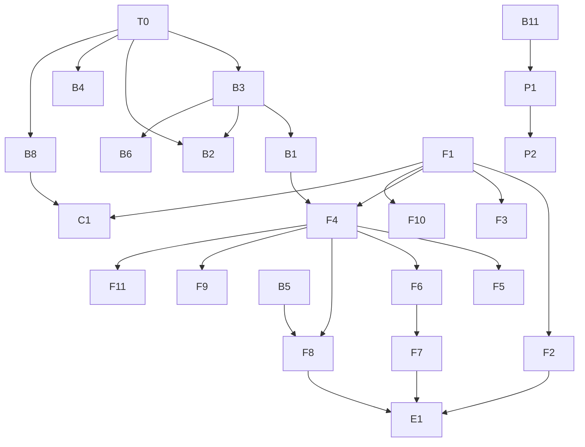

# Implementation Plan: RevoTask (Kanban)

Authoritative copy. `.kiro/specs/` holds an older duplicate set (V-028) and is not maintained.

## 1. Overview

This plan turns `specs/requirements.md` and `specs/design.md` into ordered tasks. Nothing in it has been implemented by the spec rewrite. The backend already has most Kanban routes. The main work is the missing board read, the missing UI, and fixing the payloads the UI sends.

Size: S is under half a day, M about a day, L several days. Sizes are estimates, not measurements.

IDs: `T` decision, `B` backend, `F` frontend, `C` contract tests, `E` end-to-end tests, `X` documentation, `P` platform and planned items.

### 1.1 Definition of done (applies to every task)

A task is done only when:

1. The code change is made and only the files named in the task, plus their tests, changed.
2. The tests named in the task exist and pass. The exact command and result are reported (`pytest backend/tests/...`, `npx jest ...`, `npx playwright test ...`). A test that was not run is reported as not run.
3. Static checks pass: `npx tsc --noEmit`, `npm run lint`, `npm run build` for frontend tasks. The backend CI command (`pytest tests/ -v`) passes for backend tasks.
4. Swagger docstrings and the route table in `specs/design.md` section 5.2 match the change.
5. Requirement tags in `specs/requirements.md` (`[Plan]`, `[BE]`, `[Done]`) are updated to match.
6. Authorization and validation paths have a negative test (401, cross-user 404, 400).
7. No secrets, debug code or unrelated formatting are included.

## 2. Tasks

### Phase 0: Decisions

- [ ] **T0. Confirm open decisions D1 to D13** (S). Owner: product owner.
  - Refs: `requirements.md` section 12.
  - Output: each default confirmed or changed. Update the affected requirements, design and tasks (`structure.md` section 3 rule 6).
  - Blocks: B1 (D2), B2 (D3), B3 (D7), B4 (D1), F10 (D5), F11 (D9, D13), F12 (D8), P1 (D10).
  - Done when: section 12 shows the final answer for every row.
  - Status (uncommitted): partly done. D6, D8 and D13 were changed by decision (`requirements.md` section 12.1). D2, D3 and D7 were built with their default. D1, D4, D5, D9 to D12 are still defaults awaiting confirmation.

### Phase 1: Backend

- [ ] **B11. Use UUID converters for path ids** (S). Depends: none.
  - Refs: R10.11. Routes: 6 to 25 (all routes with an id).
  - Change: `<uuid:board_id>` style converters in every `routes.py`, remove the `uuid.UUID(...)` calls, pass the UUID to services. Route functions receive `uuid.UUID`.
  - Tests (`backend/tests/api/test_error_handling.py`, new): `GET /api/boards/not-a-uuid` returns 404 with the envelope, for one route per blueprint. Existing tests still pass.
  - Status: not in this change. An invalid id in a path still produces a 500 on the older routes.

- [x] **B3. Card soft delete** (M). Depends: T0 (D7). Done (uncommitted).
  - Refs: R4.5, R13.1. Routes: 15, 14, 16, 17 to 20, 25.
  - Change: `cards/service.delete_card` sets `deleted_at = now()` and commits. Add one helper that builds the "not deleted" filter and use it in `_get_owned_card`, `_renormalise_positions`, `create_card` (order calculation), `comments/service._get_card_for_user`, and the board read (B1). Soft-deleted cards then return 404 `CARD_NOT_FOUND` on edit, move, delete and comment routes. No migration (the column exists). Purging old rows is not planned.
  - Tests: `backend/tests/api/test_card_routes.py` (new): delete returns 204, the row still exists with `deleted_at` set, repeat delete returns 404, edit and move and comment on a deleted card return 404, other user's delete returns 404, analytics count drops by one. `backend/tests/integration/test_card_soft_delete.py` (new): the renumbering ignores deleted cards.
  - Result: `delete_card` sets `deleted_at`; one `_not_deleted()` filter in `cards/service.py` is used by the card reads, renumbering, order calculation, comments and the board read. Tests are in `backend/tests/api/test_card_routes.py`. The separate `integration/test_card_soft_delete.py` file was not created.

- [x] **B1. Board read with columns and cards** (M). Depends: T0 (D2), B3. Done (uncommitted), tests in `backend/tests/api/test_board_routes.py` including the 3-query count.
  - Refs: R2.5, R2.7, N4.1. Route: 6.
  - Change: `boards/service.get_board_detail` runs three queries (board by id and owner, columns by `position`, cards of those columns with `deleted_at IS NULL` by `order`, `created_at`) and groups cards by column in Python. `boards/schema.board_detail_to_dict` adds `columns[].cards[]` using the existing `column_to_dict` and `card_to_dict`. Route 6 returns it. `PATCH` and other board routes keep returning the plain board.
  - Tests: `backend/tests/api/test_board_routes.py` (new): shape and field names; column order; card order and tie by `created_at`; soft-deleted card excluded; empty board returns `columns: []`; empty column returns `cards: []`; other user's board 404; unknown id 404; no token 401; SQL statement count is 3 for a board with 5 columns (SQLAlchemy event counter).

- [x] **B2. Column delete rule** (S). Depends: T0 (D3), B3. Done (uncommitted), tests in `backend/tests/api/test_column_routes.py`.
  - Refs: R3.5, R3.7. Route: 11.
  - Change: `columns/service.delete_column` counts cards of the column with `deleted_at IS NULL`. If more than zero, raise `ResourceConflictException("Column still has cards")` before deleting. Otherwise delete and renumber as today.
  - Tests: `backend/tests/api/test_column_routes.py` (new): 409 with one card and the column still exists; 204 after the card is deleted; 204 with only soft-deleted cards; other user's column 404; positions renumbered after delete.

- [ ] **B5. Move rules** (S). Depends: none.
  - Refs: R5.3, R5.10, R12.4. Route: 16.
  - Change: in `cards/service.move_card`, reject a destination column whose `board_id` differs from the card's current board (raise `ColumnNotFoundException`). In the renumbering sort, order the moved card before another card with equal `order`, then by `created_at`.
  - Tests: `backend/tests/test_cards_service.py` (extend): cross-board move raises and changes nothing; drop with order 0 into a column whose first card has order 0 puts the moved card first; existing move tests unchanged.
  - Status: partly done (uncommitted). The tie rule is built and tested (`backend/tests/api/test_card_routes.py::test_move_card_tie_puts_moved_card_first`). The cross-board destination check is not in this change.

- [ ] **B6. Comment access policy** (S). Depends: B3.
  - Refs: R6.5, R11.3. Routes: 19, 20.
  - Change: `comments/service.update_comment` and `delete_comment` load the comment through card, column and board filtered by `Board.owner_id == current_user.id`, then require `author_id == current_user.id`. Anything else raises `CommentNotFoundException` (404). The `UnauthorizedCommentAccessError` class stays unused until board sharing exists.
  - Tests: `backend/tests/api/test_comment_routes.py` (new) and `backend/tests/security/test_authorization.py` (new): other user's edit and delete return 404; author edit and delete succeed; comment on a soft-deleted card returns 404; update `test_comments.py` only where it asserted 403.
  - Changed by decision: the assessment requires a 403 test for an unauthorised comment edit, so the 404 policy above was not applied. Edit and delete of another user's comment keep returning 403 `COMMENT_ACCESS_DENIED`, now asserted exactly in `backend/tests/test_comments.py`, along with 201, 400 (missing and blank body) and 401. Comments on a soft-deleted card return 404 (B3). The board-ownership check on comment edit and delete is still missing.

- [ ] **B7. Login accepts any password string** (S). Depends: none.
  - Refs: R1.7. Route: 2.
  - Change: `LoginSchema.password` is a required string with a maximum length and no complexity policy. Registration keeps the policy.
  - Tests: `backend/tests/api/test_auth_routes.py` (extend): weak password with unknown email returns 401 `INVALID_CREDENTIALS`; wrong password returns 401; correct password returns 200; empty password returns 400.
  - Status: not in this change. (The login response `user` gained `name`, which is not part of this task; see `design.md` 5.2.1.)

- [ ] **B8. Reject priority and status in card requests** (S). Depends: T0 (D9).
  - Refs: R4.4. Routes: 13, 14.
  - Change: remove `priority` and `status` from `CreateCardSchema` and `UpdateCardSchema`. Remove the stale comments in `cards/schema.py` and `cards/service.py`. Update Swagger docstrings.
  - Tests: `backend/tests/api/test_card_routes.py`: `priority` and `status` return 400 `VALIDATION_ERROR`; valid body still returns 201 and 200.
  - Status: not in this change.

- [ ] **B9. Unique board name per user** (S). Depends: none.
  - Refs: R12.5, R2.2. Route: 4, 7.
  - Change: Alembic migration adding a unique index on `boards (owner_id, lower(name))`. The migration first checks for existing duplicates and stops with an error that lists them, so no data is deleted. `boards/service` maps `IntegrityError` to `ResourceConflictException`.
  - Tests: `backend/tests/integration/test_board_database.py` (new, PostgreSQL): duplicate insert with different case fails; different owners succeed; migration upgrade and downgrade run on an empty test database.
  - Status: not in this change (the migration would touch production data).

- [x] **B4. Board delete behaviour** (S, or M if soft delete is kept). Depends: T0 (D1).
  - Refs: R2.10, R2.11. Route: 8.
  - Step 1 (always): `backend/tests/integration/test_board_delete.py` (new, PostgreSQL) proves that after `DELETE /api/boards/{id}` its columns, cards and comments are gone, other users' data is untouched, and a foreign board returns 404. Update the Swagger docstring to say what happens to children.
  - Step 2 (only if D1 stays "soft delete"): migration adding `deleted_at` to `boards` and `board_columns`; filter every board and column query; update B1 and B2. If D1 is changed to "hard cascade", skip this step and change R2.10 to say so.
  - Status: not in this change. Board delete is still a hard database cascade.

- [ ] **B12. Stop returning an unusable refresh token** (S). Depends: none.
  - Refs: R9.5. Route: 2.
  - Change: `auth/service.login_user` no longer creates a `RefreshToken` row, and the login response drops `refresh_token`. The `refresh_tokens` table stays for P2. `AuthContext` already ignores the field.
  - Tests: `backend/tests/api/test_auth_routes.py`: the login body has `access_token` and `user` only. `test_auth_service.py` login tests updated.
  - Status: not in this change. Login still returns `refresh_token`.

- [x] **B10. API and security tests for the remaining routes** (M). Depends: B1 to B8, B11.
  - Refs: N6.1, R11.1 to R11.4, R12.x, R13, R14. Routes: 4 to 8, 9 to 12, 21 to 25.
  - Add under `backend/tests/api/`: `test_board_routes.py` (create, list isolation, patch, delete, 409), `test_column_routes.py` (create, patch, reorder with foreign id), `test_user_routes.py` (get, patch name and timezone, email rejected, bad timezone), `test_notification_routes.py`, `test_analytics_routes.py`. Add `backend/tests/security/test_authorization.py` that, for every protected route in the Flask URL map, asserts 401 without a token and 404 for another user's resource. Add `backend/tests/unit/test_error_handlers.py` (envelope for 400, 404, 405, 415, 500; no stack trace in the body).
  - The existing flat layout of `backend/tests` is not reorganized (V-024). New files use the standard layout.
  - Status: partly done (uncommitted). Written: `backend/tests/api/test_board_routes.py`, `test_column_routes.py`, `test_card_routes.py`, `test_card_list_routes.py`, `test_notification_routes.py`. Not written: `test_user_routes.py`, `test_analytics_routes.py`, `security/test_authorization.py`, `unit/test_error_handlers.py`.

- [x] **B13. Card list route, comment notifications, comment author name** (M). Added by decisions D6, D8, D13. Done (uncommitted).
  - Refs: `requirements.md` 12.1, `design.md` 5.2.1. Routes: new 26 `GET /api/v1/cards`, 18, 23, 2.
  - Change: `GET /api/v1/cards` (`search`, `board_id`, `mine`, `page`, `per_page`, owner-scoped, unknown keys 400); `notifications/service.notify_comment_added` called from `comments/service.create_comment` in the same commit; `meta.unread_count` on route 23; `author_name` on comments; `name` in the login `user`.
  - Tests: `backend/tests/api/test_card_list_routes.py`, `test_notification_routes.py`, `backend/tests/test_comments.py`, `backend/tests/api/test_auth_routes.py`.

### Phase 2: Frontend

- [x] **F1. Typed services and no silent failures** (M). Depends: none. Done (uncommitted). Service files are named `lib/services/{auth,boards,columns,cards,comments,notifications,users}Service.ts`; tests in `lib/services/__tests__/services.test.ts`. No raw `fetch` remains outside `lib/apiClient.ts`. There is no separate `lib/__tests__/apiClient.test.ts`.
  - Refs: R10.6, R10.7, R10.8. Files: `lib/types/api.ts`, `lib/apiPaths.ts`, `lib/services/{boards,columns,cards,comments,users}.ts` (all new), `context/AuthContext.tsx`, `hooks/useNotifications.ts`.
  - Change: types equal to design section 5.2 objects (snake_case, `order`). One path constant per route in `apiPaths.ts`. Services call `apiClient`. `AuthContext.login` uses `apiClient` and the login page keeps showing the same messages. Remove the 404 and 405 branch from `useNotifications`.
  - Tests: `lib/__tests__/apiClient.test.ts`, `lib/services/__tests__/*.test.ts` assert method, path and exact body for each service function; `context/__tests__/AuthContext.test.tsx` (extend) for login errors; no storage API is used.

- [x] **F2. Create board** (S). Depends: F1. Done (uncommitted).
  - Refs: R2.3, R2.4. Route: 4. Page: `/`.
  - Change: new `components/board/CreateBoardForm.tsx` with a "Create board" button that opens a form with a labelled "Board name" field. `BoardsGrid` mounts it above the list and in the empty state, and adds the new board to its list. On 409 it shows the server message and keeps the input.
  - Tests: `components/board/__tests__/CreateBoardForm.test.tsx` (new): payload `{name}`, success, 409, blank name blocked, error keeps input. `BoardsGrid.test.tsx` (extend).

- [x] **F3. Header, logout and profile guard** (S). Depends: F1. Done (uncommitted). The links are "Dashboard", "My Tasks" and "Profile"; the header also shows the user's name, the notification bell and a mobile menu toggle. Protected pages redirect to `/login?next=<path>`.
  - Refs: R1.9, R1.11, R1.12. Pages: all authenticated pages, `/profile`.
  - Change: new `components/shared/Header.tsx` rendered in `app/layout.tsx` when `token` is set, with links "Boards" and "Profile" and a "Log out" button that calls `logout()` and `router.replace("/login")`. `/profile` uses `useRequireAuth`.
  - Tests: `components/shared/__tests__/Header.test.tsx` (new): hidden without a token, links present, logout clears state and navigates. `useRequireAuth.test.tsx` unchanged.

- [x] **F4. Board page loads from one request** (M). Depends: B1, F1. Done (uncommitted). The load error shows a message but has no Retry button; 401 goes to `/login?next=...`.
  - Refs: R2.6, R5.2. Route: 6. Page: `/boards/[id]`.
  - Change: `BoardDetailView` calls the board service once, keeps `{board, columns[].cards[]}`, uses `order` in types and sorting, removes `isEndpointMissing`, `fetchColumns`, `fetchCardsForColumn`. Shows loading, error with Retry, empty board and empty column states. 401 redirects to `/login`. 404 shows "Board not found."
  - Tests: `components/board/__tests__/BoardDetailView.test.tsx` (rewrite): renders columns and cards in server order; 404; 500 shows an error and not an empty board; 405 and 404 from a missing endpoint are not hidden.

- [x] **F5. Column controls** (M). Depends: F4, B2. Partly done (uncommitted): add column (form inside `BoardDetailView`, no separate `AddColumnForm`), rename, delete with confirmation and the 409 message "This column still has cards. Move or delete them first." are built and tested (`ColumnHeader.test.tsx`, `BoardDetailView.test.tsx`). Move left and right is not in this change.
  - Refs: R3.1, R3.3, R3.4, R3.6, R3.7. Routes: 9, 10, 11, 12.
  - Change: new `AddColumnForm` ("Add column" button, field "Column name"). `ColumnHeader` gets rename (inline edit), delete (confirmation, 409 message "Move or delete this column's cards first."), and move left and move right buttons that send the complete `ordered_ids` list.
  - Tests: `AddColumnForm.test.tsx` and `ColumnHeader.test.tsx` (new): payloads, 409 handling, reorder sends the full list in the new order.

- [x] **F6. Add card** (S). Depends: F4. Done (uncommitted). The button is "Save card"; covered by `BoardDetailView.test.tsx` and e2e `cards.spec.ts`, no separate `AddCardForm.test.tsx`.
  - Refs: R4.1, R4.6, R4.7. Route: 13.
  - Change: mount `AddCardForm` in each column (button "Add card", field "Card title", optional description). The form keeps its values on error.
  - Tests: `AddCardForm.test.tsx` (new or extend): body `{title, description}`, blank title blocked, 400 shown, input kept.

- [x] **F7. Card detail dialog** (L). Depends: F6, B3, B6. Done (uncommitted). The author is shown with `author_name` from the backend instead of "You".
  - Refs: R4.3, R4.5, R4.6, R5.8, R6.1 to R6.4, R6.7, N2.2. Routes: 14, 15, 16, 17 to 20.
  - Change: mount `CardDetailModal` from the card button (`Open card: <title>`). Edit title and description with Save. Delete card with confirmation. Comments: list, add, edit and delete (author shown as "You" when `author_id` equals the current user id). "Move to column" select that sends route 16. Focus is trapped, Escape closes, focus returns to the card button.
  - Tests: `CardDetailModal.test.tsx` (extend): PATCH body `{title, description}`, comment bodies, edit and delete comment, delete confirmation, move-to select payload, Escape and focus return, 404 on a card deleted elsewhere shows an error.

- [x] **F8. Drag and drop** (M). Depends: F4, B5. Done (uncommitted). Native HTML5 drag (no touch drag; "Move to column" in the dialog is the fallback). Payload, rollback and reload are tested in `BoardDetailView.test.tsx` and `lib/__tests__/cardOrder.test.ts`; there is no separate `useDragAndDrop.test.tsx`.
  - Refs: R5.1, R5.5, R5.6, R5.9. Route: 16.
  - Change: `lib/cardOrder.ts` (pure function, design section 7.3). `useDragAndDrop` sends `{column_id, order}`, uses `patch<Card>`, and reloads the board after the request settles. Card types use `order`. Mount the hook in `BoardDetailView` and the column and card elements. On failure restore state and show a toast.
  - Tests: `lib/__tests__/cardOrder.test.ts`: empty, top, middle, end. `hooks/__tests__/useDragAndDrop.test.tsx`: exact body `{column_id, order}` (no `position`), optimistic move, rollback on 400, board reload called.

- [x] **F9. Board rename and delete** (S). Depends: F4, B4, T0 (D1).
  - Refs: R2.8, R2.9, R2.10, R2.11. Routes: 7, 8. Page: `/boards/[id]`, `/`.
  - Change: rename control in the board header, delete control with confirmation naming the board. After delete go to `/`.
  - Tests: component tests for payload `{name}`, 409, confirm and cancel.
  - Status: not in this change.

- [x] **F10. Profile** (S). Depends: F1, F3, T0 (D5). Done (uncommitted), with one difference: the page shows the user from the login response and does not call `GET /api/users/me` on open.
  - Refs: R7.1 to R7.5. Routes: 21, 22. Page: `/profile`.
  - Change: load `GET /api/users/me` on open. Show email as read-only text. Edit `name` and `timezone`. Send `{name, timezone}` through the users service (no raw `fetch`). Update `AuthContext` user state after save. Remove the stale "not yet implemented" comment.
  - Tests: `app/profile/__tests__/page.test.tsx` (new): body has `name` and `timezone` and no `email`; 400 shown; values kept on error.
  - [x] Profile UX (frontend only): unsaved-changes handling (Save disabled when clean, `beforeunload` while dirty), Reset button with name character counter, initials avatar (`lib/initials.ts`). Refs: R7.4, R7.5. Tests: `app/profile/__tests__/page.test.tsx`, `lib/__tests__/initials.test.ts`.

- [x] **F11. Search** (S). Depends: F4, T0 (D9, D13).
  - Refs: R8.1 to R8.6. No route (client side).
  - Change: replace `SearchBar` with a single labelled field ("Search cards", max 100 characters). Filter on title and description, case-insensitive, in `BoardDetailView`. Delete `hooks/useCardSearch.ts` and its `fetch` to `/api/cards`. If D13 changes to a server search, replace this task with B-new plus a service call.
  - Tests: `SearchBar.test.tsx` and `BoardDetailView.test.tsx`: case-insensitive match, description match, empty query, no match message, clear.
  - Changed by decision (D13, `requirements.md` 12.1): done (uncommitted) as a server search. `SearchBar` and `useCardSearch` were rewritten (not deleted) to call `GET /api/v1/cards?search=&board_id=` with a debounce; choosing a result opens the card dialog. Backend part: B13.

- [x] **F12. Remove My Tasks** (S). Depends: T0 (D8).
  - Refs: Section 8 of requirements. Page: `/my-tasks`.
  - Change: delete `app/my-tasks/page.tsx` and `components/board/MyTasksList.tsx`. No test exists for them. Search the repo for imports and links first.
  - Tests: `npm run build` and `npx jest` pass.
  - Changed by decision (D8, `requirements.md` 12.1): the page was kept, not removed. Done (uncommitted): `MyTasksList` loads `GET /api/v1/cards?mine=true`, groups by board, links to each board, has "Load more" and shows real errors. Tests: `components/board/__tests__/MyTasksList.test.tsx`.

- [x] **F13. Notifications UI: no change** (S). Depends: none.
  - Refs: R14.3. Files: `NotificationBell.tsx`, `useNotifications.ts`.
  - Change: none beyond the F1 cleanup. The bell stays unmounted (D6).
  - Tests: none new. Reviewer checks that nothing imports `NotificationBell`.
  - Changed by decision (D6, `requirements.md` 12.1): done (uncommitted). The bell is mounted in `Header`, reads `title`, `body`, `is_read` and `meta.unread_count`, and marks a notification read on click. It polls every 30 seconds. Tests: `components/shared/__tests__/NotificationBell.test.tsx`. Backend part: B13.

### Phase 3: Cross-cutting tests and documentation

- [x] **C1. Contract tests for every frontend payload** (M). Depends: F1, B8. Done (uncommitted) with different file names: fixture `docs/api/frontend-request-payloads.json` (11 requests: register, login, create board, create and rename column, create and update card, move card, create and update comment, update profile; no board patch or column reorder because the UI does not send them), backend `backend/tests/contract/test_frontend_payloads.py`, frontend `lib/services/__tests__/contract.test.ts`. Renaming a field in the fixture made one backend and one frontend test fail (checked, then restored).
  - Refs: R10.8, `api-contracts.md` section 16.3. Prevents repeats of V-032.
  - Change: `docs/api/contract-samples.json` (new) with one valid body per request: register, login, create and patch board, create and patch column, reorder columns, create and patch card, move card, create and patch comment, patch profile. Backend `backend/tests/api/test_contract_payloads.py` loads each sample through its Marshmallow schema and also checks that a copy with one renamed key fails with "Unknown field". Frontend `lib/__tests__/contracts.test.ts` runs each service and hook against a mocked `fetch` and asserts the body equals the sample.
  - Done when: changing `order` to `position` in the move hook makes a frontend test fail.

- [x] **E1. End-to-end Kanban journey with Page Objects** (L). Depends: F2 to F8, B1. Done (uncommitted) against a LOCAL stack only (Flask + local PostgreSQL database, `next build` + `next start`): 18 tests passed in two runs (chromium and a 375px mobile project). Not run against the public Vercel URL. Differences: Page Objects are `LoginPage`, `DashboardPage`, `BoardPage`, `CardModal`, `Header` (no `RegisterPage`); there is no keyboard-only move test (the "Move to column" select is tested instead); no `e2e/README.md` (run steps are in the root `README.md`); the stale `frontend/playwright.config.ts` was removed and `npm run e2e` points at `../e2e/playwright.config.ts`.
  - Refs: R5.7, R9.1, N6.3, `structure.md` section 7, V-026.
  - Change: `e2e/pages/{LoginPage,RegisterPage,DashboardPage,BoardPage}.ts`, `e2e/fixtures/{auth.fixture,test-data.fixture}.ts`, rewrite `e2e/tests/kanban-journey.spec.ts`. A fixture registers a unique user through the API per test, then logs in through the UI. The current `auth.setup.ts` saves `storageState`, which holds no token because the token lives in memory (R9.1), so it is replaced. No `waitForTimeout`. The journey is in design section 13.3 and ends with a second login and an assertion that every card is at the same column and position. Add `e2e/tests/auth.spec.ts` logout and reload-goes-to-login cases. Add a keyboard-only move test (R5.8).
  - The target stack (local Flask with a test database, or the public URL per `structure.md` section 7 rule 6) is chosen when the task starts and written in `e2e/README.md`. `playwright.config.ts` starts only the frontend, so the backend must already run.
  - Tests: the suite itself. Report the exact command and result. Reports kept as CI artifacts.

- [x] **X1. Record new violations V-033 and later** (S). Depends: none. Done (uncommitted): V-033 to V-043 in `docs/reports/guideline-violations.md`. Invalid path id, cross-board move, security headers, priority/status and the unused refresh token stay listed as open tasks (B11, B5, P5, B8, B12) and were not recorded as new entries.
  - Refs: `structure.md` section 4 rule 7 and section 8. File: `docs/reports/guideline-violations.md`.
  - Candidate entries (titles only; numbers assigned when recorded, with evidence from this plan and the gap report): requirements described a different product; board read endpoints missing and silently mapped to empty; move payload `position` vs `order`; profile payload `email`; notifications field names; card delete is hard delete although `deleted_at` exists; invalid path id returns 500; comment access returns 403 and skips the board check; move allows a cross-board destination; no security headers; priority and status accepted and ignored; refresh token returned but unused.
  - Done when: each entry follows the report's format (guideline, what the AI produced, correction) and the summary counts are recounted.

### Phase 4: Platform and planned items

- [ ] **P1. API prefix migration to `/api/v1`** (M). Depends: T0 (D10), B11, F1.
  - Refs: R10.4, R10.5, V-019.
  - Change: register each blueprint once, with `url_prefix` set per resource under `/api/v1` (design section 5.3 lists the extra URLs that disappear). Step 1: backend serves both `/api` and `/api/v1` for one release. Step 2: switch the constants in `lib/apiPaths.ts` and deploy the frontend. Step 3: remove the old prefix. Keep `NEXT_PUBLIC_API_BASE_URL` as an origin. Update `docs/deployment-*.md` and Swagger.
  - Tests: `backend/tests/api/test_url_map.py` (new) lists `app.url_map` and fails on duplicate or alias rules; frontend `apiPaths` test; the e2e journey after the switch.
  - Risk: frontend and backend deploy independently, hence the two-step rollout.

- [ ] **P2. Refresh and logout with an HttpOnly cookie** (L). Planned, not in MVP. Depends: P1, T0 (D4).
  - Refs: R9.4, N1.9, `security.md` sections 3.3 and 7, V-009.
  - Start with `docs/adr/0002-authentication-strategy.md`. Vercel and Railway are different sites, so the cookie needs `SameSite=None; Secure`, `supports_credentials=True` with an exact-origin CORS list, and CSRF protection on `POST /api/v1/auth/refresh` and `/logout`. A shared custom parent domain avoids `SameSite=None`. Decide in the ADR. The `refresh_tokens` table already exists.
  - Tests: refresh rotation, reuse of a revoked token, logout revokes, expired token, CSRF rejection, reload keeps the session (e2e).

- [ ] **P3. Rate limiting** (M). Planned. Depends: decision on a shared store.
  - Refs: N1.3, V-011. Routes: 1, 2, 4, 13 and other writes.
  - A process-local limiter is not valid because Railway runs several workers. A shared store (for example Redis on Railway) is a new infrastructure dependency and needs approval before work starts.
  - Tests: 429 with `RATE_LIMIT_EXCEEDED` after the limit, per IP and per account on login, counters shared across two app instances.

- [ ] **P4. Protect or disable the Swagger UI in production** (S). Planned. Depends: none.
  - Refs: N1.6. Paths: `/apidocs/`, `/apispec_1.json`, `/flasgger_static`.
  - Test: production config returns 404 for these paths. Development keeps them.

- [ ] **P5. Security headers and request size limit** (S). Planned. Depends: none.
  - Refs: N1.4, N1.5. Files: `backend/app/__init__.py` (`after_request`, `MAX_CONTENT_LENGTH`), `frontend/next.config.ts`.
  - CSP is tried in report-only mode first and enforced after the e2e journey passes under it.
  - Tests: headers present on API and page responses; 413 for an oversized body.

- [ ] **P6. Request ids and security logging** (M). Planned. Depends: none.
  - Refs: N1.10. File: `backend/app/common/logging.py` (new, listed in `structure.md`).
  - Request id per request, returned as `X-Request-ID`. Log failed logins, 401s and 404 on owned resources with user id when known. Never log passwords, tokens or bodies.
  - Tests: log records contain the id and no secrets.

- [ ] **P7. Password hashing with Argon2id or bcrypt** (S to M). Planned. Depends: dependency review.
  - Refs: N1.8, V-013.
  - A new dependency (`argon2-cffi` or `bcrypt`) needs the review required by `development-workflow.md` section 6. Existing Werkzeug hashes are verified and rehashed on the next successful login.
  - Tests: new hash prefix, old hash still logs in and is upgraded.

### Phase 5: Due dates, labels and board filter

Added 2026-11-24 from `.agents/tasks/kanban-features/brief.md`. Requirements R15 to R17, decisions D14 to D21, design section 17. Every task is `not-started`. The phases run in order, and each phase must leave `pytest`, `npx jest`, `npx tsc --noEmit`, `npm run lint` and the local Playwright suite green before the next starts. Definition of done in section 1.1 applies. No task commits, pushes or deploys.

- [x] **B14. Card due date: model, migration, schema, serialisation** (M). Status: done. Depends: none.
  - Refs: R15.1 to R15.11. Routes: 13, 14, 6, 16, 26. Design: 17.1, 17.4.
  - Change: `cards.due_date` in `app/models/card.py`; migration `add_cards_due_date` (nullable, no default, working downgrade, hand-reviewed SQL); `due_date` in `CreateCardSchema` and `UpdateCardSchema` with the overflow-safe range check (year first, then conversion inside `try/except OverflowError`, then re-check) and UTC normalisation in `load`; `app/utils/__init__.py` and `app/utils/time.py` `format_utc`; `create_card` and `update_card` (omitted versus `null`); `card_to_dict`. Update Swagger docstrings and `docs/api/README.md`.
  - Tests: `backend/tests/api/test_card_due_date.py` (201, 200, null clears, omitted unchanged, bad string, date only (400 and `details.due_date`), naive, year 1999 and 2101, `9999-12-31T23:59:59-05:00` and `0001-01-01T00:00:00+05:00` (400, not 500), `+07:00` converted, unknown field, 401, other user's card 404, persistence, move keeps value); create `backend/tests/integration/` (with `__init__.py` if the other folders have one) and the `migration_app` fixture of design 17.4 (temporary database via `CREATE DATABASE`, visible skip reported as "not verified"); `backend/tests/integration/test_due_date_migration.py` (upgrade, downgrade, upgrade; no autogenerate diff); existing board and list route tests assert `due_date`; `backend/tests/contract/test_frontend_payloads.py` and `docs/api/frontend-request-payloads.json` gain `{due_date}` and `{due_date: null}`.
  - Done when: the full backend suite passes with the final count reported (baseline 168).

- [x] **F14. Due date UI: helper, badge, dialog field, My Tasks** (M). Status: done. Depends: B14.
  - Refs: R15.12 to R15.18. Design: 17.1.
  - Change: `lib/types/api.ts`, `lib/dueDate.ts`, `hooks/useNow.ts`, `components/board/DueDateBadge.tsx`, `components/board/DueDateField.tsx`, `CardDetailModal`, `BoardCard`, `BoardColumn` (pass `now`), `BoardDetailView`, `MyTasksList`, `lib/services/cardsService.ts`. Reuse `BaseButton` and `BaseBadge` (`overdue` = `danger`, `soon` = `warning`, `upcoming` = `default`; `BaseBadge` unchanged). `BoardColumn` builds the `meta` node for `BoardCard`, and `BoardCard` renders `meta` outside its `aria-label` button (design 17.1). `MyTasksList` renders the badge directly in each row `<li>` with `flex-wrap` (it does not use `BoardCard`). Update typed `Card` and `BoardDetail` test fixtures (`due_date: null`) so `npx tsc --noEmit` stays green. No raw hex, no restyle.
  - Tests: `lib/__tests__/dueDate.test.ts`, `hooks/__tests__/useNow.test.tsx` (fake timers), `DueDateBadge.test.tsx`, `CardDetailModal.test.tsx` (exact payloads), `BoardCard.test.tsx` (badge not inside the `aria-label` button, click still opens), `MyTasksList.test.tsx` (past date shows Overdue), `lib/services/__tests__/contract.test.ts`.
  - Done when: jest total reported (baseline 191 in 24 suites), `npx tsc --noEmit`, `npm run lint` and `npm run build` pass.

- [x] **E2. E2E: set and clear a due date** (S). Status: done. Depends: B14, F14.
  - Refs: R15.12, R15.13, R15.16. Files: `e2e/tests/due-dates.spec.ts`, extend `e2e/pages/BoardPage.ts`.
  - Test: set a due date in the dialog, reload (log in again, R9.1; the token is in memory only), see the badge, clear it, see no badge. Unique data per test, no `waitForTimeout`.

- [x] **B15. Labels: models, migration, blueprint, serialisation** (L). Status: done. Depends: B14.
  - Refs: R16.1 to R16.15. Routes: 27 to 31, plus 6, 13, 14, 16, 26 (card `labels`, board `labels`). Design: 17.2, 17.4.
  - Change: `app/models/label.py`, `Card.labels`, migration `add_labels_and_card_labels` (`down_revision` = the B14 revision); `app/blueprints/labels/` (routes, schema, service) registered once at `/api`; `LabelNotFoundException`; `cards/service.get_owned_card`; `selectinload(Card.labels)` in the board read and `list_cards`; `labels` in `card_to_dict` and `board_detail_to_dict`; explicit constraint names from design 17.2 (`pk_labels`, `fk_labels_board_id_boards`, `pk_card_labels`, `fk_card_labels_card_id_cards`, `fk_card_labels_label_id_labels`, `ck_labels_color`, `ck_labels_name_not_blank`, `uq_labels_board_id_lower_name`, `ix_card_labels_label_id`); rewrite the query-count test so it counts `FROM boards`, `FROM board_columns`, `FROM cards`, `FROM card_labels` and `FROM labels` and asserts 5 (two data sizes, plus 200 labels), with the same pair for `list_cards`; create `backend/tests/security/` and the `make_label` helpers in `conftest.py`. Swagger docstrings and `docs/api/README.md`.
  - Tests: `backend/tests/api/test_label_routes.py`, `test_card_labels.py`, `unit/test_label_service.py`, `integration/test_label_database.py`, `integration/test_label_migration.py` (also compares `pg_indexes` for the `lower(name)` index), `security/test_authorization.py` (routes 27 to 31), contract samples. Cases listed in design section 13.4.
  - Done when: the full backend suite passes with the final count reported, and `flask db migrate` shows no pending difference.

- [x] **F15. Labels UI: pills, picker, manager, colours** (L). Status: done. Depends: B15, F14.
  - Refs: R16.16 to R16.20. Design: 17.2.
  - Change: `lib/types/api.ts`, `lib/apiPaths.ts`, `lib/services/labelsService.ts`, `cardsService.setCardLabels`, `lib/labelColors.ts`, CSS variables in `app/globals.css`, `LabelPill`, `LabelPicker`, `LabelManager`, `CardDetailModal`, `BoardCard` (meta outside the button), `MyTasksList` (pills in the row `<li>`), `BoardDetailView` (reload after label changes; `ViewState.success.labels`). Backend: `get_board_detail` returns `(board, columns, cards_by_column, labels)` and `board_detail_to_dict` takes `labels` (design 17.2); `set_card_labels` leaves `Card.updated_at` unchanged.
  - Tests: `labelColors.test.ts` (contrast of the 8 pairs, ratios reported), `LabelPill.test.tsx`, `MyTasksList.test.tsx` (two labels show both names), `LabelPicker.test.tsx` (keyboard, Escape, exact `{label_ids}`), `LabelManager.test.tsx` (delete opens a `BaseModal` `Delete label "X"?` with "It will be removed from N cards.", focus returns to that label's Delete button), `labelsService.test.ts` (exact payloads), contract tests.
  - Done when: jest, `tsc`, lint and build pass; a search finds no hex value in `frontend/components`.

- [x] **E3. E2E: create a label and attach it** (S). Status: done. Depends: B15, F15.
  - Refs: R16.17, R16.18, R16.20. Files: `e2e/tests/labels.spec.ts`, `e2e/pages/` additions.
  - Test: create a label, attach it to a card, reload and log in again (R9.1), see the pill (text and colour name).

- [x] **F16. Board filter: functions, URL state, filter bar, shortcut** (L). Status: done. Depends: F14, F15.
  - Refs: R17.1 to R17.15. Design: 17.3. No backend change.
  - Change: `lib/filterCards.ts`, `lib/filterParams.ts`, `hooks/useBoardFilters.ts`, `hooks/useFilterShortcut.ts`, `components/board/FilterBar.tsx`, `ColumnHeader` (`visibleCount`, `totalCount`, "x of y"), `BoardColumn` (`dragEnabled`; "No cards in this column." only for a column with no cards), `BoardDetailView` (one `role="status"` empty message), `app/boards/[id]/page.tsx` (`Suspense`). The global `SearchBar` is not changed.
  - Tests: `filterCards.test.ts`, `filterParams.test.ts`, `useBoardFilters.test.tsx` (no `router.replace` for an unknown label id before the board loads), `useFilterShortcut.test.tsx`, `FilterBar.test.tsx` (300 ms status debounce with fake timers), `ColumnHeader.test.tsx`, `BoardColumn.test.tsx` (no drag while filtered), `BoardDetailView.test.tsx` (hidden cards not rendered, counts, empty message, Clear, URL sync).
  - Done when: jest, `tsc`, lint and build pass.

- [x] **E4. E2E: filter and mobile layout** (S). Status: done. Depends: F16.
  - Refs: R17.3, R17.8, R17.12. Files: `e2e/tests/board-filter.spec.ts`, `e2e/pages/` additions.
  - Test: filter by label and keyword, see only matching cards, clear (after any reload, log in again, R9.1); at 375 px with the filter bar open the document has no horizontal scroll. Run the whole suite on chromium and the mobile project (baseline 18 passed) and report the real result. Do not run Playwright against production.

- [x] **X2. Documentation and evidence for R15 to R17** (S). Status: done. Depends: after each phase.
  - Refs: `structure.md` section 12. Files: `docs/api/README.md`, `docs/api/frontend-request-payloads.json`, `README.md` (feature list: only what is built and verified), `docs/reports/guideline-violations.md` (only real violations found, recount the summary tables), `specs/CHANGELOG.md` (replace the "planned" evidence with measured counts), tick the tasks above.
  - Done when: the CHANGELOG evidence line states only results that were actually produced.

## 3. Dependency order

Suggested order: T0, then B11, B3, B1 and F1 in parallel, then B2, B5, B6, B7, B8, B9, B12, then F2, F3, F4, F5, F6, F8, F7, F9, F10, F11, F12, then B10, C1, E1, X1, then P1, then the planned P items.

Phase 5 order (fixed by the product owner): B14, F14, E2, then B15, F15, E3, then F16, E4, with X2 after each phase.

First usable milestone: B3, B1, F1, F2, F4, F5, F6. A user can then create a board, add columns and cards, and see them after logging in again.

## 4. Coverage of existing routes and pages

Every route in `design.md` section 5.2 and every page has a task or an explicit "no change". Routes 27 to 31 are defined in `design.md` section 17.2 (tasks B15, F15).

| Route / page                                 | Task or note                                                                   |
| -------------------------------------------- | ------------------------------------------------------------------------------ |
| 1 `POST /api/auth/register`                  | No change. Tests exist. C1 adds a payload contract test. P1 moves the prefix.  |
| 2 `POST /api/auth/login`                     | B7, B12, P7. P1 moves the prefix.                                              |
| 3 `GET /api/health`                          | No change. Tests exist.                                                        |
| 4 `POST /api/boards`                         | B9, B10. F2 builds the UI.                                                     |
| 5 `GET /api/boards`                          | No change. B10 adds isolation tests.                                           |
| 6 `GET /api/boards/{id}`                     | B1 (response change), B11.                                                     |
| 7 `PATCH /api/boards/{id}`                   | B9, B10. F9 builds the UI.                                                     |
| 8 `DELETE /api/boards/{id}`                  | B4. F9 builds the UI.                                                          |
| 9 `POST /api/boards/{id}/columns`            | B10. F5 builds the UI.                                                         |
| 10 `PATCH /api/columns/{id}`                 | B10. F5.                                                                       |
| 11 `DELETE /api/columns/{id}`                | B2. F5.                                                                        |
| 12 `PATCH /api/boards/{id}/columns/reorder`  | B10. F5.                                                                       |
| 13 `POST /api/v1/columns/{id}/cards`         | B8. F6.                                                                        |
| 14 `PATCH /api/v1/cards/{id}`                | B8. F7.                                                                        |
| 15 `DELETE /api/v1/cards/{id}`               | B3. F7.                                                                        |
| 16 `PATCH /api/v1/cards/{id}/position`       | B5. F7 (move-to select), F8.                                                   |
| 17 `GET /api/cards/{id}/comments`            | B3 (deleted cards), F7.                                                        |
| 18 `POST /api/cards/{id}/comments`           | F7. Tests exist.                                                               |
| 19 `PATCH /api/comments/{id}`                | B6. F7.                                                                        |
| 20 `DELETE /api/comments/{id}`               | B6. F7.                                                                        |
| 21 `GET /api/users/me`                       | B10. F10.                                                                      |
| 22 `PATCH /api/users/me`                     | B10. F10.                                                                      |
| 23 `GET /api/notifications`                  | B10 (tests only). No UI change (F13).                                          |
| 24 `PATCH /api/notifications/{id}/read`      | B10 (tests only). No UI change (F13).                                          |
| 25 `GET /api/analytics/boards/{id}/summary`  | B10 (tests only). No UI (D11).                                                 |
| 26 `GET /api/v1/cards` (added, D8 and D13)   | B13. F11 (search), F12 (My Tasks).                                             |
| 13, 14, 16 (due date field)                  | B14 (backend), F14 (UI), E2.                                                   |
| 6, 26 (`due_date`, `labels`, board `labels`) | B14, B15 (backend), F14, F15 (UI).                                             |
| 27 `GET /api/boards/{id}/labels`             | B15. F15 (`LabelManager`, `LabelPicker`). F16 reads the labels from route 6.   |
| 28 `POST /api/boards/{id}/labels`            | B15. F15. E3.                                                                  |
| 29 `PATCH /api/labels/{id}`                  | B15. F15.                                                                      |
| 30 `DELETE /api/labels/{id}`                 | B15. F15.                                                                      |
| 31 `PUT /api/v1/cards/{id}/labels`           | B15. F15. E3.                                                                  |
| Board filter (no route)                      | F16. E4.                                                                       |
| Extra alias URLs (design section 5.3)        | P1 removes them.                                                               |
| Page `/`                                     | F2.                                                                            |
| Page `/login`                                | No change. F1 changes how `AuthContext.login` sends the request.               |
| Page `/register`                             | No change. Tests exist for the backend. A frontend payload test comes from C1. |
| Page `/boards/[id]`                          | F4 to F9, F11.                                                                 |
| Page `/profile`                              | F3 (guard), F10.                                                               |
| Page `/my-tasks`                             | F12 (kept by decision D8, see F12).                                            |

## 5. Notes

- No task changes application code as part of the spec rewrite. All tasks above are proposed work.
- Update after the Kanban UI work: tasks ticked `[x]` or marked "partly done" were built in the working tree and are not committed. Verification run for that work: backend `pytest` 168 passed, frontend `npx jest` 23 suites / 175 tests passed, `npx tsc --noEmit`, `npm run lint` and `npm run build` succeeded, local Playwright 18 passed. Route 26 (`GET /api/v1/cards`) belongs to task B13.
- `.github/workflows/{frontend-ci,backend-ci,playwright}.yml` exist. The names differ from `structure.md` section 2 (V-027). No task renames them. E1 needs the e2e workflow to start or reach a backend.
- Test names and files marked "new" do not exist yet. Test files named "exists" were found in the repository and were not run for this document.

### Phase 6: New Pages and Features

Added from docs-sync investigation. All items below were confirmed implemented in the working tree and are marked `[x]`.

#### New Pages

- [x] **NP1. /inbox page** (M). Done.
  - Description: notification inbox with tabs (All / Unread), per-item mark-as-read, mark-all-as-read, preview mode, relative timestamps, `?item=` query param highlight.
  - File: `frontend/app/inbox/page.tsx`.

- [x] **NP2. /notes page** (M). Done.
  - Description: personal notes stored in localStorage per user. Create, edit, pin, delete, search, expand/collapse.
  - Files: `frontend/app/notes/page.tsx`, `frontend/lib/notesStorage.ts`.

- [x] **NP3. /reports page** (M). Done.
  - Description: workspace stats dashboard — total boards, assigned cards, overdue, due-soon, high-priority, notifications unread, completion ring, workspace health bar, Refresh button.
  - File: `frontend/app/reports/page.tsx`.

#### Board Enhancements

- [x] **BF1. Board favorites** (S). Done.
  - Description: `is_favorite` field on boards; backend `PATCH` endpoint; `boardsService.setFavorite()`; sidebar Favorites section.

- [x] **BF2. Board background picker** (S). Done.
  - Description: `BackgroundPicker.tsx` component; `lib/board-backgrounds.ts`; `hooks/useBoardBg.ts`; background stored in localStorage per board.

- [x] **BF3. Board list view** (S). Done.
  - Description: `BoardListView.tsx`; view toggle in `BoardDetailView` (Kanban / List / Calendar).

- [x] **BF4. Board import/export** (M). Done.
  - Description: `lib/boardImportExport.ts`; Export downloads board as JSON; Import creates a board from a JSON file; UI integrated in `BoardDetailView`.

- [x] **BF5. AddNewSplitButton** (S). Done.
  - Description: `AddNewSplitButton.tsx` — split button for adding a card or column in `BoardDetailView`.

- [x] **BF6. DashboardGuide** (S). Done.
  - Description: `DashboardGuide.tsx` — first-time guide card shown on the dashboard.

#### Card Enhancements

- [x] **CF1. Card sort controls** (S). Done.
  - Description: `lib/sortCards.ts`; sort dropdown in `BoardDetailView` (Manual / Due / Priority / Created / Title).

- [x] **CF2. Card group-by-priority** (S). Done.
  - Description: `lib/groupCards.ts`; group toggle in `BoardDetailView` (None / Priority).

#### Column Enhancements

- [x] **CLF1. Column color field** (S). Done.
  - Description: `board_columns.color` database field; `lib/columnColor.ts`; color chip in `ColumnHeader`; color stored in backend.

- [x] **CLF2. Column is_done flag** (S). Done.
  - Description: `board_columns.is_done` boolean field; used by the Reports page and `boardImportExport`.

#### Backend Enhancements

- [x] **BK1. GET /api/v1/workspace/summary endpoint** (S). Done.
  - Description: returns `workspace_name`, `projects`, `tasks`, `members`.
  - Test: `backend/tests/api/test_workspace_summary.py`.

- [x] **BK2. members blueprint** (M). Done.
  - Description: `blueprints/members/` with invite, list, and remove routes.
  - Test: `backend/tests/api/test_member_routes.py`.

- [x] **BK3. labels blueprint** (M). Done.
  - Description: `blueprints/labels/` with full CRUD routes.
  - Test: `backend/tests/api/test_label_routes.py`.

#### Sidebar / Navigation

- [x] **SN1. Sidebar nav links extended** (S). Done.
  - Description: nav links extended to include `/notes`, `/inbox`, `/reports`.
  - Files: `frontend/components/shared/sidebar/SidebarNav.tsx`, `frontend/components/shared/sidebar/constants.ts`.

- [x] **SN2. WorkspaceSwitcher component** (S). Done.
  - Description: workspace stats popup in the sidebar (placeholder state — "not available yet").

#### E2E Tests (new)

- [x] **E5. inbox.spec.ts** (S). Done.
  - Description: inbox page workflows (InboxPage page object).
  - File: `e2e/tests/inbox.spec.ts`.

- [x] **E6. notes.spec.ts** (S). Done.
  - Description: notes page workflows (NotesPage page object).
  - File: `e2e/tests/notes.spec.ts`.

- [x] **E7. reports.spec.ts** (S). Done.
  - Description: reports page workflows (ReportsPage page object).
  - File: `e2e/tests/reports.spec.ts`.

- [x] **E8. board-favorites.spec.ts** (S). Done.
  - Description: favorite and unfavorite boards.
  - File: `e2e/tests/board-favorites.spec.ts`.

- [x] **E9. board-import-export.spec.ts** (S). Done.
  - Description: export a board to JSON and import a board from JSON.
  - File: `e2e/tests/board-import-export.spec.ts`.

- [x] **E10. card-sort-group.spec.ts** (S). Done.
  - Description: card sorting and grouping by priority.
  - File: `e2e/tests/card-sort-group.spec.ts`.

- [x] **E11. board-list-view.spec.ts** (S). Done.
  - Description: toggle between grid and list view on a board.
  - File: `e2e/tests/board-list-view.spec.ts`.
